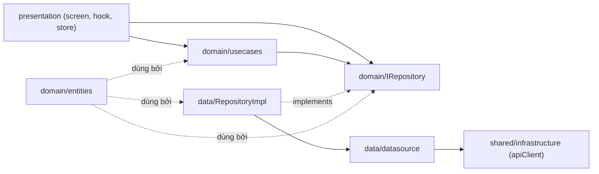

# BÁO CÁO THUYẾT TRÌNH — ỨNG DỤNG DI ĐỘNG SOUNDSPAL (TalentLink Mobile)

> Tài liệu tổng hợp phục vụ thuyết trình và phản biện đồ án.
> Nội dung: kiến trúc thư mục · các chức năng (business → code) · setup, làm việc với Backend và dịch vụ bên thứ ba · build/deploy/Fastlane · kiểm thử · lý do lựa chọn công nghệ · câu hỏi phản biện.

---

## MỤC LỤC

1. [Giới thiệu tổng quan](#1-giới-thiệu-tổng-quan)
2. [Công nghệ sử dụng và lý do chọn](#2-công-nghệ-sử-dụng-và-lý-do-chọn)
3. [Kiến trúc tổng thể — Clean Architecture theo feature](#3-kiến-trúc-tổng-thể--clean-architecture-theo-feature)
4. [Kiến trúc thư mục chi tiết](#4-kiến-trúc-thư-mục-chi-tiết)
5. [Luồng khởi động ứng dụng](#5-luồng-khởi-động-ứng-dụng)
6. [Hạ tầng dùng chung (shared)](#6-hạ-tầng-dùng-chung-shared)
7. [Các chức năng trong dự án (business → code)](#7-các-chức-năng-trong-dự-án-business--code)
8. [Tích hợp dịch vụ bên thứ ba](#8-tích-hợp-dịch-vụ-bên-thứ-ba)
9. [Kết nối với Backend](#9-kết-nối-với-backend)
10. [Cài đặt môi trường và chạy ứng dụng](#10-cài-đặt-môi-trường-và-chạy-ứng-dụng)
11. [Build và Deploy (EAS · Fastlane · CI/CD)](#11-build-và-deploy-eas--fastlane--cicd)
12. [Kiểm thử và chất lượng mã nguồn](#12-kiểm-thử-và-chất-lượng-mã-nguồn)
13. [Giới hạn đã biết và hướng phát triển](#13-giới-hạn-đã-biết-và-hướng-phát-triển)
14. [Bộ câu hỏi phản biện thường gặp](#14-bộ-câu-hỏi-phản-biện-thường-gặp)

---

## 1. Giới thiệu tổng quan

**Soundspal** (tên nội bộ _TalentLink_) là ứng dụng di động kết nối cộng đồng âm nhạc. Ứng dụng phục vụ 3 nhóm người dùng (vai trò — _role_):

| Vai trò (role)        | Hành vi chính trên ứng dụng                                       |
| --------------------- | ----------------------------------------------------------------- |
| Ca sĩ (`singer`)      | Xây dựng hồ sơ, ứng tuyển công việc, thu âm dự thi beat challenge |
| Producer (`producer`) | Đăng beat, tìm ca sĩ cộng tác, ứng tuyển công việc                |
| Địa điểm (`venue`)    | Đăng tin tuyển dụng, duyệt hồ sơ ứng tuyển                        |

Người dùng nâng cấp **Premium** để mở khoá thêm quyền lợi (badge, ưu tiên hiển thị, tăng hạn mức đăng tin).

**5 tab chính** ở thanh điều hướng dưới cùng:

| Tab       | Màn hình              | Feature                         |
| --------- | --------------------- | ------------------------------- |
| Trang chủ | `HomeScreen`          | `home` (dùng API của `explore`) |
| Khám phá  | `ExploreScreen`       | `explore`                       |
| Việc làm  | `JobsTabScreen`       | `jobs`                          |
| Tin nhắn  | `NotificationsScreen` | `messaging`                     |
| Cá nhân   | `PersonalScreen`      | `profiles`                      |

**Định danh ứng dụng:**

| Thuộc tính       | Giá trị                         |
| ---------------- | ------------------------------- |
| Tên hiển thị     | Soundspal                       |
| Expo slug        | `talent_link`                   |
| Package Android  | `com.jonasaugust12.talent_link` |
| URL scheme       | `soundspal://`                  |
| Version hiện tại | 1.0.28 (versionCode 13)         |
| Firebase project | `talentlink-22clc`              |

---

## 2. Công nghệ sử dụng và lý do chọn

| Công nghệ                        | Phiên bản     | Vai trò                           | Vì sao chọn                                                         |
| -------------------------------- | ------------- | --------------------------------- | ------------------------------------------------------------------- |
| **React Native + Expo**          | 0.81 / SDK 54 | Một codebase cho iOS + Android    | Phát triển nhanh; EAS Build không cần Mac cho bản Android           |
| **Expo Router**                  | 6             | Định tuyến theo cấu trúc thư mục  | Chuẩn Expo hiện đại; hỗ trợ deep link (`/blog/[id]`) sẵn            |
| **TypeScript (strict)**          | 5.9           | Ngôn ngữ, kiểm tra kiểu chặt      | Giảm lỗi hợp đồng API; đồng bộ kiểu với backend                     |
| **NativeWind (TailwindCSS)**     | 4 / 3.3       | Styling                           | Viết style nhanh, hỗ trợ dark mode qua `themeStore`                 |
| **TanStack React Query**         | 5             | Quản lý _server state_, cache API | ~90% state là dữ liệu từ server → không cần Redux cho list/detail   |
| **Zustand**                      | 5             | Quản lý _client state_ nhỏ        | Token, theme, audio player — gọi được cả ngoài React (`getState()`) |
| **react-native-mmkv**            | 4             | Lưu trữ cục bộ (persist token)    | Đọc/ghi nhanh, đồng bộ khi khởi động → tránh "nháy" màn login       |
| **Axios**                        | 1.13          | HTTP client + interceptor         | Interceptor xử lý refresh-token 401 trưởng thành hơn fetch tự viết  |
| **Socket.IO Client**             | 4.8           | Nhắn tin thời gian thực           | Backend đã dùng Socket.IO; có fallback REST cho lịch sử tin nhắn    |
| **React Native Firebase**        | 25            | Thông báo đẩy (Cloud Messaging)   | Thư viện FCM chuẩn cho React Native                                 |
| **@react-native-google-signin**  | 16            | Đăng nhập Google                  | SDK native chuẩn, lấy `serverAuthCode` cho backend đổi lấy JWT      |
| **react-hook-form + Zod**        | 7 / 4         | Quản lý form + kiểm tra dữ liệu   | Form hiệu năng cao; Zod validate theo schema, dùng lại được         |
| **Reanimated + Gesture Handler** | 4 / 2         | Hoạt ảnh, cử chỉ                  | Hiệu năng chạy trên luồng UI (worklets)                             |

**Điểm quan trọng cần nhớ khi phản biện — vì sao dùng CẢ React Query VÀ Zustand:**

- **React Query** quản lý _server state_ (dữ liệu tải từ API: danh sách job, chi tiết blog...). Nó tự lo cache, refetch, loading/error, invalidate.
- **Zustand** quản lý _client state_ (trạng thái do app tự sinh: token đăng nhập, theme sáng/tối, trình phát audio, trạng thái socket). Ưu điểm là **gọi được ngoài React** — ví dụ `apiClient.ts` (một file thuần TS, không phải component) vẫn lấy được token bằng `useAuthStore.getState()`.
- Đây không phải trùng lặp mà là **tách vai trò**: server state ≠ client state.

---

## 3. Kiến trúc tổng thể — Clean Architecture theo feature

Dự án áp dụng **Clean Architecture theo từng feature** (_feature-based_). Mỗi tính năng là một module độc lập, bên trong chia làm **3 lớp**:

```
features/{tên-feature}/
├── domain/          ← Lớp nghiệp vụ thuần (pure TypeScript)
│   ├── entities/        Kiểu dữ liệu (Job, User, Beat, Message...)
│   ├── repositories/    Interface I{Name}Repository (hợp đồng)
│   ├── usecases/        Quy tắc nghiệp vụ (chỉ thêm khi có rule thật)
│   ├── constants/       Hằng số nghiệp vụ
│   └── utils/           Hàm thuần (format, validate)
├── data/            ← Lớp truy cập dữ liệu
│   ├── datasources/     Gọi HTTP thật qua axios
│   ├── repositories/    Cài đặt interface của domain
│   └── mappers/         Chuyển đổi dữ liệu API → dạng UI dùng (vd blog)
└── presentation/    ← Lớp giao diện + trạng thái client
    ├── screens/         Màn hình full page
    ├── components/       Thành phần UI nhỏ
    ├── hooks/           Hook React Query (useGetXxx, useCreateXxx)
    └── store/           Zustand store (nếu feature cần client state)
```

### Quy tắc phụ thuộc (dependency rule)

Chiều phụ thuộc **luôn hướng vào trong**: `presentation → data → domain`. Lớp trong **không biết** đến lớp ngoài.



**Nguyên tắc bắt buộc:**

- `domain/` **không** được import React, Expo, Axios, hay Zustand (giữ thuần để test và tái sử dụng).
- `app/` **không** chứa logic nghiệp vụ — chỉ định tuyến và layout.
- Xoá/làm mới cache React Query đặt ở `presentation/hooks/`.
- Zustand chỉ giữ _client state_ (theme, phiên đăng nhập, audio player) ở `presentation/store/`.

### Vì sao chia như vậy? (trade-off cần nói khi phản biện)

| Lợi ích                                            | Chi phí / đánh đổi                                  |
| -------------------------------------------------- | --------------------------------------------------- |
| Dễ mở rộng (12 feature không giẫm chân nhau)       | Nhiều file, nhiều tầng — với CRUD đơn giản hơi dư   |
| Dễ onboard người mới (biết feature nào ở đâu)      | Cần kỷ luật tuân thủ quy tắc phụ thuộc              |
| Đổi nguồn dữ liệu chỉ sửa lớp `data`, UI không đổi | UseCase đôi khi chỉ "chuyển tiếp" nếu không có rule |
| `domain` thuần → viết unit test dễ                 |                                                     |

> **Lưu ý thực dụng của dự án:** UseCase **chỉ được thêm khi có quy tắc nghiệp vụ thật** (ví dụ: validate dữ liệu login, kiểm tra `jobId` trước khi ứng tuyển). Với thao tác CRUD thuần, gọi thẳng repository là đủ — tránh tạo lớp thừa. Đây là lý do chỉ `auth`, `jobs`, `blog` có `usecases/`.

---

## 4. Kiến trúc thư mục chi tiết

### 4.1 Cây thư mục cấp cao

```
TL-Mobile/
├── app/                  # Expo Router — CHỈ định tuyến (file mỏng, re-export screen)
├── features/             # 12 module nghiệp vụ (domain/data/presentation)
├── shared/               # Hạ tầng và UI dùng chung
│   ├── domain/               constants, kiểu apiresponse
│   ├── infrastructure/       apiClient, queryClient, storage (MMKV), socket
│   ├── presentation/         ui, navigation, hooks, store, providers
│   └── utils/                jwt, apiError
├── assets/               # Ảnh, icon, splash
├── __tests__/            # Unit + integration test (soi chiếu theo module)
├── docs/                 # Tài liệu (kiến trúc, từng feature, onboarding)
├── fastlane/             # Tự động hoá build & phát hành (Fastfile, Appfile)
├── scripts/              # Script tiện ích (đồng bộ version, sinh splash...)
├── .github/workflows/    # CI/CD GitHub Actions
├── app.json              # Cấu hình Expo (tên app, plugin, package, splash)
├── eas.json              # Cấu hình EAS Build (profile dev/preview/production)
├── google-services.json  # Cấu hình Firebase (Android) — bị gitignore
├── .env.example          # Mẫu biến môi trường
└── package.json          # Script npm và danh sách thư viện
```

### 4.2 Vai trò từng thư mục

| Thư mục                          | Vai trò                    | Quy tắc                                                           |
| -------------------------------- | -------------------------- | ----------------------------------------------------------------- |
| **`app/`**                       | Định tuyến (Expo Router)   | File mỏng: `export { default } from '@/features/...'` + `_layout` |
| **`features/{x}/domain/`**       | Nghiệp vụ thuần            | Entity, interface repository, usecase — không import React/Expo   |
| **`features/{x}/data/`**         | Truy cập dữ liệu           | Datasource (axios), cài đặt repository, mapper DTO                |
| **`features/{x}/presentation/`** | Giao diện + client state   | Screen, component, hook React Query, Zustand store                |
| **`shared/domain/`**             | Kiểu và hằng số dùng chung | `colors`, `businessTypes`, `provinces`, `apiresponse.type`        |
| **`shared/infrastructure/`**     | Hạ tầng kỹ thuật           | `apiClient`, `queryClient`, MMKV storage, `socketService`         |
| **`shared/presentation/`**       | UI và hook dùng chung      | `ui/`, `navigation/`, `useToast`, `useProtectedRoute`, các store  |
| **`shared/utils/`**              | Hàm thuần                  | `jwt.ts` (giải mã token), `apiError.ts`                           |
| **`__tests__/`**                 | Kiểm thử                   | Đối chiếu theo module (chưa đặt cùng feature)                     |

### 4.3 Cấu trúc thư mục `app/` (định tuyến)

Expo Router định tuyến theo file. Các thư mục trong ngoặc `(...)` là **nhóm route** (route group), không xuất hiện trong URL. Mỗi file route chỉ re-export màn hình từ `features/`.

```
app/
├── _layout.tsx            # Root layout: providers + hook toàn cục
├── index.tsx              # Điểm vào, điều hướng ban đầu
├── (auth)/                # login, register, verify-email, forgot/reset-password, complete-oauth-profile
├── (tabs)/                # index (home), explore, jobs, notifications, personal
├── (search)/              # tìm kiếm
├── (jobs)/                # detail, edit-job, applicants, my-applications, recruitment-form
├── (profiles)/            # artistProfile, venueProfile, các gallery (media/video/portfolio)
├── (editprofile)/         # editProfile, venueEditProfile, change-email
├── (messages)/            # contactMessage (danh sách), detailMessage (khung chat)
├── (payments)/            # premium
├── (blog)/                # index (danh sách), [id] (chi tiết)
└── (challenge)/           # explore, beat-detail, record, result, leaderboard, create, myContent
```

### 4.4 12 module trong `features/`

| Feature         | Có usecase? | Có store?           | Ghi chú                                             |
| --------------- | ----------- | ------------------- | --------------------------------------------------- |
| `auth`          | ✅          | ✅ authStore        | Đăng nhập, đăng ký, OAuth, JWT, refresh token       |
| `home`          | —           | —                   | Chỉ có presentation (màn tổng hợp, không API riêng) |
| `explore`       | —           | ✅ searchStore      | Tìm kiếm nghệ sĩ, beat, thể loại                    |
| `jobs`          | ✅          | ✅ jobBookmarkStore | **Feature mẫu Clean Arch đầy đủ nhất**              |
| `profiles`      | —           | ✅ userStore        | Hồ sơ nghệ sĩ/địa điểm, media gallery               |
| `collab`        | —           | —                   | Cộng tác/submissions (UI nằm trong profiles)        |
| `challenge`     | —           | ✅ audioStore       | Beat challenge: đăng beat, thu âm, xếp hạng         |
| `blog`          | ✅          | —                   | Bài viết, bình luận, lưu bài (có mapper)            |
| `messaging`     | —           | ✅ messagingStore   | Chat thời gian thực qua Socket.IO                   |
| `notifications` | —           | —                   | Thông báo đẩy FCM (đăng ký thiết bị, nhận push)     |
| `payments`      | —           | —                   | Nâng cấp Premium qua cổng PayOS                     |
| `search`        | —           | —                   | Màn tìm kiếm (presentation)                         |

---

## 5. Luồng khởi động ứng dụng

```
index.js
  → registerRootComponent(App)  → expo-router/entry
    → app/_layout.tsx  (RootLayout)
        QueryClientProvider          ← cấp cache React Query cho toàn app
          SafeAreaProvider
            KeyboardProvider
              SocketProvider         ← sở hữu vòng đời socket, ngắt khi app xuống nền
                RootLayoutNav
                  useAuthInitialize()    ← xác thực token + làm mới /users/me khi mở app
                  useProtectedRoute()    ← điều hướng bảo vệ (login/verify)
                  usePushNotifications()  ← nhận push (foreground/tap)
                  usePushTokenSync()      ← đồng bộ FCM token khi xoay vòng
                  Stack (các nhóm route)
                  AppDialogHost + Toast
```

`registerBackgroundHandler` được import ở `app/_layout.tsx` như **side-effect** để đăng ký handler nhận push khi app ở nền/bị tắt (phải import sớm).

**3 file cần đọc đầu tiên khi tiếp cận source:**

1. `app/_layout.tsx` — nơi lắp ráp toàn bộ provider và hook toàn cục.
2. `shared/infrastructure/api/apiClient.ts` — cách gọi API và xử lý refresh token.
3. `features/auth/presentation/store/authStore.ts` — nơi lưu phiên đăng nhập.

---

## 6. Hạ tầng dùng chung (shared)

### 6.1 `apiClient.ts` — HTTP client + tự động refresh token

File: `shared/infrastructure/api/apiClient.ts`. Đây là trái tim của lớp giao tiếp mạng.

**Request interceptor:** trước mỗi request, tự đính `Authorization: Bearer <accessToken>` lấy từ `authStore`.

**Response interceptor — xử lý lỗi 401 (token hết hạn):**

```
1. Gọi API → server trả 401.
2. Nếu chưa retry: đánh dấu _retry, gọi POST tới AUTH_REFRESH_URL với refresh_token.
3. Nhận access_token + refresh_token mới → giải mã JWT lấy user → lưu vào authStore.
4. Gọi lại request ban đầu với token mới. → User không thấy gì.
5. Nếu refresh thất bại (hoặc không có refresh_token) → logout, đẩy về Login.
```

Hai điểm kỹ thuật đáng nói khi phản biện:

- **Hàng đợi chống refresh trùng (`failedQueue`):** nếu nhiều request cùng bị 401 một lúc, chỉ **một** lần gọi refresh được thực hiện; các request còn lại chờ trong hàng đợi rồi tiếp tục với token mới. Tránh gọi refresh nhiều lần song song.
- **Không phát lại request upload (multipart/FormData):** `FormData` bị "tiêu thụ" sau lần gửi đầu, không thể gửi lại. Khi upload gặp 401, code trả lỗi `ERR_UPLOAD_AUTH_REFRESH` để người dùng upload lại, thay vì gửi body rỗng gây lỗi mạng.

### 6.2 `queryClient.ts` — cấu hình cache React Query

| Tuỳ chọn               | Giá trị | Ý nghĩa                                               |
| ---------------------- | ------- | ----------------------------------------------------- |
| `staleTime`            | 5 phút  | Trong 5 phút dữ liệu coi là còn "tươi", không refetch |
| `gcTime`               | 10 phút | Cache bị dọn sau 10 phút không dùng                   |
| `retry` (query)        | 2       | Thử lại 2 lần khi lỗi                                 |
| `refetchOnWindowFocus` | false   | Không refetch khi quay lại app (tiết kiệm mạng)       |
| `retry` (mutation)     | 1       | Mutation thử lại 1 lần                                |

### 6.3 `storage.ts` — lưu trữ cục bộ MMKV

MMKV là bộ nhớ key-value native, nhanh và đọc đồng bộ. Được khởi tạo với `id` và `encryptionKey` từ biến môi trường (mã hoá cơ bản). Dùng để **persist token đăng nhập** (mở lại app không phải login lại) và `device_id`.

> ⚠️ Đổi `EXPO_PUBLIC_STORAGE_*` trên bản đã phát hành → app không giải mã được dữ liệu cũ → user bị đăng xuất và mất dữ liệu cục bộ.

### 6.4 `socketService.ts` — nhắn tin thời gian thực

Lớp singleton quản lý kết nối Socket.IO. Kết nối bằng `accessToken` (gửi qua `auth`, `query`, và header). Tự kết nối lại tối đa 5 lần với _exponential backoff_. Lắng nghe các sự kiện và cập nhật thẳng vào `messagingStore`:

| Sự kiện lắng nghe (nhận)             | Xử lý                                |
| ------------------------------------ | ------------------------------------ |
| `message:new`                        | Thêm tin nhắn, tăng badge chưa đọc   |
| `message:edited` / `message:deleted` | Sửa/xoá tin nhắn trong store         |
| `typing:start` / `typing:stop`       | Hiện/ẩn "đang nhập..."               |
| `messages:read` / `message:read`     | Cập nhật trạng thái "đã xem"         |
| `user:online` / `user:offline`       | Cập nhật trạng thái online           |
| `users:online`                       | Snapshot danh sách online (dự phòng) |

| Sự kiện phát (emit)            | Khi nào                |
| ------------------------------ | ---------------------- |
| `conversation:join` / `:leave` | Vào/rời màn chat       |
| `typing:start` / `typing:stop` | Khi người dùng gõ phím |

### 6.5 `shared/presentation` — UI và điều hướng dùng chung

- **`ui/`**: bộ component tái sử dụng — `CommonHeader`, `AppDialog`, `ConfirmModal`, `SearchBar`, `FilterSheet`, `MessageBubble`, `MessageInput`, `ChatItem`, `OnlineIndicator`, `TypingIndicator`, `PremiumBadge`, `Shimmer` (skeleton loading)...
- **`navigation/`**: `CustomTabBar` (thanh tab tuỳ biến), `TabScreenWrapper`.
- **`hooks/`**: `useProtectedRoute` (bảo vệ route), `useToast`.
- **`store/`**: `themeStore` (sáng/tối), `settingsStore`, `redirectStore`.
- **`providers/`**: `SocketProvider`.
- **`RootErrorBoundary.tsx`**: bắt lỗi render toàn cục.

---

## 7. Các chức năng trong dự án (business → code)

Mỗi chức năng dưới đây trình bày theo mạch: **người dùng làm gì → luồng đi trong code → API gọi**.

### 7.1 Auth — Đăng nhập và phiên làm việc

**Nghiệp vụ:** quyết định user có được vào app hay không. Sau khi đăng nhập, lưu JWT vào máy; mỗi request đính JWT để chứng minh danh tính. Chưa đăng nhập → đá về màn Login.

**Đăng nhập email/mật khẩu — luồng code:**

```
LoginScreen → LoginForm (validate bằng Zod)
  → useLogin (hook)  → POST /auth/login
    → server trả access_token + refresh_token
    → getUserFromToken() giải mã JWT lấy {id, email, role, is_verified}
    → authStore.setCredentials()  (persist qua MMKV)
    → queryClient.clear()  (xoá cache user cũ)
    → điều hướng /(tabs)
```

**Đăng ký:** `RegisterScreen` → `POST /auth/signup` → màn nhập OTP 6 số → `POST /auth/verify-email`. Mật khẩu: ≥ 6 ký tự, ≥ 1 chữ hoa, ≥ 1 số.

**Đăng nhập Google (OAuth) — điểm hay bị hỏi:**

```
Bấm nút Google → GoogleSignin.signIn()  (popup chọn Gmail)
  → nhận serverAuthCode từ Google
  → POST /auth/mobile-oauth  (gửi code lên server TalentLink)
  → server xác minh code với Google, lấy email
     ├─ Đã có tài khoản → trả access_token + refresh_token → vào app
     └─ Lần đầu → trả registration_token
          → CompleteOAuthProfileScreen (nhập username + chọn role)
          → POST /auth/complete-oauth → trả JWT → vào app
```

> Điểm mấu chốt: **điện thoại không giữ client_secret**. Google chỉ xác nhận "đúng người này"; thẻ dùng trong app vẫn là JWT của TalentLink. `webClientId` (loại "Web application") cần cho SDK lấy `serverAuthCode` để server đổi lấy JWT — tên có chữ "web" nhưng **không** mở trình duyệt.

**Quên mật khẩu (3 bước):** `POST /auth/reset-password-request` → `POST /auth/confirm-reset-password-request` (nhận `reset_token`) → `POST /auth/reset-password`.

**Route guard (`useProtectedRoute.ts`):**

| Tình huống                            | App làm gì         |
| ------------------------------------- | ------------------ |
| Chưa login mà vào tab cần đăng nhập   | Đá về Login        |
| Login rồi nhưng chưa verify email     | Đá về màn nhập OTP |
| Login + verify rồi mà vẫn ở màn Login | Đưa vào `/(tabs)`  |

`useAuthHydration` chờ MMKV nạp token xong mới quyết định điều hướng → tránh "nháy" màn login khi mở app.

**Danh sách API auth:** `/auth/login`, `/signup`, `/verify-email`, `/logout`, `/mobile-oauth`, `/complete-oauth`, `/refresh`, `/reset-password-request`, `/confirm-reset-password-request`, `/reset-password`.

### 7.2 Home — Trang chủ

Màn tổng hợp nội dung nổi bật: danh sách nghệ sĩ nổi bật (thẻ trượt ngang), tin tuyển dụng mới, blog mới. **Không có API riêng** — dùng lại API của `explore` và `jobs`. Chạm vào thẻ để xem chi tiết, vuốt xuống để làm mới.

### 7.3 Explore — Khám phá

**Nghiệp vụ:** tìm nghệ sĩ và khám phá beat.

```
ExploreScreen
  → SearchBar (nhập từ khoá) + bộ lọc vai trò (Tất cả / Ca sĩ / Producer / Địa điểm)
  → hook search  → API tìm kiếm user / featured
  → danh sách beat (lọc theo thể loại) → chạm để mở beat-detail
```

`searchStore` (Zustand) giữ trạng thái từ khoá và bộ lọc.

### 7.4 Jobs — Việc làm (feature mẫu Clean Architecture đầy đủ nhất)

**Nghiệp vụ:** Venue đăng tin tuyển; Ca sĩ/Producer ứng tuyển; hai bên quản lý hồ sơ.

**Luồng đầy đủ 3 lớp (đây là ví dụ kinh điển cho phản biện):**

```
JobsTabScreen (màn)
  → useGetJobs() (hook, presentation)
    → GetJobsUseCase.execute() (domain — quy tắc nghiệp vụ)
      → jobRepository.getJobs() (interface domain)
        → JobRepositoryImpl (data — cài đặt)
          → jobRemoteDataSource.getJobs() (data — HTTP)
            → GET /posts (shared/apiClient)
```

**Các luồng con:**

- **Xem/tìm tin:** duyệt danh sách, lọc theo loại công việc và địa điểm (`JobFilterSheet`), xem chi tiết (`JobDetailScreen`).
- **Ứng tuyển:** `JobApplyModal` → `SubmitJobApplicationUseCase` (validate `jobId`, thông tin liên hệ) → nộp hồ sơ.
- **Đăng tin (Venue):** `RecruitmentFormScreen` (form nhiều bước: loại nghệ sĩ, ngân sách, thể loại, lịch, hạn nộp).
- **Quản lý:** `JobApplicantsScreen` (duyệt/từ chối hồ sơ), `MyApplicationsScreen` (xem trạng thái, rút hồ sơ).
- **Hạn mức:** tài khoản thường 5 tin/tháng, Premium 100 tin/tháng.

`jobBookmarkStore` giữ danh sách tin đã lưu (client state). UseCase ở đây: `GetJobsUseCase`, `SubmitJobApplicationUseCase`.

### 7.5 Profiles — Hồ sơ cá nhân

**Nghiệp vụ:** xem và chỉnh sửa hồ sơ nghệ sĩ/địa điểm.

- **Xem hồ sơ:** `artistProfile`, `venueProfile` + các gallery: `mediaGallery`, `videoGallery`, `portfolioGallery`, `featuredReleases`.
- **Chỉnh sửa:** `editProfile` / `venueEditProfile` — ảnh đại diện, ảnh bìa, tên hiển thị, giới thiệu, liên hệ, mạng xã hội, thể loại sở trường. Venue có thêm: loại hình, sức chứa, tiện ích.
- **Portfolio:** tải ảnh/video, thêm liên kết bài hát, kinh nghiệm biểu diễn.
- **Upload media:** đi qua endpoint `/storage/upload`.

`userStore` giữ thông tin user hiện tại. `useGetCurrentUser` gọi `/users/me` lấy hồ sơ đầy đủ (bao gồm `tier` Premium).

### 7.6 Collab — Cộng tác

Quản lý submissions/cộng tác giữa nghệ sĩ (giao diện đặt trong màn profiles, route `(profiles)/collaboration`). Có lớp data + repository gọi API riêng.

### 7.7 Challenge — Thử thách âm nhạc (Beat Challenge)

**Nghiệp vụ:** Producer đăng beat; cộng đồng thu âm dự thi trên beat đó; bình chọn và xếp hạng.

```
(challenge)/explore   → danh sách beat (lọc theo thể loại)
  → beat-detail        → nghe thử + xem bảng xếp hạng
    → record           → xin quyền micro → thu âm → nghe lại → gửi bài dự thi
      → result / leaderboard  → xem điểm và thứ hạng
(challenge)/create     → Producer đăng beat mới (tên, thể loại, BPM, file âm thanh, ảnh bìa)
(challenge)/myContent  → xem/xoá beat và bài dự thi của mình
```

`audioStore` (Zustand) quản lý trình phát và trạng thái thu âm. API: `/beats/*`, entries.

### 7.8 Blog

**Nghiệp vụ:** đọc và viết bài chia sẻ kiến thức âm nhạc.

- Danh sách (`(blog)/index`), lọc theo chủ đề; chi tiết (`(blog)/[id]`).
- Bình luận (CRUD), lưu bài (bookmark).
- Người dùng tự viết và đăng bài kèm ảnh (`AddBlogPostMediaUseCase` xử lý media).
- Có `mappers/` chuyển đổi dữ liệu API → dạng UI (blog là feature dùng mapper rõ nhất).

API: `/blogs/*`, `/bookmarks`, `/storage/upload`.

### 7.9 Messaging — Tin nhắn thời gian thực

**Nghiệp vụ:** chat 1-1 thời gian thực, có trạng thái "đang nhập", "đã xem", online, gửi tệp.

```
ContactMessageScreen (danh sách hội thoại, badge chưa đọc, tìm theo tên)
  → DetailMessageScreen (khung chat)
     → socketService.joinConversation()
     → gửi tin: emit qua socket  +  lưu lịch sử qua REST (/messages)
     → nhận tin: lắng nghe message:new → cập nhật messagingStore → UI cập nhật ngay
```

- **Kết hợp Socket.IO + REST:** socket lo _realtime_ (nhận/gửi tức thời, typing, presence); REST lo _lịch sử_ (`/conversations`, `/messages`) và đánh dấu đã đọc.
- **Thao tác tin nhắn:** nhấn giữ → Sửa / Xoá / Sao chép (`MessageActionSheet`). Tin kèm thông tin công việc hoặc tệp không sửa được.
- **Tệp đính kèm:** ảnh/tài liệu, tối đa 10 MB.
- **Nhắn từ tin tuyển dụng:** từ `JobDetailScreen` bấm "Nhắn tin" → tin đầu tự kèm thẻ thông tin công việc (JOB_REF).

`messagingStore` giữ tin nhắn, danh sách online, người đang gõ, số chưa đọc.

### 7.10 Notifications — Thông báo đẩy (FCM)

**Nghiệp vụ:** server chủ động gửi thông báo về máy kể cả khi app đóng, qua trung gian Firebase Cloud Messaging (FCM).

**Luồng 2 pha:**

```
PHA 1 — Đăng ký thiết bị (lúc login):
  useDevicePayload() → xin quyền + getToken() (FCM token, timeout 5s không chặn login)
  → LoginScreen đính {device_id, fcm_token, platform} vào POST /auth/login
  → backend lưu userId ↔ token

PHA 2 — Nhận thông báo:
  backend gửi {token, title, body, data.route} cho FCM → FCM đẩy về máy
  ├─ App foreground → usePushNotifications() hiện toast
  ├─ App background/killed → OS tự hiện banner (registerBackgroundHandler)
  └─ User bấm → resolvePushRoute() điều hướng theo data.route
  usePushTokenSync(): onTokenRefresh → cập nhật token khi FCM xoay vòng (POST /auth/device-token)
```

**3 loại thông báo:** tin nhắn mới (`new_message`), có người ứng tuyển (`new_application`), hồ sơ đổi trạng thái (`application_status_changed`).

> Cấu hình phía app đã hoàn tất (plugin Firebase trong `app.json`, `google-services.json`, mock cho test). Đây là tính năng cần bản build native (không chạy trên Expo Go).

### 7.11 Payments — Nâng cấp Premium (cổng PayOS)

**Nghiệp vụ:** user trả tiền nâng cấp Premium. App **không** nhập số thẻ — dùng cổng thanh toán PayOS (chuẩn Việt Nam).

**Luồng (điểm hay bị hỏi — vì sao phải poll):**

```
1. PremiumScreen → bấm "Nâng cấp" → buildPremiumUpgradeCheckoutRequest()
2. POST /payments/checkout → server trả checkout_url + orderCode
3. Linking.openURL(checkout_url) → mở trình duyệt PayOS
4. User trả tiền trên PayOS
   ├─ PayOS gọi webhook → SERVER TalentLink (app không thấy)
   └─ PayOS deep link → mở lại app: soundspal://...?orderCode=..&status=PAID
5. App POLL mỗi 5 giây: GET /payments/status/:orderCode
      (vì webhook có độ trễ 1–3 giây, deep link đôi khi thiếu dữ liệu)
6. Khi status=success → POLL lớp 2: GET /users/me đến khi tier === 'premium'
      (backend đổi tier bất đồng bộ sau webhook)
   → toast thành công + invalidate cache user
```

| Khái niệm      | Giải thích ngắn                                                   |
| -------------- | ----------------------------------------------------------------- |
| `checkout_url` | Link mở PayOS trong trình duyệt                                   |
| `orderCode`    | Mã đơn PayOS (chỉ số) — dùng để hỏi trạng thái                    |
| Deep link      | `soundspal://...` — PayOS xong thì mở lại app                     |
| Webhook        | PayOS **gọi server** báo đã trả tiền — app không nghe được        |
| Poll           | App **hỏi server** định kỳ 5 giây vì không nhận webhook trực tiếp |

**Vì sao không dùng In-App Purchase của Apple/Google?** Backend đã tích hợp PayOS (phù hợp thị trường VN); IAP cần setup riêng từng store và mất phí hoa hồng. Gói hiện tại: 30 ngày. API: `/payments/checkout`, `/payments/status/:orderCode`, `/payments/history`.

---

## 8. Tích hợp dịch vụ bên thứ ba

Dự án tích hợp **3 dịch vụ bên ngoài**, cần phân biệt rõ (đây là điểm hay nhầm khi phản biện):

| Dịch vụ                      | Dùng để làm gì        | Cấu hình ở đâu                                       | Là project riêng?                   |
| ---------------------------- | --------------------- | ---------------------------------------------------- | ----------------------------------- |
| **Google Sign-In** (OAuth)   | Đăng nhập bằng Google | `EXPO_PUBLIC_GOOGLE_WEB_CLIENT_ID` (biến môi trường) | Project Google riêng cho đăng nhập  |
| **Firebase Cloud Messaging** | Thông báo đẩy         | `google-services.json` + plugin trong `app.json`     | Project Firebase `talentlink-22clc` |
| **PayOS**                    | Thanh toán Premium    | Xử lý phía backend; app chỉ mở `checkout_url`        | Cổng thanh toán bên thứ ba          |

> **Lưu ý quan trọng:** Google Sign-In và Firebase là **hai project Google độc lập**, không đồng bộ nhầm. `webClientId` (đăng nhập) phải **trùng** với client_id backend dùng để đổi `serverAuthCode`, lệch nhau → lỗi 401 `oauth_failed`.

### 8.1 Cấu hình Google Sign-In

1. Đặt biến `EXPO_PUBLIC_GOOGLE_WEB_CLIENT_ID` trong `.env` (loại OAuth client "Web application").
2. Code dùng tại `features/auth/presentation/hooks/useGoogleSignIn.ts`:
    ```typescript
    GoogleSignin.configure({ webClientId: '...', offlineAccess: true });
    ```
3. Chức năng chỉ hoạt động trên bản build **ký đúng chứng chỉ** đã đăng ký với Firebase (SHA-1). Build bằng chứng chỉ debug khác → có thể lỗi; khi đó vẫn đăng nhập được bằng email/mật khẩu.

### 8.2 Cấu hình Firebase Cloud Messaging

1. `google-services.json` (project `talentlink-22clc`) đặt ở thư mục gốc, khai báo trong `app.json` qua `android.googleServicesFile`. File này **bị gitignore** (không commit).
2. Plugin trong `app.json`: `@react-native-firebase/app` và `@react-native-firebase/messaging`.
3. Cần bật **Cloud Messaging API** trong Firebase Console; phía backend cần service-account credentials để gửi FCM.
4. Test push nhanh: Firebase Console → Cloud Messaging → Send test message → dán FCM token.

### 8.3 Cấu hình PayOS

App không cấu hình gì trực tiếp — toàn bộ khoá bí mật PayOS nằm ở backend. App chỉ:

- Gọi `POST /payments/checkout` để lấy `checkout_url`.
- Mở `checkout_url` bằng trình duyệt và nhận lại deep link `soundspal://` khi xong.

---

## 9. Kết nối với Backend

### 9.1 Kiến trúc Backend (repo anh em `DATN-Backend`)

Ứng dụng mobile giao tiếp với một hệ thống backend **microservices** (nằm ở repo riêng `DATN-Backend`):

| Service                | Ngôn ngữ | Vai trò chính                                         |
| ---------------------- | -------- | ----------------------------------------------------- |
| `user-service`         | Go       | Xác thực (`/auth/*`), người dùng, phát event thiết bị |
| `notification-service` | .NET     | Lưu device registration, gửi FCM push                 |
| `job-post-service`     | —        | Tin tuyển dụng, ứng tuyển, phát event push            |
| (messaging, ...)       | Node     | Chat, các nghiệp vụ khác                              |

Giao tiếp nội bộ giữa các service dùng **Redis Stream** (event-driven), ví dụ stream `user-device-lifecycle` để đăng ký thiết bị push, `notification-requested` để yêu cầu gửi push.

### 9.2 Các endpoint chính app gọi

| Nhóm             | Endpoint tiêu biểu                                                   |
| ---------------- | -------------------------------------------------------------------- |
| Auth             | `/auth/login`, `/auth/signup`, `/auth/refresh`, `/auth/mobile-oauth` |
| Users / Search   | `/users/me`, `/users/*`, `/search/*`                                 |
| Jobs             | `/posts/*`, `/my-submissions`                                        |
| Challenge        | `/beats/*`                                                           |
| Blog             | `/blogs/*`, `/bookmarks`                                             |
| Messaging        | `/conversations`, `/messages`                                        |
| Payments         | `/payments/checkout`, `/payments/status/:orderCode`                  |
| Storage (upload) | `/storage/upload`                                                    |
| Realtime         | Socket.IO tại `SOCKET_URL`, path `/socket.io`                        |

### 9.3 Biến môi trường cấu hình kết nối (`.env`)

Toàn bộ địa chỉ máy chủ và mã dịch vụ nằm trong `.env` ở thư mục gốc — **không có giá trị mặc định trong source**. Sao chép `.env.example` rồi điền:

| Biến                                 | Dùng tại                                              |
| ------------------------------------ | ----------------------------------------------------- |
| `EXPO_PUBLIC_API_BASE_URL`           | `shared/infrastructure/api/apiClient.ts`              |
| `EXPO_PUBLIC_AUTH_REFRESH_URL`       | `shared/infrastructure/api/apiClient.ts`              |
| `EXPO_PUBLIC_SOCKET_URL`             | `shared/infrastructure/socket/socketService.ts`       |
| `EXPO_PUBLIC_SOCKET_PATH`            | `shared/infrastructure/socket/socketService.ts`       |
| `EXPO_PUBLIC_GOOGLE_WEB_CLIENT_ID`   | `features/auth/presentation/hooks/useGoogleSignIn.ts` |
| `EXPO_PUBLIC_STORAGE_ID`             | `shared/infrastructure/storage/storage.ts`            |
| `EXPO_PUBLIC_STORAGE_ENCRYPTION_KEY` | `shared/infrastructure/storage/storage.ts`            |

**Hai lưu ý cần biết khi phản biện:**

1. **Đang có sự dịch chuyển tên miền:** `API_BASE_URL` đã trỏ `api.soundspal.com`, còn `AUTH_REFRESH_URL` vẫn trỏ tên miền cũ `talentlink.io.vn`. Đây là giai đoạn chuyển đổi domain; hai giá trị nên được thống nhất về cùng stack backend có đầy đủ pipeline (bao gồm FCM).
2. **`EXPO_PUBLIC_` không phải cơ chế bảo mật:** tiền tố này khiến giá trị bị nhúng thẳng vào file `.apk`/`.ipa` khi build — ai giải nén cũng đọc được. Nó chỉ để **tách môi trường**, tuyệt đối không đặt mật khẩu, `client_secret`, hay khoá riêng tư vào đây; những thứ bí mật phải ở phía server.

> Expo chỉ đọc `.env` khi khởi động và cache lại. Mỗi lần sửa `.env` phải chạy `npm run start:clear`.

### 9.4 Chuẩn phản hồi API

Response theo dạng bọc thống nhất (kiểu `apiresponse.type.ts`), thường có `data` chứa payload thật. Lớp `data/datasources` bóc `data` này; lớp `mappers` (nếu có) chuyển sang dạng UI dùng.

---

## 10. Cài đặt môi trường và chạy ứng dụng

> ⚠️ Ứng dụng **không chạy được bằng Expo Go** vì dùng thư viện native (Firebase, MMKV, Google Sign-In). Bắt buộc build **development build**.

### 10.1 Công cụ cần cài

| Công cụ              | Phiên bản                        | Bắt buộc cho          |
| -------------------- | -------------------------------- | --------------------- |
| Node.js + npm        | Node 20 LTS+                     | Tất cả                |
| Git                  | mới nhất                         | Tất cả                |
| JDK                  | 17 (hoặc 21)                     | Build Android         |
| Android Studio + SDK | API 28 và 35, Build-Tools 35.0.0 | Build Android         |
| Xcode + CocoaPods    | Xcode 15+                        | Build iOS (chỉ macOS) |

Biến môi trường hệ thống cần đặt: `JAVA_HOME`, `ANDROID_HOME` (+ thêm `platform-tools`, `emulator` vào `PATH`).

### 10.2 Các bước chạy lần đầu (Android)

```bash
# 1. Cài thư viện (node_modules bị loại khỏi bản nộp)
npm install

# 2. Tạo file cấu hình .env (BẮT BUỘC) rồi điền giá trị thật
cp .env.example .env

# 3. Sinh thư mục native android/ (không kèm trong bản nộp — sinh từ app.json)
npx expo prebuild --platform android

# 4. Biên dịch + cài lên thiết bị/máy ảo (lần đầu 10–25 phút)
npx expo run:android
```

Các lần sau chỉ cần `npm start` (khởi động Metro), trừ khi đổi mã native/thư viện thì build lại.

**iOS (chỉ macOS):** thêm bước `cd ios && pod install && cd ..` sau prebuild, rồi `npx expo run:ios`.

### 10.3 Kiểm tra cài đặt thành công

```bash
npm run typecheck   # kiểm tra kiểu TypeScript (không được lỗi)
npm run lint        # kiểm tra quy chuẩn (cho phép warning)
npm test            # chạy bộ kiểm thử
npx expo-doctor     # kiểm tra môi trường Expo
```

---

## 11. Build và Deploy (EAS · Fastlane · CI/CD)

Dự án có **3 cách build** và một **pipeline CI/CD tự động** phát hành lên Google Play.

### 11.1 EAS Build (build trên máy chủ Expo)

Cấu hình trong `eas.json` với 3 profile:

| Profile       | Đặc điểm                                    | Lệnh                            |
| ------------- | ------------------------------------------- | ------------------------------- |
| `development` | `developmentClient: true`, phân phối nội bộ | `npm run build:android:dev`     |
| `preview`     | Phân phối nội bộ (bản APK để test)          | `npm run build:android:preview` |
| `production`  | `autoIncrement: true` (tự tăng version)     | `npm run build:android:prod`    |

`appVersionSource: remote` → EAS quản lý số version trên máy chủ.

### 11.2 Build cục bộ (Gradle — không cần tài khoản)

```bash
npx expo prebuild --platform android
cd android && ./gradlew assembleRelease
# File: android/app/build/outputs/apk/release/app-release.apk
adb install -r android/app/build/outputs/apk/release/app-release.apk
```

### 11.3 Fastlane — tự động hoá versioning và phát hành

File `fastlane/Fastfile` định nghĩa 4 lane (Android):

| Lane                  | Việc làm                                                                                                         |
| --------------------- | ---------------------------------------------------------------------------------------------------------------- |
| `doctor`              | Kiểm tra EAS CLI và Node đã sẵn sàng                                                                             |
| `bump_version`        | `npm version patch` → chạy `scripts/sync-version.js` đồng bộ sang `app.json`                                     |
| `trigger_release`     | **(Chạy ở máy dev)** bump version → commit → tạo tag `release-v<x>` → push lên GitHub                            |
| `upload_to_playstore` | **(Chạy trong CI)** lấy `app-release.aab` → upload lên Google Play (track `internal`) bằng `PLAY_STORE_JSON_KEY` |

`fastlane/Appfile` khai báo `package_name("com.jonasaugust12.talent_link")`.

### 11.4 CI/CD — GitHub Actions

Có 5 workflow trong `.github/workflows/`:

| Workflow          | Kích hoạt khi         | Việc làm                                              |
| ----------------- | --------------------- | ----------------------------------------------------- |
| `lint.yml`        | push / PR             | Chạy ESLint                                           |
| `test.yml`        | push / PR             | Chạy Jest                                             |
| `commit-lint.yml` | push / PR             | Kiểm tra commit message theo Conventional Commits     |
| `build.yml`       | push / PR             | Verify `expo prebuild` (Android) sinh ra được project |
| `eas-build.yml`   | push tag `release-v*` | **CD: build production + phát hành lên Play Store**   |

**Luồng phát hành hoàn chỉnh (tag-based) — nói được luồng này là ghi điểm phản biện:**

```
[Máy dev]  fastlane android trigger_release
   → bump version, commit, tạo tag release-v1.0.x, push tag lên GitHub
        ↓
[GitHub Actions]  eas-build.yml nhận tag release-v*
   1. Checkout code, setup Node 20
   2. Ghi google-services.json từ secret GOOGLE_SERVICES_JSON (base64)
   3. eas build --platform android --profile production --wait
   4. Tải file .aab từ artifact URL của EAS
   5. Setup Ruby + Fastlane
   6. fastlane android upload_to_playstore → đẩy lên Google Play (internal track)
```

**Các secret cần cấu hình trên GitHub:** `EXPO_TOKEN` (build EAS), `GOOGLE_SERVICES_JSON` (base64 file Firebase, vì file bị gitignore), `PLAY_STORE_JSON_KEY` (service account Google Play).

> `.easignore` cho phép EAS đóng gói `google-services.json` (vốn bị gitignore) để prebuild/gradle dùng khi build trên máy chủ EAS.

---

## 12. Kiểm thử và chất lượng mã nguồn

### 12.1 Kiểm thử (Jest)

- **Framework:** Jest + `jest-expo` + `@testing-library/react-native`.
- **Quy mô:** 42 test suite / 358 test case, chia 2 loại:

| Loại                            | Số lượng            | Cần Internet?                                  |
| ------------------------------- | ------------------- | ---------------------------------------------- |
| Unit + component test           | 37 suite / 306 case | Không                                          |
| Integration test (gọi API thật) | 5 suite / 52 case   | Có (gọi backend thật để kiểm tra hợp đồng API) |

- Khi có Internet đầy đủ: kết quả mong đợi **340 pass / 18 fail**. 18 case chưa hoàn thiện tập trung ở 3 nhóm liên quan giả lập native (`multipartUpload`, `useProtectedRoute`, `JobApplyModal`) — không ảnh hưởng biên dịch/vận hành.
- Jest **không** đọc `.env` (đó là cơ chế của Expo bundler), nên kết quả test không phụ thuộc `.env`.
- Lệnh: `npm test`, `npm run test:watch`, `npm run test:coverage`.

### 12.2 Chất lượng mã và quy trình

| Công cụ                 | Vai trò                                                          |
| ----------------------- | ---------------------------------------------------------------- |
| **TypeScript strict**   | Kiểm tra kiểu chặt (`npm run typecheck`)                         |
| **ESLint**              | Quy chuẩn mã (`eslint.config.mjs`)                               |
| **Prettier**            | Định dạng mã tự động                                             |
| **Husky + lint-staged** | Git hook: tự format + lint file khi commit                       |
| **commitlint**          | Ép commit message theo Conventional Commits (`feat:`, `fix:`...) |

Alias import `@/` trỏ về gốc dự án (cấu hình ở `tsconfig.json` + `babel.config.js`).

---

## 13. Giới hạn đã biết và hướng phát triển

Nêu chủ động các giới hạn sẽ giúp buổi phản biện chủ động hơn:

| Giới hạn hiện tại                                                                                                | Hướng phát triển                             |
| ---------------------------------------------------------------------------------------------------------------- | -------------------------------------------- |
| Premium chủ yếu **hiển thị** badge; chưa chặn cứng tính năng free ở client (backend mới là nơi quyết định quyền) | Chặn quyền nhất quán ở cả client và server   |
| Hai mục "Tài khoản & bảo mật" và "Quyền riêng tư" mới có giao diện, chưa có chức năng                            | Hoàn thiện chức năng                         |
| Token lưu MMKV mã hoá cơ bản                                                                                     | Nâng lên Keychain (iOS) / Keystore (Android) |
| Hai domain `soundspal.com` / `talentlink.io.vn` còn lệch trong `.env`                                            | Thống nhất về một stack backend              |
| 18 test case chưa hoàn thiện (giả lập native)                                                                    | Bổ sung mock, hoàn thiện test                |
| Chưa co-locate test vào từng feature (`__tests__/` tách riêng)                                                   | Đưa test vào `features/{x}/__tests__/`       |
| Chưa build/phát hành iOS lên App Store (mới làm Android/Play)                                                    | Mở rộng pipeline iOS                         |

---

## 14. Bộ câu hỏi phản biện thường gặp

**H: Vì sao chọn Clean Architecture cho một app mobile? Có bị "over-engineering" không?**
Đ: Vì app có 12 feature và nhiều người cùng làm; tách domain/data/presentation giúp mỗi feature độc lập, dễ test lớp `domain` (thuần TS), và đổi nguồn dữ liệu không ảnh hưởng UI. Để tránh dư thừa, dự án **chỉ thêm UseCase khi có quy tắc nghiệp vụ thật** — CRUD thuần gọi thẳng repository.

**H: React Query và Zustand có trùng vai trò không?**
Đ: Không. React Query quản lý _server state_ (dữ liệu từ API: cache, refetch, invalidate). Zustand quản lý _client state_ (token, theme, audio player). Zustand còn gọi được **ngoài React** — ví dụ `apiClient.ts` lấy token qua `getState()`.

**H: Token hết hạn thì xử lý thế nào?**
Đ: Interceptor của Axios bắt lỗi 401, tự gọi `/auth/refresh` để lấy token mới rồi phát lại request — người dùng không thấy gì. Có hàng đợi (`failedQueue`) để nhiều request 401 cùng lúc chỉ refresh **một** lần. Upload multipart không phát lại được (FormData bị tiêu thụ) nên báo lỗi để user thử lại.

**H: Đăng nhập Google có gửi mật khẩu Gmail cho server không?**
Đ: Không. SDK Google trả `serverAuthCode`; app gửi code này cho server TalentLink, server đổi lấy JWT. App không bao giờ thấy mật khẩu Google, cũng không giữ `client_secret`.

**H: Vì sao thanh toán phải poll 5 giây mà không tin deep link một lần?**
Đ: Vì webhook PayOS → backend có độ trễ 1–3 giây và deep link đôi khi thiếu dữ liệu. App poll `GET /payments/status/:orderCode` đến khi có kết quả chắc chắn, rồi poll thêm `/users/me` vì backend đổi `tier` bất đồng bộ sau webhook.

**H: Chat realtime hoạt động ra sao? Mất mạng thì sao?**
Đ: Socket.IO lo realtime (nhận/gửi tức thời, typing, presence), REST lo lịch sử và đánh dấu đã đọc. Socket tự kết nối lại tối đa 5 lần với backoff luỹ thừa; khi mở lại app sẽ kết nối lại và tải lịch sử qua REST.

**H: `.env` có bí mật không? Sao lại để lộ trong app?**
Đ: `EXPO_PUBLIC_*` bị nhúng vào file cài đặt khi build nên **không bí mật** — chỉ dùng tách môi trường. Mọi khoá bí mật (client_secret PayOS/Google, service account) đều nằm ở backend.

**H: Vì sao không dùng Expo Go?**
Đ: App dùng thư viện native (Firebase Messaging, MMKV/Nitro, Google Sign-In) không có sẵn trong Expo Go, nên phải build development build.

**H: Deploy lên store như thế nào?**
Đ: Chạy `fastlane trigger_release` ở máy dev để bump version + tạo tag `release-v*` + push. GitHub Actions bắt tag đó, build production trên EAS, tải `.aab`, rồi Fastlane upload lên Google Play track `internal`.

---

## Tài liệu tham khảo trong repo

| Tài liệu               | Nội dung                                          |
| ---------------------- | ------------------------------------------------- |
| `README.md`            | Quick start, biến môi trường                      |
| `docs/architecture.md` | Sơ đồ Clean Architecture (Mermaid), ma trận layer |
| `docs/onboarding.md`   | Hướng dẫn nắm source tổng quan                    |
| `docs/features/*.md`   | Tài liệu chi tiết từng feature (business + code)  |
| `HuongDanCaiDat.txt`   | Hướng dẫn cài đặt công cụ, môi trường, `.env`     |
| `HuongDanSuDung.txt`   | Hướng dẫn biên dịch, chạy, sử dụng ứng dụng       |

```

```
