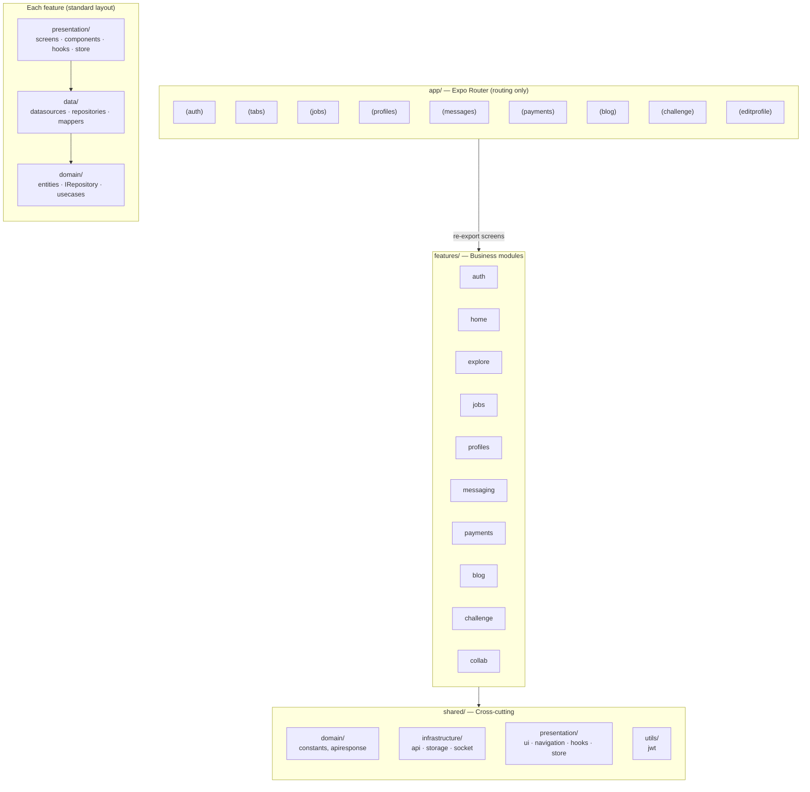
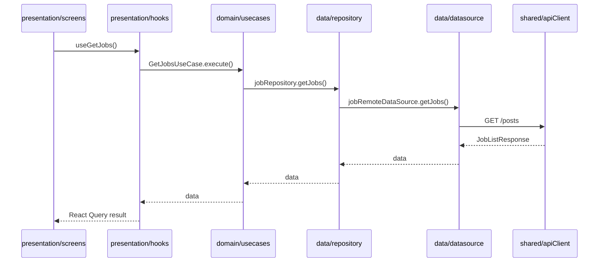
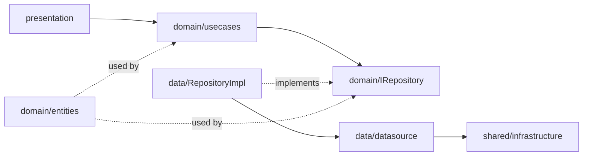

# TalentLink Mobile — Architecture Overview

> Feature-based Clean Architecture · Expo Router · React Query · Zustand

## Refactor status

| Item                                 | Status                                           |
| ------------------------------------ | ------------------------------------------------ |
| `app/` thin routing                  | Done                                             |
| 10 feature modules under `features/` | Done                                             |
| `shared/` infrastructure + UI        | Done                                             |
| Data layer (datasource + repository) | Done for all API-backed features                 |
| Use cases                            | Partial (auth, jobs, blog) — optional to expand  |
| `home/`                              | Presentation only (hub screen, no dedicated API) |

Legacy root folders (`components/`, `hooks/`, `lib/`, `types/`, `stores/`, etc.) have been removed.

---

## 1. Folder roles



### Folder reference

| Path                                | Role                             | Rules                                                                  |
| ----------------------------------- | -------------------------------- | ---------------------------------------------------------------------- |
| **`app/`**                          | File-based routing (Expo Router) | Thin files: `export { default } from '@/features/...'` + `_layout.tsx` |
| **`features/{name}/domain/`**       | Pure business layer              | Entities, repository interfaces, use cases — no React/Expo imports     |
| **`features/{name}/data/`**         | Data access                      | Datasources (axios), repository implementations, DTO mappers           |
| **`features/{name}/presentation/`** | UI + client state                | Screens, components, React Query hooks, Zustand slices                 |
| **`shared/domain/`**                | Shared domain types              | `colors`, `businessTypes`, `apiresponse.type`                          |
| **`shared/infrastructure/`**        | Technical infrastructure         | `apiClient`, `queryClient`, MMKV storage, `socketService`              |
| **`shared/presentation/`**          | Shared UI & hooks                | `ui/`, `navigation/`, `useToast`, `useProtectedRoute`, `themeStore`    |
| **`shared/utils/`**                 | Pure helpers                     | `jwt.ts`                                                               |
| **`__tests__/`**                    | Unit + integration tests         | Mirrors modules (not yet co-located inside features)                   |

### Repository tree (top level)

```
TL-Mobile/
├── app/                    # Expo Router — thin re-exports
├── features/
│   ├── auth/
│   ├── blog/
│   ├── challenge/
│   ├── collab/
│   ├── explore/
│   ├── home/
│   ├── jobs/
│   ├── messaging/
│   ├── payments/
│   └── profiles/
├── shared/
│   ├── domain/
│   ├── infrastructure/
│   ├── presentation/
│   └── utils/
├── assets/
├── __tests__/
└── docs/                   # This folder
```

---

## 2. Features, routes & backend services

```mermaid
flowchart TB
    subgraph CLIENT["TalentLink Mobile App"]
        direction TB

        subgraph ROUTES["app/ Routes"]
            T_HOME["(tabs)/index → Home"]
            T_EXPLORE["(tabs)/explore"]
            T_JOBS_TAB["(tabs)/jobs"]
            T_PERSONAL["(tabs)/personal"]
            T_NOTIF["(tabs)/notifications"]

            A_LOGIN["(auth)/login · register · OAuth…"]
            J_DETAIL["(jobs)/detail · edit · recruitment"]
            P_PROFILE["(profiles)/artist · venue · galleries…"]
            P_EDIT["(editprofile)/editProfile"]
            M_CHAT["(messages)/contact · detail"]
            PAY_PREM["(payments)/premium"]
            B_BLOG["(blog)/index · [id]"]
            C_BEAT["(challenge)/explore · record · leaderboard…"]
        end

        subgraph FEAT["features/"]
            HOME["home<br/>Featured users/jobs cards"]
            EXPLORE["explore<br/>Search users · genres · beats"]
            JOBS["jobs<br/>Posts · apply · my posts"]
            PROFILES["profiles<br/>User media · edit profile"]
            AUTH["auth<br/>Login · signup · OAuth · JWT"]
            MESSAGING["messaging<br/>Conversations · realtime"]
            PAYMENTS["payments<br/>PayOS checkout"]
            BLOG["blog<br/>Posts · comments · bookmarks"]
            CHALLENGE["challenge<br/>Beats · entries · leaderboard"]
            COLLAB["collab<br/>Submissions · review"]
        end

        subgraph SHARED_SVC["shared/ Services"]
            API["apiClient<br/>axios + token refresh"]
            QC["queryClient<br/>TanStack Query"]
            STORAGE["mmkvStorage / storage"]
            SOCKET["socketService"]
            UI["ui components<br/>Header · Modal · Chat…"]
            NAV["CustomTabBar · TabScreenWrapper"]
        end
    end

    subgraph BACKEND["Backend talentlink.io.vn/api/v1"]
        API_AUTH["/auth/*"]
        API_USERS["/users/* · /search/*"]
        API_POSTS["/posts/* · /my-submissions"]
        API_BEATS["/beats/*"]
        API_BLOGS["/blogs/* · /bookmarks"]
        API_MSG["/conversations · /messages"]
        API_PAY["/payments/*"]
        API_STORAGE["/storage/upload"]
    end

    T_HOME --> HOME
    T_EXPLORE --> EXPLORE
    T_JOBS_TAB --> JOBS
    T_PERSONAL --> PROFILES
    T_NOTIF --> MESSAGING
    A_LOGIN --> AUTH
    J_DETAIL --> JOBS
    P_PROFILE --> PROFILES
    P_EDIT --> PROFILES
    M_CHAT --> MESSAGING
    PAY_PREM --> PAYMENTS
    B_BLOG --> BLOG
    C_BEAT --> CHALLENGE

    HOME --> EXPLORE
    HOME --> JOBS
    HOME --> CHALLENGE
    EXPLORE --> BLOG
    PROFILES --> COLLAB
    PROFILES --> JOBS
    JOBS --> COLLAB

    AUTH & JOBS & PROFILES & EXPLORE & BLOG & CHALLENGE & MESSAGING & PAYMENTS & COLLAB --> API
    AUTH & JOBS & PROFILES & EXPLORE & BLOG & CHALLENGE & MESSAGING & PAYMENTS & COLLAB --> QC
    MESSAGING --> SOCKET
    AUTH --> STORAGE

    AUTH --> API_AUTH
    PROFILES & EXPLORE --> API_USERS
    JOBS & COLLAB --> API_POSTS
    CHALLENGE --> API_BEATS
    BLOG --> API_BLOGS
    BLOG & PROFILES --> API_STORAGE
    MESSAGING --> API_MSG
    PAYMENTS --> API_PAY
```



---

## 3. Request flow inside a feature (example: `jobs`)



---

## 4. Feature × layer matrix

| Feature       | Screens        | API                    | Repository    | Use cases                                       | Store            |
| ------------- | -------------- | ---------------------- | ------------- | ----------------------------------------------- | ---------------- |
| **auth**      | 8              | Yes                    | Yes           | `LoginUseCase`                                  | `authStore`      |
| **home**      | 1              | —                      | —             | —                                               | —                |
| **explore**   | 1              | search / featured      | Yes           | —                                               | `searchStore`    |
| **jobs**      | 4              | Yes                    | Yes           | `GetJobsUseCase`, `SubmitJobApplicationUseCase` | —                |
| **profiles**  | 11             | user / media / storage | Yes           | —                                               | `userStore`      |
| **messaging** | 3              | Yes                    | Yes           | —                                               | `messagingStore` |
| **payments**  | 1              | PayOS                  | Yes           | —                                               | —                |
| **blog**      | 2              | Yes                    | Yes + mappers | `AddBlogPostMediaUseCase`                       | —                |
| **challenge** | 7              | beats / entries        | Yes           | —                                               | `audioStore`     |
| **collab**    | UI in profiles | Yes                    | Yes           | —                                               | —                |

---

## 5. Dependency rules



**Rules:**

- `domain/` must not import React, Expo, Axios, or Zustand.
- `app/` must not contain business logic — only routing and layouts.
- React Query cache invalidation lives in `presentation/hooks/`.
- Zustand stores for client-only state (theme, auth session, audio player) live in `presentation/store/`.

---

## 6. Optional follow-ups

1. Add use cases for challenge, payments, messaging.
2. Co-locate tests: `features/jobs/__tests__/`.
3. Remove one-time scripts in `scripts/` after the team is comfortable.
4. Add `features/home/data` if the home tab gains its own API surface.

---

## Related

- [README.md](../README.md) — setup & quick start
- Migration scripts (historical): `scripts/migrate-clean-arch.mjs`, `scripts/create-remaining-repos.mjs`
