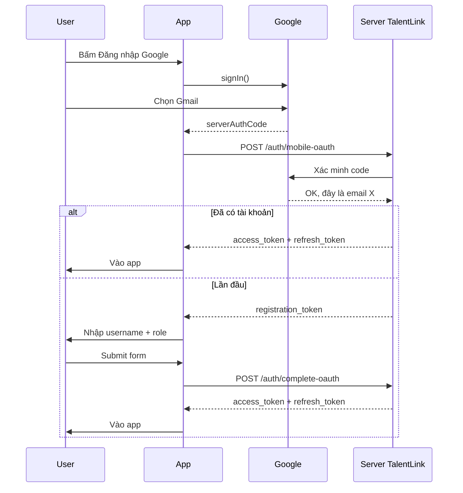

# Feature: Auth (Đăng nhập & Phiên làm việc)

**Code nằm ở:** `features/auth/`  
**Màn hình login:** `app/(auth)/*`

---

## Auth là gì? (đọc phần này trước)

**Auth** = phần code lo việc **user có được vào app hay không**.

Sau khi đăng nhập thành công, app lưu một **thẻ điện tử** (gọi là token) vào máy. Mỗi lần gọi API, app đưa thẻ đó lên server để chứng minh: _"Đây là user X, đã đăng nhập rồi"_.

Nếu chưa đăng nhập → app đá về màn **Login**.

---

## User làm được những gì?

| Việc             | Mô tả ngắn                                         |
| ---------------- | -------------------------------------------------- |
| Đăng ký          | Tạo tài khoản bằng email + mật khẩu                |
| Xác minh email   | Nhập mã OTP 6 số gửi qua email                     |
| Đăng nhập        | Email/username + mật khẩu                          |
| Đăng nhập Google | Bấm nút Google, không cần nhập mật khẩu TalentLink |
| Quên mật khẩu    | Nhận mã qua email → đặt mật khẩu mới               |
| Đăng xuất        | Xóa token trên máy                                 |

Khi đăng ký, user chọn **vai trò**: `producer` (producer), `singer` (ca sĩ), hoặc `venue` (địa điểm).

---

## 1. Đăng nhập bằng email / mật khẩu

### User thấy gì?

Màn **Login** → nhập email hoặc username + mật khẩu → bấm Đăng nhập.

### Chuyện gì xảy ra bên trong? (từng bước)

1. **LoginForm** kiểm tra input có hợp lệ không (dùng thư viện Zod).
2. Gọi **useLogin** → gửi request lên server: `POST /auth/login`.
3. Server trả về 2 chuỗi: `access_token` và `refresh_token`.
4. App **giải mã** `access_token` để lấy thông tin user (id, email, role...) — hàm `getUserFromToken`.
5. Lưu vào **authStore** (nhớ trên máy qua MMKV).
6. Xóa cache cũ (`queryClient.clear`) — tránh hiện data của user trước đó.
7. Chuyển sang màn chính `/(tabs)`.

### File liên quan

| File                               | Làm gì           |
| ---------------------------------- | ---------------- |
| `screens/LoginScreen.tsx`          | Màn hình login   |
| `components/LoginForm.tsx`         | Form nhập liệu   |
| `hooks/useAuthApi.ts` → `useLogin` | Gọi API          |
| `store/authStore.ts`               | Lưu token + user |

---

## 2. Đăng ký tài khoản mới

1. User điền form trên **RegisterScreen**.
2. Gửi `POST /auth/signup`.
3. Chuyển sang màn **nhập mã OTP** (6 số) gửi về email.
4. Gửi `POST /auth/verify-email`.
5. Xong → có thể vào app hoặc quay lại login.

**Mật khẩu:** ít nhất 6 ký tự, có 1 chữ hoa, 1 số, và phải nhập lại đúng.

---

## 3. Đăng nhập Google — giải thích từ đầu

Đây là phần nhiều dev mới hay bối rối. Đọc chậm từng mục.

### 3.1 Ví dụ dễ hiểu

Tưởng tượng bạn vào **câu lạc bộ TalentLink**:

- Bạn **không** đưa mật khẩu Gmail cho bảo vệ câu lạc bộ.
- Bạn đến **quầy Google** (Google đã biết bạn là ai vì bạn đăng nhập Gmail trên máy).
- Google đưa cho app một **phiếu tạm** (gọi là `serverAuthCode`).
- App gửi phiếu đó cho **server TalentLink**.
- Server đổi phiếu → cấp cho bạn **thẻ thành viên** (JWT của TalentLink).

**Kết luận:** Google chỉ giúp xác nhận _"đúng là người này"_. Thẻ dùng trong app vẫn là thẻ của **TalentLink**, không phải thẻ Google.

### 3.2 Tại sao không nhập mật khẩu Google vào app?

Vì **không an toàn**. App lạ không nên biết mật khẩu Google của bạn. Google tự lo phần đăng nhập, app chỉ nhận kết quả.

### 3.3 Trên điện thoại khác web thế nào?

|                      | Trên web                | Trên app (TalentLink)                    |
| -------------------- | ----------------------- | ---------------------------------------- |
| Màn hình Google      | Mở trong trình duyệt    | Popup chọn tài khoản Google (SDK có sẵn) |
| App nhận gì          | Một đoạn `code` qua URL | Một đoạn `serverAuthCode` từ SDK         |
| Ai đổi code lấy thẻ? | Server TalentLink       | Vẫn **server TalentLink**                |

Điểm quan trọng: **điện thoại không giữ mật mã bí mật** (client secret). Mọi thứ nhạy cảm xử lý trên **server**, không nhét vào app.

### 3.4 Các bước khi user bấm "Đăng nhập Google"

```
Bước 1  User bấm nút Google trên LoginScreen
Bước 2  App gọi GoogleSignin.signIn() — hiện popup chọn Gmail
Bước 3  User chọn tài khoản
Bước 4  Google trả về serverAuthCode
Bước 5  App gửi code lên server: POST /auth/mobile-oauth
Bước 6  Server hỏi Google "code này thật không?" → lấy email user
Bước 7a  NẾU user đã có tài khoản TalentLink → trả JWT → vào app luôn
Bước 7b  NẾU lần đầu → trả registration_token → sang màn nhập username + role
```

### 3.5 Trường hợp A — Đã có tài khoản rồi

Server trả:

```json
{
    "is_registered": true,
    "access_token": "...",
    "refresh_token": "..."
}
```

App làm:

1. Lưu token vào `authStore`.
2. Chuyển sang `/(tabs)` — xong.

### 3.6 Trường hợp B — Lần đầu dùng Google

Google chỉ cho biết email/tên. TalentLink còn cần **username** và **vai trò** (producer/singer/venue) — Google không có.

Server trả:

```json
{
    "is_registered": false,
    "registration_token": "một-chuỗi-tạm"
}
```

App làm:

1. Mở màn **CompleteOAuthProfileScreen**.
2. User nhập username + chọn role.
3. Gửi `POST /auth/complete-oauth` kèm `registration_token`.
4. Server tạo tài khoản → trả JWT.
5. Lưu token → vào app.

`registration_token` giống **phiếu giữ chỗ** — chứng minh bạn vừa đăng nhập Google xong, chưa hết hạn.

### 3.7 Các loại "token" — đừng nhầm

| Tên                  | Là gì                             | App có lưu lâu không?               |
| -------------------- | --------------------------------- | ----------------------------------- |
| `serverAuthCode`     | Phiếu tạm từ Google               | **Không** — gửi server xong thôi    |
| `registration_token` | Phiếu giữ chỗ khi đăng ký dở      | Chỉ vài phút, đến khi nhập username |
| `access_token`       | Thẻ vào cửa TalentLink            | **Có** — lưu trong authStore        |
| `refresh_token`      | Thẻ gia hạn khi thẻ chính hết hạn | **Có** — lưu trong authStore        |

**Chỉ cần nhớ:** Sau khi login xong, app dùng `access_token` + `refresh_token` của **TalentLink**. Còn lại là đồ tạm.

### 3.8 `webClientId` là gì? (hay bị hỏi)

Trong code có dòng:

```typescript
GoogleSignin.configure({
    webClientId: 'xxx.apps.googleusercontent.com',
    offlineAccess: true,
});
```

Giải thích đơn giản:

- Google cấp nhiều loại ID cho app (Android, iOS, Web).
- Để lấy được `serverAuthCode` cho **server đổi**, SDK cần **Web client ID**.
- Tên có chữ "web" nhưng **không có nghĩa** mở trình duyệt — chỉ là loại ID thôi.
- `offlineAccess: true` = "xin thêm code để server xử lý".

**File cấu hình:** `hooks/useGoogleSignIn.ts`

### 3.9 Sơ đồ tổng thể (nhìn 1 lần là hiểu)



### 3.10 File code liên quan Google login

| File                                       | Việc của nó                                           |
| ------------------------------------------ | ----------------------------------------------------- |
| `hooks/useGoogleSignIn.ts`                 | Bấm nút → gọi Google SDK → gọi API → chuyển màn       |
| `hooks/useAuthApi.ts`                      | `useMobileOAuth`, `useCompleteOAuth`                  |
| `screens/CompleteOAuthProfileScreen.tsx`   | Màn nhập username + role (lần đầu)                    |
| `components/CompleteOAuthForm.tsx`         | Form validate username                                |
| `data/datasources/authRemoteDataSource.ts` | Gọi HTTP `/auth/mobile-oauth`, `/auth/complete-oauth` |

### 3.11 Lỗi thường gặp khi login Google

| Tình huống                         | App làm gì                                       |
| ---------------------------------- | ------------------------------------------------ |
| User bấm Hủy popup Google          | Không hiện lỗi (bình thường)                     |
| Không lấy được code                | Báo "Không thể lấy authorization code từ Google" |
| Android thiếu Google Play Services | Hiện dialog bảo cập nhật                         |
| API server lỗi                     | Hiện message từ server                           |

---

## 4. Quên mật khẩu

3 màn hình, 3 bước:

1. **Nhập email** → `POST /auth/reset-password-request`
2. **Nhập mã OTP** → `POST /auth/confirm-reset-password-request` → nhận `reset_token`
3. **Nhập mật khẩu mới** → `POST /auth/reset-password`

---

## 5. Token là gì? (JWT — giải thích ngắn)

Sau login, server trả **JWT** (một chuỗi dài dạng `eyJhbGci...`).

Bên trong JWT có thông tin dạng JSON (đã mã hóa), ví dụ:

```json
{
    "id": "user-123",
    "email": "a@gmail.com",
    "role": "producer",
    "is_verified": true
}
```

App **không** cần gọi API mỗi lần muốn biết "user là ai" — đọc từ JWT là đủ cho thông tin cơ bản.

**Lưu ở đâu?** `authStore` → persist qua **MMKV** (bộ nhớ trên máy, mở app lại vẫn còn).

---

## 6. Refresh token — tự động gia hạn

`access_token` **hết hạn sau một thời gian**. User không cần login lại — app tự xử lý:

1. Gọi API → server trả lỗi **401** (hết hạn).
2. **apiClient** (file `shared/infrastructure/api/apiClient.ts`) bắt lỗi 401.
3. Gửi `refresh_token` lên `POST /auth/refresh`.
4. Nhận token mới → lưu lại → **gọi lại API** vừa fail.

User không thấy gì cả — diễn ra ngầm.

**Lưu ý:** Upload ảnh (FormData) nếu gặp 401 thì **không** tự thử lại — user phải upload lại (giới hạn kỹ thuật).

---

## 7. Chặn user chưa login (route guard)

File: `shared/presentation/hooks/useProtectedRoute.ts`  
Gọi trong `app/_layout.tsx` — chạy mỗi khi đổi màn.

| Tình huống                             | App làm gì         |
| -------------------------------------- | ------------------ |
| Chưa login mà vào tab Jobs, Profile... | Đá về màn Login    |
| Login rồi nhưng chưa verify email      | Đá về màn nhập OTP |
| Login + verify rồi mà vẫn ở màn Login  | Đưa vào `/(tabs)`  |

**Tại sao đôi khi mở app không bị flash màn login?**  
App đợi MMKV load token xong (`useAuthHydration`) rồi mới quyết định chuyển màn.

---

## 8. Đăng xuất

1. User bấm Đăng xuất ở **PersonalScreen**.
2. Gọi `POST /auth/logout`.
3. **Dù API có lỗi hay không** — app vẫn xóa token trên máy và xóa cache.

---

## 9. Cấu trúc thư mục `features/auth/`

```
features/auth/
├── domain/           ← Types + quy tắc (không gọi API)
│   ├── entities/auth.type.ts
│   ├── repositories/IAuthRepository.ts
│   └── usecases/LoginUseCase.ts
├── data/             ← Gọi API thật
│   ├── datasources/authRemoteDataSource.ts
│   └── repositories/AuthRepositoryImpl.ts
└── presentation/     ← UI + hooks
    ├── screens/      ← LoginScreen, RegisterScreen, ...
    ├── components/   ← LoginForm, CompleteOAuthForm, ...
    ├── hooks/        ← useAuthApi, useGoogleSignIn, ...
    └── store/authStore.ts
```

**Quy tắc đơn giản:**

- Sửa **giao diện** → `presentation/screens` hoặc `components`
- Sửa **gọi API** → `data/datasources`
- Sửa **lưu token** → `store/authStore.ts`

---

## 10. Danh sách API Auth

| API                                         | Dùng khi nào                     |
| ------------------------------------------- | -------------------------------- |
| `POST /auth/login`                          | Đăng nhập email/password         |
| `POST /auth/signup`                         | Đăng ký                          |
| `POST /auth/verify-email`                   | Nhập OTP xác minh                |
| `POST /auth/logout`                         | Đăng xuất                        |
| `POST /auth/mobile-oauth`                   | Đăng nhập Google (bước 1)        |
| `POST /auth/complete-oauth`                 | Hoàn tất profile Google (bước 2) |
| `POST /auth/refresh`                        | Gia hạn token (tự động)          |
| `POST /auth/reset-password-request`         | Bắt đầu quên MK                  |
| `POST /auth/confirm-reset-password-request` | Xác nhận mã quên MK              |
| `POST /auth/reset-password`                 | Đặt MK mới                       |

---

## 11. Câu hỏi thường gặp

**H: Login email và login Google khác nhau thế nào?**  
T: Cùng kết quả cuối — có JWT trong `authStore`. Khác ở chỗ Google không cần mật khẩu TalentLink; lần đầu Google còn phải nhập thêm username + role.

**H: Token lưu trên máy có an toàn không?**  
T: Lưu MMKV có mã hóa cơ bản. Mức production cao hơn có thể dùng Keychain (iOS) / Keystore (Android).

**H: Sao không gọi `/users/me` ngay sau login?**  
T: JWT đã có id, email, role — đủ để vào app. Profile đầy đủ fetch sau khi vào màn Profile.

**H: Google login xong có cần OTP email không?**  
T: Thường không — Gmail đã xác thực rồi. Backend set `is_verified: true`.

---

## 12. Gặp lỗi thì mở file nào?

| Triệu chứng                           | Mở file                                       |
| ------------------------------------- | --------------------------------------------- |
| Cứ bị đá về Login                     | `useProtectedRoute.ts`, `useAuthHydration.ts` |
| API toàn lỗi 401                      | `apiClient.ts`, kiểm tra `authStore`          |
| Google login fail                     | `useGoogleSignIn.ts`                          |
| Form login không gửi được             | `LoginForm.tsx`, `LoginUseCase.ts`            |
| Upload ảnh fail sau khi hết hạn token | `apiClient.ts` (phần FormData)                |
