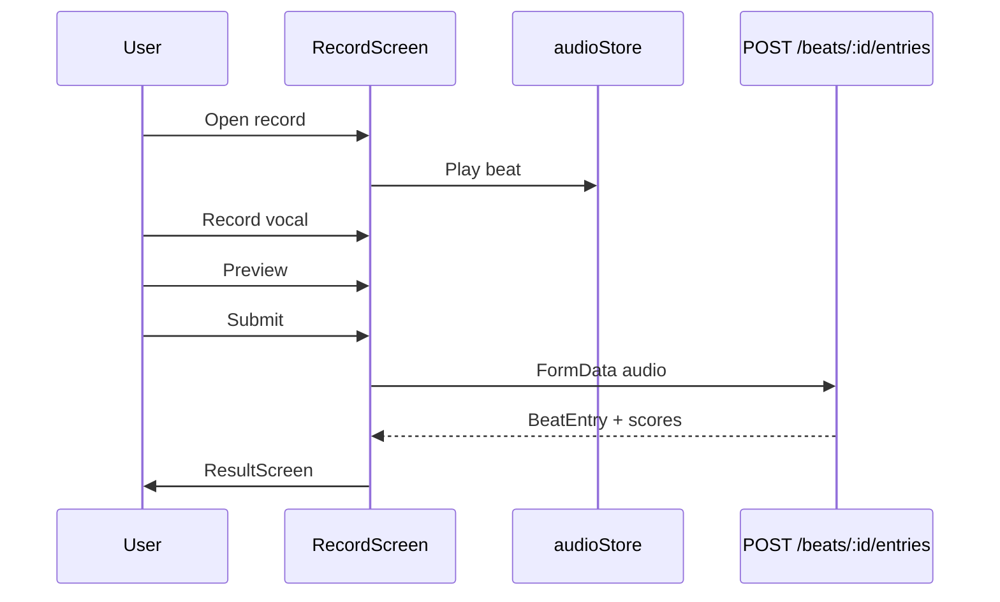

# Feature: Challenge (Sonic Pulse / Beat Challenge)

**Route:** `app/(challenge)/*`  
**Module:** `features/challenge/`  
**Sản phẩm:** Thử thách âm nhạc — user thu âm trên beat, submit entry, vote, leaderboard.

---

## 1. Mục đích nghiệp vụ

| Actor       | Hành vi                                      |
| ----------- | -------------------------------------------- |
| Listener    | Duyệt beat, nghe top entries, vote           |
| Creator     | Upload beat + tạo challenge                  |
| Participant | Thu âm vocal trên beat → submit → xem điểm   |
| Host        | Xem leaderboard, quản lý beat/entry của mình |

---

## 2. Luồng nghiệp vụ

### 2.1 Khám phá beat

```
(challenge)/explore → ChallengeExploreScreen
  → BeatList (component từ explore)
  → useGetBeats({ page, genre })
  → Tap beat → /(challenge)/beat-detail?id=
```

Entry từ home hero cũng vào route này.

### 2.2 Beat detail

```
BeatDetailScreen
  → useGetBeatById(id)
  → audioStore.playBeat() — hero player
  → Top 5 entries (leaderboard limit=5, include_unscored=true)
  → CTA "Thu âm" → /(challenge)/record?beatId=
  → "Bảng xếp hạng" → /(challenge)/leaderboard?beatId=
```

### 2.3 Thu âm & submit

```
RecordScreen
  → Request mic permission
  → Play beat + record vocal (expo-av)
  → Preview recording
  → Submit → challengeApi.submitEntry (FormData: audio, explanation)
  → POST /beats/:id/entries
  → Navigate ResultScreen với score breakdown
```

**Explanation hardcoded:** `"Recorded using Sonic Pulse Studio"`

### 2.4 Leaderboard & vote

```
LeaderboardScreen
  → useGetLeaderboard(beatId, limit=50)
  → Podium top 3 + RankList
  → Vote toggle → POST/DELETE /beats/entries/:id/vote
  → Play entry audio (audioStore pauses beat)
```

Vote count optimistic local (`votedIds` session-only).

### 2.5 Tạo challenge

```
(challenge)/create → CreateChallengeScreen
  → CreateChallengeForm
  → useGetAllGenres() [profiles]
  → Required: title, genre, audio file
  → Optional: cover, BPM (default 120), key (default C)
  → POST /beats (FormData)
```

### 2.6 Nội dung của tôi

```
(challenge)/myContent → MyContentScreen
  → Tab beats: useGetMyBeats → delete beat
  → Tab entries: useGetMyEntries → delete entry
  → Owner check: creator_id === user.id
```

---

## 3. Cấu trúc code

```
features/challenge/
├── domain/
│   ├── entities/challenge.type.ts
│   └── repositories/IChallengeRepository.ts
├── data/
│   ├── datasources/challengeRemoteDataSource.ts
│   └── repositories/ChallengeRepositoryImpl.ts
└── presentation/
    ├── hooks/useChallengeApi.ts
    ├── store/audioStore.ts          # Zustand + expo-av
    ├── screens/ (7 screens)
    └── components/
        ├── beatDetail/
        ├── createChallenge/
        ├── leaderboard/
        └── recordStudio/
```

---

## 4. API endpoints

| Method | Path                      | Mục đích               |
| ------ | ------------------------- | ---------------------- |
| GET    | `/beats`                  | List beats             |
| GET    | `/beats/:id`              | Beat detail            |
| POST   | `/beats`                  | Create beat (FormData) |
| PUT    | `/beats/:id`              | Update beat            |
| DELETE | `/beats/:id`              | Delete beat            |
| GET    | `/beats/:id/leaderboard`  | Rankings               |
| POST   | `/beats/:id/entries`      | Submit recording       |
| POST   | `/beats/entries/:id/vote` | Upvote                 |
| DELETE | `/beats/entries/:id/vote` | Remove vote            |
| GET    | `/beats/stats/:userId`    | User stats             |
| GET    | `/beats/my`               | My beats               |
| GET    | `/beats/entries/my`       | My entries             |
| DELETE | `/beats/entries/:id`      | Delete entry           |

---

## 5. `audioStore` — playback logic

**File:** `presentation/store/audioStore.ts`

| State          | Mục đích       |
| -------------- | -------------- |
| `currentBeat`  | Beat đang phát |
| `currentEntry` | Entry preview  |
| `isPlaying`    | Play/pause     |

**Rules:**

- Play entry → pause beat
- Record screen mount → stop entry preview
- Mutual exclusion — chỉ một audio stream

Dùng `expo-av` `Audio.Sound` — unload khi switch track.

---

## 6. Scoring & entry status

```typescript
// BeatEntry scoring_status
'pending' | 'completed' | 'failed' | 'scored';
```

- UI labels trong `MyContentScreen`
- Leaderboard `include_unscored=true` — hiện entry chưa chấm điểm
- `ResultScreen` hiển thị breakdown sau submit

---

## 7. Business rules

| Rule              | Chi tiết                                                                                          |
| ----------------- | ------------------------------------------------------------------------------------------------- |
| Create validation | Title + genre + audio bắt buộc                                                                    |
| Record submit     | Phải có recording trước khi submit                                                                |
| Delete beat       | Chỉ owner (`creator_id === user.id`)                                                              |
| Delete entry      | Chỉ owner entry                                                                                   |
| Vote              | Toggle upvote/remove; optimistic UI                                                               |
| BeatList fallback | Dummy data nếu API empty/error                                                                    |
| Imperative API    | `submitEntry`, `voteEntry`, `createBeat` gọi qua `challengeApi` export — không phải mutation hook |

---

## 8. Phụ thuộc

| Hướng                | Chi tiết                                       |
| -------------------- | ---------------------------------------------- |
| challenge → auth     | User id ownership                              |
| challenge → profiles | `useGetAllGenres` create form                  |
| challenge ↔ explore  | BeatList, MiniPlayer, FilterChips, HeroSection |
| home → challenge     | Hero CTA                                       |
| shared               | CommonHeader, ConfirmModal                     |

---

## 9. Tại sao triển khai như vậy?

| Quyết định               | Lý do                                                         |
| ------------------------ | ------------------------------------------------------------- |
| Zustand audioStore       | Playback ngoài React tree; nhiều screen share player          |
| FormData upload          | Audio binary — không JSON                                     |
| Imperative submitEntry   | Recording flow phức tạp — không fit mutation hook pattern sẵn |
| include_unscored         | UX — user thấy entry mới trước khi server chấm                |
| Components trong explore | Shared layout explore tab — trade-off tổ chức folder          |

---

## 10. Sơ đồ luồng thu âm



---

## 11. Câu hỏi thường gặp

**H: Tại sao dùng expo-av không phải react-native-track-player?**  
T: expo-av đủ cho preview ngắn + record; track-player phức tạp hơn cho background playback.

**H: Vote có sync server không?**  
T: Có API vote — UI optimistic; refresh leaderboard sau vote.

**H: Scoring ai làm?**  
T: Backend — mobile chỉ hiển thị status và điểm trả về.

---

## 12. Debug

| Triệu chứng       | File                                 |
| ----------------- | ------------------------------------ |
| Beat không phát   | `audioStore.ts`, check Sound load    |
| Submit fail       | `challengeRemoteDataSource` FormData |
| Mic permission    | `RecordScreen` permissions           |
| Leaderboard trống | `include_unscored` param             |
