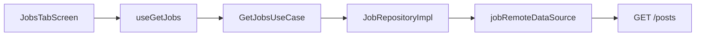
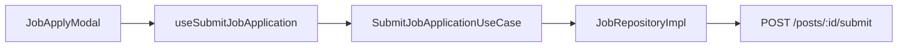

# Feature: Jobs (Việc làm / Tuyển dụng)

**Route:** `app/(tabs)/jobs`, `app/(jobs)/*`  
**Module:** `features/jobs/`  
**Feature mẫu Clean Architecture** — đọc kỹ file này để hiểu pattern cho các feature khác.

---

## 1. Mục đích nghiệp vụ

Kết nối **venue / nhà tuyển dụng** với **ca sĩ / producer**:

- Duyệt danh sách tin tuyển (job offer)
- Xem chi tiết, apply kèm cover letter + demo file
- Venue đăng tin 4 bước (wizard)
- Chỉnh sửa / xóa tin của mình

**Lưu ý backend:** Entity gọi là **post** (`post_type: 'job_offer'`), API path `/posts` — không phải `/jobs`.

**Review đơn ứng tuyển** (accept/reject) nằm ở feature **collab** + màn **profiles**, không trong jobs.

---

## 2. Luồng nghiệp vụ

### 2.1 Duyệt job

```
(tabs)/jobs → JobsTabScreen
  → Tab "Các job khác": useGetJobs()
  → Client filter bỏ job có creator_id === user.id
  → Tab "Job của tôi": useGetMyPosts()
  → SearchBar → search param (refetch mỗi keystroke)
  → JobCardFull → /(jobs)/detail?id=
```

### 2.2 Apply job

```
JobDetailScreen / JobCardFull
  → JobApplyModal
  → Validate: họ tên, email, SĐT VN, cover letter ≥50 ký tự
  → MediaPicker (optional demo) → useGetMyMedia() từ profiles
  → useSubmitJobApplication()
  → SubmitJobApplicationUseCase (check jobId không rỗng)
  → POST /posts/:jobId/submit
```

### 2.3 Đăng tin tuyển

```
JobHeader "Đăng tin" → RecruitmentFormScreen
  Step 1: title, brief, description
  Step 2: location, budget, deadline
  Step 3: skills, artist type
  Step 4: review → useCreateJob()
  → POST /posts
  Default: status=published, visibility=public, post_type=job_offer
```

### 2.4 Sửa / xóa

```
Job owned → EditJobScreen
  → Check creator_id === user.id
  → useUpdateJob() / useDeleteJob()
```

### 2.5 Review submission (feature khác)

```
(profiles)/collaboration → tab "Nhận được"
  → JobSubmissionsScreen
  → useGetOpportunitySubmissions() [collab]
  → Accept/Reject → PUT /submissions/:id/review
```

---

## 3. Cấu trúc code

```
features/jobs/
├── domain/
│   ├── entities/job.type.ts
│   ├── repositories/IJobRepository.ts
│   ├── usecases/
│   │   ├── GetJobsUseCase.ts
│   │   └── SubmitJobApplicationUseCase.ts
│   └── utils/jobFormatters.ts      ← collab cũng import
├── data/
│   ├── datasources/jobRemoteDataSource.ts
│   └── repositories/JobRepositoryImpl.ts
└── presentation/
    ├── screens/
    │   ├── JobsTabScreen.tsx
    │   ├── JobDetailScreen.tsx
    │   ├── RecruitmentFormScreen.tsx
    │   └── EditJobScreen.tsx
    ├── components/     # JobList, JobApplyModal, MediaPicker, ...
    └── hooks/useJobApi.ts
```

**Route mỏng:**

```tsx
// app/(tabs)/jobs.tsx
export { default } from '@/features/jobs/presentation/screens/JobsTabScreen';
```

---

## 4. Layer chi tiết

### Domain — `job.type.ts`

Types chính: `Job`, `CreateJobRequest`, `UpdateJobRequest`, `SubmitApplicationRequest`, `Application`, `MySubmission`.

Enums: `PostType`, `ArtistType`, `RecruitmentType`, `PostStatus`, `LocationType`.

Fields backend quan trọng: `can_accept_submissions`, `is_deadline_passed`, `is_pool` — **UI chưa check** trước khi hiện nút Apply.

### Use cases

**`GetJobsUseCase`** — pass-through repository (placeholder cho filter business rule sau).

**`SubmitJobApplicationUseCase`** — rule thật:

```typescript
if (!jobId?.trim()) throw new Error('Job ID is required');
return repository.submitJobApplication(jobId, body);
```

Create/Update/Delete **không có use case** — hook gọi repository trực tiếp (CRUD thuần).

### Data — `jobRemoteDataSource.ts`

| Method | Endpoint                         |
| ------ | -------------------------------- |
| GET    | `/posts?page&page_size&search`   |
| GET    | `/posts/:id`                     |
| GET    | `/posts/me?page&page_size`       |
| POST   | `/posts`                         |
| PUT    | `/posts/:id`                     |
| DELETE | `/posts/:id`                     |
| POST   | `/posts/:jobId/submit`           |
| GET    | `/my-submissions?page&page_size` |

### Presentation — `useJobApi.ts`

| Hook                      | staleTime | Invalidate on success |
| ------------------------- | --------- | --------------------- |
| `useGetJobs`              | 60s       | —                     |
| `useGetJobById`           | 300s      | —                     |
| `useGetMyPosts`           | 60s       | —                     |
| `useCreateJob`            | —         | jobs list, myPosts    |
| `useUpdateJob`            | —         | detail, lists         |
| `useDeleteJob`            | —         | lists                 |
| `useSubmitJobApplication` | —         | detail, mySubmissions |

Query keys: object `jobKeys` tập trung.

---

## 5. Business rules & validation

### RecruitmentFormScreen

- Bắt buộc: `title`, `brief_description`, `description`
- `location_type === 'remote'` → ẩn field địa điểm
- `is_negotiable === true` → ẩn min/max budget

### JobApplyModal

| Field           | Rule                                        |
| --------------- | ------------------------------------------- |
| full_name       | ≥ 2 ký tự                                   |
| email           | regex email                                 |
| phone_number    | `^(0\|+84)[0-9]{9,10}$`                     |
| cover_letter    | ≥ 50 ký tự                                  |
| portfolio_links | optional, split newline/comma, validate URL |
| demo_file       | optional, `selectedMedia.file_url`          |

### Ownership

```typescript
String(job.creator_id).trim() === String(user.id).trim();
```

- Owner thấy **Edit**, không thấy **Apply**
- Tab "Các job khác" filter bỏ job của mình

### Edge cases / tech debt

| Issue                            | Chi tiết                                                  |
| -------------------------------- | --------------------------------------------------------- |
| Pagination                       | `getJobs` page=0, `getMyPosts` page=1 — có thể off-by-one |
| Bookmark button                  | UI có, **chưa handler**                                   |
| "Hồ sơ" creator                  | Nút có, **chưa navigate**                                 |
| `useGetMySubmissions` trong jobs | **Dead code** — UI dùng collab hook                       |
| Deadline / pool                  | Backend field, UI không chặn apply                        |

---

## 6. Components quan trọng

| Component                     | Vai trò                            |
| ----------------------------- | ---------------------------------- |
| `JobHeader`                   | Title + CTA đăng tin               |
| `JobTabs`                     | "Các job khác" / "Job của tôi"     |
| `JobList` + `JobCardSkeleton` | List + loading                     |
| `JobCardFull`                 | Card với actions apply/edit/detail |
| `JobApplyModal`               | Form apply + validation            |
| `MediaPicker`                 | Chọn demo từ thư viện media user   |
| `JobDetailActions`            | Owner → edit; guest → apply        |
| `RecruitmentFormScreen`       | Wizard 4 bước                      |

---

## 7. Phụ thuộc cross-feature

| Feature      | Phụ thuộc                                           |
| ------------ | --------------------------------------------------- |
| **auth**     | `user.id` ownership                                 |
| **profiles** | `useGetMyMedia`, type `Media` cho demo file         |
| **collab**   | Review/withdraw submissions; import `jobFormatters` |
| **shared**   | `apiClient`, `TabScreenWrapper`, `SearchBar`        |

---

## 8. Tại sao triển khai như vậy?

| Quyết định              | Lý do                                                           |
| ----------------------- | --------------------------------------------------------------- |
| Repository + datasource | Tách HTTP khỏi hook — test được, đổi API một chỗ                |
| UseCase chỉ cho submit  | Rule validate jobId — pattern mở rộng cho premium gate sau      |
| React Query hooks       | Server state — không đưa job list vào Zustand                   |
| Client filter own jobs  | API `/posts` trả tất cả — filter nhanh không cần endpoint riêng |
| Wizard 4 bước           | UX form dài — giảm drop-off                                     |
| Submission ở collab     | Tách "đăng/apply" vs "quản lý hợp tác" — 2 persona khác nhau    |

---

## 9. Sơ đồ luồng data





---

## 10. Câu hỏi thường gặp

**H: Sao API là `/posts` mà feature tên jobs?**  
T: Backend model chung Post — job là `post_type: 'job_offer'`. Mobile map sang domain `Job` cho rõ nghiệp vụ.

**H: Tại sao không gộp collab vào jobs?**  
T: Collab cover cả submission withdraw, review, danh sách "đã gửi/nhận" — dùng chung cho nhiều loại opportunity, không chỉ job.

**H: GetJobsUseCase chỉ pass-through — có thừa không?**  
T: Placeholder Clean Arch — sau có thể thêm filter premium, geo, role-based list mà không sửa hook.

**H: Demo file lấy từ đâu?**  
T: Thư viện media user (`profiles`) — upload trước qua `POST submissions/media`, apply gửi `file_url`.

---

## 11. Debug

| Triệu chứng           | Mở file                                 |
| --------------------- | --------------------------------------- |
| List trống            | `useJobApi.ts`, check filter creator_id |
| Apply fail validation | `JobApplyModal.tsx`                     |
| Không sửa được job    | `EditJobScreen.tsx` ownership check     |
| Search lag            | `JobsTabScreen` — không debounce search |
