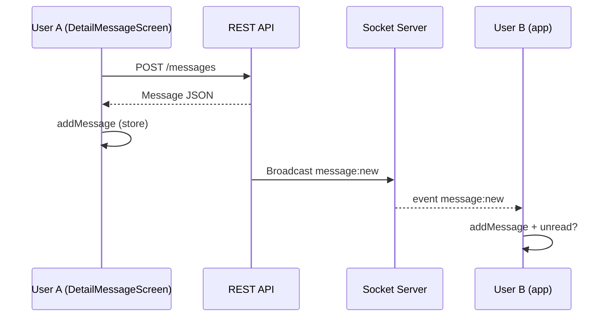

# Feature: Messaging (Tin nhắn / Chat)

**Route:** `app/(tabs)/notifications`, `app/(messages)/*`  
**Module:** `features/messaging/`  
**Realtime:** `shared/infrastructure/socket/socketService.ts` (Socket.IO)

Tab app hiển thị **「Tin nhắn」** nhưng folder route là `(messages)` và `(tabs)/notifications`.

---

## Messaging là gì?

Cho phép user **chat 1-1** (direct message):

- Xem danh sách hội thoại (inbox)
- Mở thread, đọc / gửi tin text + ảnh
- Sửa / xóa tin của mình
- Thấy đang gõ, online (qua socket)

Bắt đầu chat từ **profile người khác** → nút "Nhắn tin".

---

## Phần 1 — Socket là gì? (đọc trước khi đọc code chat)

### HTTP (apiClient) vs Socket — khác nhau thế nào?

|              | **HTTP / REST** (`apiClient`)          | **Socket** (`socketService`)             |
| ------------ | -------------------------------------- | ---------------------------------------- |
| Hình ảnh     | Gọi điện: hỏi → trả lời → cúp máy      | Giữ đường dây mở suốt                    |
| Ai chủ động? | **App** hỏi server mỗi lần cần data    | **Server** có thể **đẩy** tin bất cứ lúc |
| Dùng khi     | Load lịch sử, gửi tin, đánh dấu đã đọc | Tin mới realtime, typing, online         |
| Ví dụ        | `GET /messages/conversation/abc`       | Server bắn event `message:new`           |

**Tại sao chat cần cả hai?**

- Chỉ HTTP: muốn tin mới phải **refresh 1 giây/lần** (poll) — tốn pin, chậm.
- Socket: server **báo ngay** khi có tin → giống Messenger/Zalo.

### Socket.IO là gì?

Thư viện giúp app giữ **kết nối realtime** với server `https://talentlink.io.vn`.

Config trong `socketService.ts`:

```
URL:    https://talentlink.io.vn
Path:   /socket.io
Auth:   JWT accessToken (giống apiClient)
```

Khi connect thành công → app và server **cùng một "phòng dây"** — server gửi event tên cụ thể, app lắng nghe.

### App **nghe** event gì? (server → app)

| Event             | Nghĩa           | Store cập nhật                          |
| ----------------- | --------------- | --------------------------------------- |
| `message:new`     | Có tin nhắn mới | `addMessage` + có thể `incrementUnread` |
| `message:edited`  | Ai đó sửa tin   | `updateMessage`                         |
| `message:deleted` | Ai đó xóa tin   | `removeMessage`                         |
| `typing:start`    | Đang gõ...      | `addTypingUser`                         |
| `typing:stop`     | Ngừng gõ        | `removeTypingUser`                      |
| `user:online`     | User online     | `addOnlineUser`                         |
| `user:offline`    | User offline    | `removeOnlineUser`                      |

### App **gửi** event gì? (app → server)

| Emit                 | Khi nào                |
| -------------------- | ---------------------- |
| `conversation:join`  | Vào màn chat thread    |
| `conversation:leave` | Rời màn chat           |
| `typing:start`       | User gõ chữ            |
| `typing:stop`        | Ngừng gõ (hoặc sau 3s) |

### Ví dụ đời thường

- **HTTP** = bạn gọi bạn: "Có tin gì không?" — bạn trả lời xong cúp máy.
- **Socket** = hai người **mở loa** — ai nói thì nghe ngay, không cần hỏi lại.

### Ai gọi `socketService.connect()`?

| Màn hình                      | Hành vi                               |
| ----------------------------- | ------------------------------------- |
| `NotificationsScreen` (inbox) | `connect()` nếu chưa connected        |
| `DetailMessageScreen` (chat)  | `joinConversation(id)` khi vào thread |

`SocketProvider` có trong code nhưng **chưa mount** ở `app/_layout.tsx` — socket connect **lazy** khi user vào tab tin nhắn.

---

## Phần 2 — Setup socket chi tiết

**File:** `shared/infrastructure/socket/socketService.ts`  
**Thư viện:** `socket.io-client`  
**Provider (tùy chọn):** `shared/presentation/providers/SocketProvider.tsx`

Phần này giải thích **cách socket được cấu hình và bật** trong app messaging — đọc sau Phần 1 nếu muốn hiểu sâu code `socketService.ts`.

### 2.1 Kiến trúc tổng quan

```
┌─────────────────────────────────────────────────────────────┐
│  app/_layout.tsx                                             │
│    QueryClientProvider                                       │
│      (SocketProvider)  ← CÓ CODE nhưng CHƯA BỌC vào layout │
│                                                             │
│  NotificationsScreen / DetailMessageScreen                   │
│    socketService.connect()  ← CÁCH ĐANG DÙNG (lazy)         │
└─────────────────────────────────────────────────────────────┘
                          │
                          ▼
              socketService (singleton)
                          │
          io('https://talentlink.io.vn', { ... })
                          │
                          ▼
              Server Socket.IO (backend)
```

**Singleton** = cả app chỉ có **một** instance `socketService` — mọi màn chat dùng chung, không tạo socket mới mỗi lần mở thread.

### 2.2 Bước setup trong code (`connect()`)

Khi gọi `socketService.connect()`:

```typescript
// 1. Guard — tránh connect trùng
if (isConnecting) return; // Đang connect dở
if (hasReachedMaxAttempts) return; // Fail 5 lần → dừng hẳn
if (socket?.connected) return; // Đã connect rồi

// 2. Bắt buộc đã login
const { user, accessToken } = useAuthStore.getState();
if (!user || !accessToken) return null;

// 3. Tạo kết nối Socket.IO
this.socket = io('https://talentlink.io.vn', { ...options });

// 4. Đăng ký listeners
this.setupListeners();
```

#### Giải thích từng option `io(...)`

| Option                       | Giá trị                    | Ý nghĩa                                               |
| ---------------------------- | -------------------------- | ----------------------------------------------------- |
| `path`                       | `/socket.io`               | Endpoint Socket.IO trên server (không phải `/api/v1`) |
| `auth.token`                 | JWT access                 | Cách 1 gửi token — chuẩn Socket.IO v4                 |
| `query.token`                | JWT access                 | Cách 2 — một số server đọc từ query string            |
| `extraHeaders.Authorization` | `Bearer ...`               | Cách 3 — giống REST API                               |
| `extraHeaders['x-user-id']`  | user.id                    | Server biết user nào connect                          |
| `transports`                 | `['websocket', 'polling']` | Thử WebSocket trước; fail thì fallback long-polling   |
| `reconnection`               | `true`                     | Socket.IO tự reconnect khi mất mạng                   |
| `reconnectionAttempts`       | `5`                        | Tối đa 5 lần (built-in của thư viện)                  |

**Tại sao gửi token 3 chỗ?** Backend có thể đọc token từ nhiều nơi tùy middleware — gửi đủ để không bị reject auth.

**URL khác `apiClient`:** REST dùng `https://talentlink.io.vn/api/v1`; socket dùng **root** `https://talentlink.io.vn` + path `/socket.io`.

### 2.3 Hai cách “bật” socket trong project

#### Cách A — Lazy (đang dùng)

`NotificationsScreen.tsx`:

```typescript
useEffect(() => {
    if (!socketService.isConnected()) {
        socketService.connect();
    }
}, []);
```

- Socket chỉ connect khi user **vào tab Tin nhắn**
- Tiết kiệm pin/băng thông nếu user không chat
- Nhược: đang ở tab Home/Jobs **không** nhận tin realtime trên inbox

#### Cách B — Global qua Provider (có sẵn, chưa bật)

`SocketProvider.tsx` — khi `user && accessToken` thì `connect()`, logout thì `disconnect()`.

Để bật, bọc trong `app/_layout.tsx`:

```tsx
<QueryClientProvider client={queryClient}>
    <SocketProvider>
        <SafeAreaProvider>...</SafeAreaProvider>
    </SocketProvider>
</QueryClientProvider>
```

`SocketProvider` phải **bên trong** `QueryClientProvider` (vì gọi `useQueryClient()`).

Sau khi bật có thể xóa `connect()` thừa ở `NotificationsScreen` (giữ `isConnected` check vẫn an toàn).

### 2.4 `setupListeners()` — sau khi connect

Mỗi lần `connect()` gọi `removeAllListeners()` trước — **tránh đăng ký trùng** (connect 2 lần → 1 tin hiện 2 lần).

| Nhóm     | Events                                             | Cập nhật                             |
| -------- | -------------------------------------------------- | ------------------------------------ |
| Kết nối  | `connect`, `disconnect`, `connect_error`, `error`  | Log + reconnect logic                |
| Tin nhắn | `message:new`, `message:edited`, `message:deleted` | `messagingStore`                     |
| Typing   | `typing:start`, `typing:stop`                      | `messagingStore` (bỏ qua chính mình) |
| Online   | `user:online`, `user:offline`                      | `messagingStore`                     |

Listeners gọi `useMessagingStore.getState()` — **không cần React hook**, chạy được ngoài component.

Ví dụ tin mới:

```typescript
this.socket.on('message:new', (message) => {
    const store = useMessagingStore.getState();
    store.addMessage(message.conversationId, message);
    if (store.activeConversationId !== message.conversationId) {
        store.incrementUnread(message.conversationId);
    }
});
```

### 2.5 Reconnect — hai lớp

| Lớp                    | Ai xử lý                          | Khi nào                                                       |
| ---------------------- | --------------------------------- | ------------------------------------------------------------- |
| **Socket.IO built-in** | `reconnection: true` trong `io()` | Mất mạng tạm, server restart                                  |
| **Custom**             | `handleConnectionError()`         | `connect_error` — backoff 1s, 2s, 4s... max 10s, tối đa 5 lần |

Sau 5 lần custom fail → `hasReachedMaxAttempts = true` → `connect()` trả `null` cho đến khi gọi `resetReconnectAttempts()`.

`disconnect` với reason `io server disconnect` → server **chủ động ngắt** (thường auth sai) → `handleDisconnect()` thử disconnect + connect lại sau 1s.

**Lưu ý:** Token hết hạn — socket **không** tự refresh JWT như `apiClient`. Biến `hasAttemptedTokenRefresh` có trong code nhưng **chưa có logic refresh thật** — cần login lại hoặc reconnect sau khi có token mới.

### 2.6 Connect ≠ vào phòng chat — join / leave

Connect socket **không** đồng nghĩa nhận được mọi thread. Phải **join phòng**:

```typescript
// Vào DetailMessageScreen
socketService.joinConversation(conversationId);
// emit: conversation:join { conversationId }

// Rời màn
socketService.leaveConversation(conversationId);
// emit: conversation:leave { conversationId }
```

**Typing** cũng emit riêng:

```typescript
socketService.startTyping(conversationId); // typing:start
socketService.stopTyping(conversationId); // typing:stop
```

`joinConversation` / `startTyping` **không làm gì** nếu `!socket.connected` — nên luôn `connect()` trước (inbox đã làm bước này).

### 2.7 Timeline một phiên chat (mental model)

```
T0  User login → authStore có accessToken
T1  Vào tab Tin nhắn → connect()
T2  Event 'connect' → socket.id được cấp
T3  User mở chat với B → joinConversation(conv-123)
T4  B gửi tin (HTTP) → server emit message:new → addMessage store
T5  User gõ → startTyping → B thấy TypingIndicator
T6  User back → leaveConversation(conv-123)
T7  App background lâu → có thể disconnect
T8  App foreground → Socket.IO tự reconnect (nếu chưa max attempts)
T9  Logout → nên disconnect() (Provider hoặc manual)
```

### 2.8 API public của `socketService`

| Method                               | Mục đích                                         |
| ------------------------------------ | ------------------------------------------------ |
| `connect()`                          | Mở kết nối (cần auth)                            |
| `disconnect()`                       | Đóng hẳn, xóa listeners                          |
| `isConnected()`                      | Check `socket.connected`                         |
| `joinConversation(id)`               | Vào phòng chat                                   |
| `leaveConversation(id)`              | Rời phòng                                        |
| `startTyping(id)` / `stopTyping(id)` | Báo đang gõ                                      |
| `resetReconnectAttempts()`           | Reset sau khi fix mạng / auth                    |
| `setQueryClient(client)`             | Provider gọi — **hiện chưa dùng** trong handlers |

### 2.9 Checklist debug socket

| Triệu chứng                  | Kiểm tra                                            |
| ---------------------------- | --------------------------------------------------- |
| Không connect                | Đã login? `accessToken` trong authStore?            |
| `connect_error`              | Token hết hạn? Server `talentlink.io.vn` reachable? |
| Connect nhưng không nhận tin | Đã `joinConversation`? Đúng `conversationId`?       |
| Tin nhận 2 lần               | `connect()` gọi nhiều lần không qua guard?          |
| Max retry reached            | Gọi `resetReconnectAttempts()` hoặc restart app     |
| Typing không hiện            | Socket connected? `startTyping` có emit?            |

**Log trong dev:** tìm console `🔌`, `✅ Connected`, `📨 New message`, `📥 Joining conversation`.

> Chi tiết socket như shared infrastructure: xem thêm [shared.md — mục 6](./shared.md#6-socketservice--setup-socket-chi-tiết).

---

## Phần 3 — Messaging hoạt động cụ thể trong app

### Hai nguồn dữ liệu (quan trọng!)

```
┌─────────────────────────────────────────────────────────┐
│  REST (apiClient)          Socket (socketService)        │
│  ─────────────────         ─────────────────────         │
│  Lần đầu load inbox         Tin mới đẩy về               │
│  Lần đầu load history      Sửa/xóa tin người khác        │
│  Gửi tin (POST)            Typing / online               │
│  Đánh dấu đã đọc                                         │
└─────────────────────────────────────────────────────────┘
                    ↓ cả hai ghi vào
              messagingStore (Zustand)
                    ↓
              UI render (ChatItem, MessageBubble)
```

**Gửi tin:** vẫn qua **HTTP** `POST /messages` — không gửi nội dung tin qua socket.  
Socket chỉ để **người kia nhận** tin mới (và typing/online).

### `messagingStore` — bộ nhớ chat trên máy

**File:** `features/messaging/presentation/store/messagingStore.ts`

Không dùng React Query cho UI chat chính — dùng **Zustand** vì socket push liên tục.

| State                  | Lưu gì                                    |
| ---------------------- | ----------------------------------------- |
| `conversationsById`    | Map id → hội thoại                        |
| `conversationOrder`    | Thứ tự inbox (mới nhất trước)             |
| `messagesById`         | Map id → từng tin                         |
| `conversationMessages` | convId → danh sách messageId theo thứ tự  |
| `unreadCounts`         | Số tin chưa đọc mỗi hội thoại             |
| `typingUsers`          | Ai đang gõ trong phòng nào                |
| `onlineUsers`          | Ai đang online                            |
| `activeConversationId` | Đang mở thread nào (để không tăng unread) |

**Tại sao normalize (map + id list)?**  
Cập nhật 1 tin / thêm 1 tin nhanh, không copy cả mảng lớn.

---

## Luồng A — Mở tab Tin nhắn (inbox)

**Màn:** `NotificationsScreen.tsx`  
**Route:** `(tabs)/notifications`

```
1. Mount màn hình
2. GET /conversations  (apiClient)
3. setConversations() → messagingStore
4. socketService.connect() nếu chưa có
5. User thấy list ChatItem

[Sau đó — background]
6. Socket nhận message:new
7. addMessage + incrementUnread (nếu không đang mở thread đó)
8. Inbox tự cập nhật
```

Filter: tab **Tất cả** / **Chưa đọc**, search theo tên participant.

Tap 1 dòng → `/(messages)/detailMessage?conversationId=xxx`

---

## Luồng B — Mở thread chat

**Màn:** `DetailMessageScreen.tsx`  
**Route:** `(messages)/detailMessage`

```
Vào màn (có conversationId từ URL)
│
├─ 1. GET /conversations/:id        → header (tên, avatar đối phương)
│
├─ 2. GET /messages/conversation/:id
│      (chỉ nếu chưa có trong store — hasMessages)
│      → setMessages() load lịch sử
│
├─ 3. setActiveConversation(id)
├─ 4. socketService.joinConversation(id)
├─ 5. clearUnread(id)
├─ 6. POST /messages/conversation/:id/read
│
Rời màn (unmount)
├─ leaveConversation(id)
├─ stopTyping(id)
└─ setActiveConversation(null)
```

### Gửi tin text

```
User bấm Gửi
  → POST /messages { conversationId, content }
  → Response: Message object
  → addMessage() vào store (hiện ngay cho mình)
  → Đối phương nhận qua socket message:new (nếu đang online)
```

### Gửi ảnh

```
Chọn ảnh từ thư viện
  → POST /storage/upload (folder: messages) — FormData
  → POST /messages { conversationId, attachmentUrl, attachmentType: 'image' }
  → addMessage()
```

### Đang gõ (typing)

```
User gõ chữ
  → socket emit typing:start
  → Sau 3 giây không gõ → typing:stop

Đối phương nhận typing:start/stop
  → TypingIndicator hiện dưới list tin
```

### Sửa / xóa tin

```
Long press tin của mình
  → Sửa: PUT /messages/:id → updateMessage store
  → Xóa: DELETE /messages/:id → removeMessage (soft: "Tin nhắn đã bị xóa")

Người kia thấy qua socket message:edited / message:deleted
```

**Rule:** Chỉ sửa/xóa tin **của mình**, tin chưa bị xóa.

---

## Luồng C — Bắt đầu chat từ profile

**Màn:** `ArtistProfileScreen` / `VenueProfileScreen`

```
User bấm "Nhắn tin" (ẩn nếu xem profile chính mình)
  → useGetOrCreateConversation(otherUserId)
  → POST /conversations {
       name: 'TL-MESS',
       isGroup: false,
       participantIds: [otherUserId]
     }
  → Server trả conversation (mới hoặc đã có)
  → Navigate detailMessage?conversationId=
```

DM luôn 1-1 — không tạo group trên UI hiện tại.

---

## API REST (đầy đủ)

| Method | Path                              | Dùng ở đâu                          |
| ------ | --------------------------------- | ----------------------------------- |
| GET    | `/conversations`                  | Inbox load                          |
| GET    | `/conversations/:id`              | Header chat                         |
| POST   | `/conversations`                  | Tạo / get-or-create DM              |
| DELETE | `/conversations/:id`              | Xóa hội thoại (hook có, UI ít dùng) |
| GET    | `/messages/conversation/:id`      | Lịch sử tin                         |
| POST   | `/messages`                       | Gửi tin                             |
| PUT    | `/messages/:id`                   | Sửa tin                             |
| DELETE | `/messages/:id`                   | Xóa tin                             |
| POST   | `/messages/conversation/:id/read` | Đánh dấu đã đọc cả thread           |
| POST   | `/storage/upload`                 | Upload ảnh đính kèm                 |

Datasource: `messagingRemoteDataSource.ts`  
Hooks React Query: `useMessagingApi.ts` — **chủ yếu** `useGetOrCreateConversation`; inbox/chat dùng `apiClient` + store trực tiếp.

---

## Sơ đồ: gửi tin từ A → B



---

## Unread — khi nào +1?

```
Socket message:new tới
  → Nếu activeConversationId === conversationId đó
      → KHÔNG tăng unread (đang xem thread)
  → Ngược lại
      → incrementUnread(conversationId)
```

Vào thread → `clearUnread` + `POST .../read`.

---

## Cấu trúc thư mục

```
features/messaging/
├── domain/entities/messaging.type.ts
├── data/datasources/messagingRemoteDataSource.ts
├── presentation/
│   ├── screens/
│   │   ├── NotificationsScreen.tsx   ← inbox
│   │   ├── DetailMessageScreen.tsx   ← chat thread
│   │   └── ContactMessageScreen.tsx  ← stub, chưa có API
│   ├── store/messagingStore.ts
│   └── hooks/useMessagingApi.ts

shared/
├── infrastructure/socket/socketService.ts
└── presentation/ui/
    ├── ChatItem.tsx
    ├── MessageBubble.tsx
    ├── MessageInput.tsx
    └── TypingIndicator.tsx
```

---

## File nên đọc theo thứ tự

| Thứ tự | File                      | Vì sao                               |
| ------ | ------------------------- | ------------------------------------ |
| 1      | `socketService.ts`        | Socket connect + events (đọc Phần 2) |
| 2      | `messagingStore.ts`       | State chat                           |
| 3      | `NotificationsScreen.tsx` | Inbox + connect socket               |
| 4      | `DetailMessageScreen.tsx` | Toàn bộ thread                       |
| 5      | `messaging.type.ts`       | Shape Conversation / Message         |

---

## Câu hỏi thường gặp

**H: Sao không dùng hết React Query cho chat?**  
Socket đẩy tin liên tục — cập nhật Zustand trực tiếp đơn giản hơn invalidate query từng event.

**H: Gửi tin qua socket hay HTTP?**  
**HTTP** `POST /messages`. Socket chỉ để **nhận** tin mới và realtime phụ (typing, online).

**H: Mở app có tự connect socket không?**  
Chỉ khi vào tab Tin nhắn (lazy — xem Phần 2.3). Không connect global ở `_layout` hiện tại. Có thể bật `SocketProvider` nếu cần unread realtime mọi tab.

**H: `useMessagingApi` vs gọi `apiClient` trong screen?**  
Cùng project dùng **cả hai**: hook cho create conversation; screen chat gọi `apiClient` + `messagingStore` trực tiếp.

**H: ContactMessageScreen là gì?**  
UI stub — accept/reject chưa nối API.

---

## Debug

| Triệu chứng             | Kiểm tra                                             |
| ----------------------- | ---------------------------------------------------- |
| Không nhận tin realtime | `socketService.connect()`, token, `joinConversation` |
| Unread sai              | `activeConversationId`, `incrementUnread`            |
| Inbox trống             | `GET /conversations`, `setConversations`             |
| Gửi không được          | `POST /messages`, token 401                          |
| Ảnh fail                | `/storage/upload` FormData                           |
