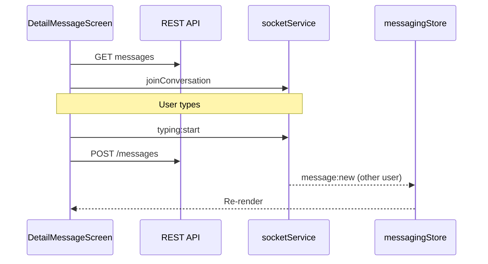

# Feature: Messaging (Tin nhắn / Chat)

**Route:** `app/(tabs)/notifications`, `app/(messages)/*`  
**Module:** `features/messaging/`  
**Realtime:** Socket.IO qua `shared/infrastructure/socket/socketService.ts`

---

## 1. Mục đích nghiệp vụ

**Direct messaging** giữa users:

- Danh sách hội thoại (inbox)
- Chat 1-1 text + ảnh
- Typing indicator, online status
- Edit / delete tin nhắn của mình
- Unread count

Tab app hiển thị tên **"Tin nhắn"** nhưng route group là `notifications`.

---

## 2. Luồng nghiệp vụ

### 2.1 Inbox

```
(tabs)/notifications → NotificationsScreen
  → GET /conversations
  → Normalize vào messagingStore (Zustand)
  → Filter: All / Unread
  → Search theo tên participant
  → Tap → /(messages)/detailMessage?conversationId=
```

Empty state → CTA sang `/(tabs)/explore`.

### 2.2 Chat thread

```
DetailMessageScreen
  → GET /conversations/:id + GET /messages/conversation/:id
  → socketService.joinConversation(id)
  → POST .../read — clear unread
  → Send text → POST /messages
  → Send image → POST /storage/upload (folder: messages) → POST /messages
  → Long press → edit / delete / copy
  → Typing emit sau keystroke, auto stop 3s
  → Leave room on unmount
```

### 2.3 Bắt đầu DM từ profile

```
ArtistProfile / VenueProfile
  → useGetOrCreateConversation(participantId)
  → POST /conversations { name: 'TL-MESS', isGroup: false, participantIds: [id] }
  → Navigate detailMessage
```

### 2.4 Realtime (socket)

```
socketService events:
  message:new     → addMessage + incrementUnread (nếu không active conv)
  message:edited  → updateMessage
  message:deleted → removeMessage
  typing:start/stop → typing users
  user:online/offline → online set
```

---

## 3. Cấu trúc code

```
features/messaging/
├── domain/
│   ├── entities/messaging.type.ts
│   └── repositories/IMessagingRepository.ts
├── data/
│   ├── datasources/messagingRemoteDataSource.ts
│   └── repositories/MessagingRepositoryImpl.ts
└── presentation/
    ├── hooks/useMessagingApi.ts
    ├── store/messagingStore.ts    # Normalized cache
    └── screens/
        ├── NotificationsScreen.tsx
        ├── DetailMessageScreen.tsx
        └── ContactMessageScreen.tsx  # STUB
```

**Lưu ý kiến trúc:** Screens chủ yếu gọi `apiClient` + `messagingStore` trực tiếp; hooks dùng nhiều từ profiles (`useGetOrCreateConversation`).

---

## 4. API endpoints

| Method | Path                                      | Mục đích               |
| ------ | ----------------------------------------- | ---------------------- |
| GET    | `/conversations`                          | List                   |
| GET    | `/conversations/:id`                      | Detail                 |
| POST   | `/conversations`                          | Create / get-or-create |
| DELETE | `/conversations/:id`                      | Delete conversation    |
| GET    | `/messages/conversation/:id`              | Messages               |
| GET    | `/messages/conversation/:id/unread-count` | Unread                 |
| POST   | `/messages/conversation/:id/read`         | Mark thread read       |
| POST   | `/messages`                               | Send                   |
| PUT    | `/messages/:id`                           | Edit                   |
| DELETE | `/messages/:id`                           | Delete                 |
| POST   | `/messages/:id/read`                      | Mark one read          |
| POST   | `/storage/upload`                         | Image attachment (UI)  |

---

## 5. `messagingStore` — normalized state

**File:** `presentation/store/messagingStore.ts`

| Slice                  | Mục đích                       |
| ---------------------- | ------------------------------ |
| `conversations`        | Map id → conversation          |
| `messages`             | Map conversationId → message[] |
| `conversationOrder`    | Sort by last message time      |
| `unreadCounts`         | Per conversation               |
| `typingUsers`          | Per conversation               |
| `onlineUsers`          | Set user ids                   |
| `activeConversationId` | Skip unread increment          |

Actions: `addMessage`, `updateMessage`, `removeMessage`, `incrementUnread`, `clearUnread`, ...

---

## 6. Business rules

| Rule                 | Chi tiết                                              |
| -------------------- | ----------------------------------------------------- |
| DM creation          | Luôn `isGroup: false`, name `'TL-MESS'`               |
| Unread               | +1 on socket `message:new` unless active conversation |
| Edit/delete          | Chỉ sender, message chưa deleted                      |
| Soft delete          | `content: 'Tin nhắn đã bị xóa'`, `isDeleted: true`    |
| Typing               | Exclude current user; 3s auto stop                    |
| Sort inbox           | Most recent `updated_at` first                        |
| ContactMessageScreen | **Stub** — accept/reject TODO, hardcoded name         |

---

## 7. Shared UI dùng

| Component            | File                      |
| -------------------- | ------------------------- |
| `ChatItem`           | Conversation row          |
| `MessageBubble`      | Bubble + attachment       |
| `MessageInput`       | Input + image pick + send |
| `MessageActionSheet` | Long press actions        |
| `OnlineIndicator`    | Green dot                 |
| `TypingIndicator`    | Animated dots             |

---

## 8. Phụ thuộc

| Hướng                | Chi tiết                                           |
| -------------------- | -------------------------------------------------- |
| messaging → auth     | `user.id`                                          |
| profiles → messaging | Start DM                                           |
| messaging → explore  | Empty CTA                                          |
| messaging → socket   | Realtime                                           |
| profiles storage     | `UploadFileResponse` type trong messaging entities |

---

## 9. Tại sao triển khai như vậy?

| Quyết định                     | Lý do                                                       |
| ------------------------------ | ----------------------------------------------------------- |
| Zustand + socket               | Realtime cần update ngoài React Query lifecycle             |
| Direct apiClient trong screens | Chat UX cần optimistic + socket merge — hooks alone awkward |
| Normalized store               | Tránh duplicate messages khi socket + fetch                 |
| SocketProvider chưa global     | Lazy connect từ messaging — có thể mount ở `_layout` sau    |
| get-or-create conversation     | Một endpoint — không cần check exists trước                 |

---

## 10. Sơ đồ realtime



---

## 11. Câu hỏi thường gặp

**H: Tại sao không dùng React Query cho messages?**  
T: Socket push liên tục — Zustand merge dễ hơn invalidate query từng event.

**H: SocketProvider không mount — chat vẫn chạy?**  
T: `DetailMessageScreen` gọi `socketService.connect()` — lazy. Unread tab bar có thể trễ nếu không connect sớm.

**H: Group chat có không?**  
T: API/type hỗ trợ `isGroup` — UI chỉ implement DM.

---

## 12. Debug

| Triệu chứng        | File                                          |
| ------------------ | --------------------------------------------- |
| Tin không realtime | `socketService.ts`, check connect             |
| Unread sai         | `activeConversationId`, `incrementUnread`     |
| Ảnh không gửi      | `DetailMessageScreen` storage upload          |
| Inbox trống        | `NotificationsScreen` fetch + store normalize |
