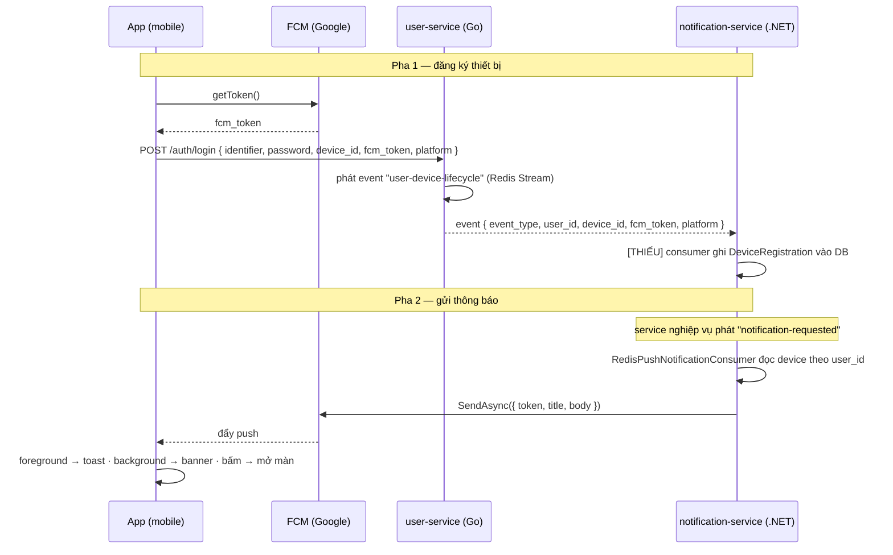

# Feature: Push Notification (FCM) — MOBILE

> Tài liệu tổng thể cho tính năng push notification. Viết để **cả người mới lẫn AI agent khác**
> đều tiếp nối được: có đầy đủ path file (2 repo), contract dữ liệu, trạng thái từng phần và
> hướng dẫn code cho phần còn thiếu.
>
> 📄 Tài liệu anh em:
>
> - [`notifications-messaging.md`](./notifications-messaging.md) — push cho **tin nhắn** (gửi tin → có banner)
> - [`notifications-web.md`](./notifications-web.md) — để **web** cũng đăng ký FCM token và nhận push

## 0. Bối cảnh 2 repo

| Repo           | Vai trò                                       | Vị trí (máy dev hiện tại)                 |
| -------------- | --------------------------------------------- | ----------------------------------------- |
| `TL-Mobile`    | App mobile (Expo + React Native, expo-router) | `Dien/backend/TL-Mobile`                  |
| `DATN-Backend` | Microservices (Go + .NET + Node)              | `Dien/backend/DATN-Backend` (repo anh em) |

Trong tài liệu: path bắt đầu bằng `features/`, `app/`, `shared/` là của **TL-Mobile**; path bắt đầu
bằng `user-service/`, `notification-service/` là của **DATN-Backend**.

---

## 1. Push notification là gì? (concept)

Khác với gọi API thường (**app hỏi → server trả**), push là **server chủ động gõ cửa máy** kể cả
khi app đang đóng. Backend **không** nối trực tiếp tới điện thoại được → phải đi qua **FCM** (Firebase
Cloud Messaging — cổng của Google) làm trung gian. FCM là bên duy nhất giữ kết nối thường trực tới máy.

`device token` (FCM token) = "địa chỉ nhà" của _app-này-trên-máy-này_. Mỗi máy một token, token **tự
xoay vòng** theo thời gian nên phải cập nhật.

Luồng chia làm **2 pha**:

1. **Đăng ký thiết bị** (lúc login): app xin quyền → lấy `fcm_token` từ Firebase → gửi kèm login →
   backend lưu `userId ↔ token` vào DB.
2. **Gửi thông báo** (khi có sự kiện): backend tra token của user → gửi `{token, title, body}` cho FCM
   → FCM đẩy về máy → OS hiện banner → user bấm → app mở đúng màn.



---

## 2. Trạng thái tổng quan

| Chặng                                          | Phía                           | Trạng thái                               |
| ---------------------------------------------- | ------------------------------ | ---------------------------------------- |
| Xin quyền + lấy FCM token                      | Mobile                         | ✅ Xong                                  |
| Cấu hình `google-services.json` (Android)      | Mobile                         | ✅ Xong                                  |
| Gửi token kèm login / mobile-oauth             | Mobile                         | ✅ Xong                                  |
| Nhận token ở DTO login + phát event            | Backend `user-service`         | ✅ Xong                                  |
| **Ghi `DeviceRegistration` vào DB (consumer)** | Backend `notification-service` | ✅ Xong (`RedisDeviceLifecycleConsumer`) |
| Service nghiệp vụ phát sự kiện push (job)      | Backend `job-post-service`     | ✅ Xong (submission + review)            |
| Đọc device + gọi FCM gửi                       | Backend `notification-service` | ✅ Xong                                  |
| Nhận / hiện / bấm mở màn                       | Mobile                         | ✅ Xong                                  |
| Endpoint cập nhật token (`/auth/device-token`) | Backend `user-service`         | ✅ Xong                                  |
| Unit test luồng push (mobile)                  | Mobile                         | ✅ 28 test pass                          |
| Rebuild dev client (native module mới)         | Mobile                         | ⏳ Cần chạy                              |
| Trỏ đúng backend đã deploy pipeline FCM        | Mobile                         | ⚠️ Cần xác nhận (xem §3.3)               |

**Tóm tắt (cập nhật 2026-07-15):** Backend đã hoàn thiện cả 3 mảnh từng thiếu (consumer ghi device,
phát push job, endpoint token — xem `DATN-Backend/docs/PUSH_BACKEND_CHANGES.md`). Phía mobile code +
cấu hình + unit test đã xong. Chỉ còn **2 việc để bật**: (1) **rebuild dev client** (§3.2) và
(2) **xác nhận `baseURL` trỏ đúng backend có pipeline FCM** (§3.3).

---

## 3. Phía MOBILE (`TL-Mobile`)

### 3.1 Đã làm — feature module `features/notifications/`

| File                                                                        | Việc                                                             |
| --------------------------------------------------------------------------- | ---------------------------------------------------------------- |
| `features/notifications/domain/entities/notification.type.ts`               | Types `DevicePayload`, `DevicePlatform`, `RegisterDeviceRequest` |
| `features/notifications/data/deviceInfo.ts`                                 | Tạo/lưu `device_id` (MMKV) + `resolvePlatform()`                 |
| `features/notifications/data/datasources/notificationRemoteDataSource.ts`   | Gọi `POST /auth/device-token` (chờ backend)                      |
| `features/notifications/presentation/hooks/useDevicePayload.ts`             | Xin quyền + `getToken()` (có timeout 5s, không chặn login)       |
| `features/notifications/presentation/hooks/usePushNotifications.ts`         | Foreground → toast; bấm thông báo → điều hướng theo `data.route` |
| `features/notifications/presentation/hooks/usePushTokenSync.ts`             | `onTokenRefresh` → gọi datasource cập nhật token                 |
| `features/notifications/presentation/handlers/registerBackgroundHandler.ts` | `setBackgroundMessageHandler` (background/killed)                |

Wire vào auth (đính token khi đăng nhập):

- `features/auth/domain/entities/auth.type.ts` — `LoginRequest` & `MobileOAuthRequest` `extends DeviceInfo`.
- `features/auth/presentation/screens/LoginScreen.tsx` — `handleLogin` gọi `getDevicePayload()` rồi merge vào `login(...)`.
- `features/auth/presentation/hooks/useGoogleSignIn.ts` — merge device payload vào `mobileOAuth(...)`.
- `app/_layout.tsx` — import `registerBackgroundHandler` (side-effect) + gọi `usePushNotifications()` & `usePushTokenSync()`.

Cấu hình:

- `app.json` — plugin `@react-native-firebase/app` + `@react-native-firebase/messaging`, `android.googleServicesFile: "./google-services.json"`. (iOS đã gỡ — chỉ làm Android.)
- `google-services.json` ở gốc project (project Firebase `talentlink-22clc`). Đã có trong `.gitignore`.
- Dependency: `@react-native-firebase/app@^25`, `@react-native-firebase/messaging@^25`.
- `jest.setup.js` — mock 2 package Firebase để test không vỡ.

Quyết định thiết kế:

- Foreground dùng luôn `react-native-toast-message` sẵn có → **không cài thêm** notifee.
- Background/killed: OS **tự** hiện banner (backend phải gửi kèm khối `notification`).

### 3.2 Còn thiếu — chỉ 1 hành động

⏳ **Rebuild dev client** (đã thêm native module, build cũ sẽ crash):

```bash
cd TL-Mobile
npx expo prebuild --clean --platform android
npx expo run:android        # hoặc: npm run build:android:dev  (EAS)
```

### 3.3 ⚠️ Xác nhận backend đích trước khi bật

`shared/infrastructure/api/apiClient.ts` hiện đặt:

```ts
baseURL: 'https://api.soundspal.com/api/v1',   // dòng đang dùng
//baseURL:'https://talentlink.io.vn/api/v1',   // dòng cũ (đã comment)
```

Login (đính `fcm_token`) đi theo `baseURL` này → **backend sau `api.soundspal.com` phải là bản
`DATN-Backend` đã deploy `RedisDeviceLifecycleConsumer` + `notification-service`** thì device mới được
ghi và push mới tới. Nếu pipeline FCM chỉ chạy trên stack `talentlink.io.vn` thì đổi lại dòng baseURL.
Lưu ý interceptor refresh (dòng ~124) vẫn hardcode `talentlink.io.vn/api/v1/auth/refresh` — hai domain
đang lệch nhau, cần thống nhất về đúng stack có pipeline FCM.

---

## 4. Phía BACKEND (`DATN-Backend`)

### 4.1 Đã có

| File                                                                                | Việc                                                                                                                            |
| ----------------------------------------------------------------------------------- | ------------------------------------------------------------------------------------------------------------------------------- |
| `user-service/internal/application/dto/auth_dto.go`                                 | `LoginRequest`/`MobileOauthRequest` có `device_id`, `fcm_token`, `platform`                                                     |
| `user-service/internal/application/services/auth/auth_service.go`                   | Login/OAuth/Logout gọi `ProduceUserDeviceLifecycleEvent(...)`                                                                   |
| `user-service/internal/infrastructure/messaging/redis_producer_service.go`          | Phát event lên stream `user-device-lifecycle`                                                                                   |
| `notification-service/.../Domain/Devices/DeviceRegistration.cs`                     | Entity: `UserId`, `DeviceId`, `FcmToken`, `Platform`, `IsActive`, `LastActiveAt`; method `RefreshToken()`, `UpdateLastActive()` |
| `notification-service/.../Persistence/Repositories/DeviceRegistrationRepository.cs` | Repo (CRUD + `GetDeviceRegistrationsByUserIdAsync`)                                                                             |
| `notification-service/.../Notifications/FcmService.cs`                              | Gửi FCM thật qua `FirebaseAdmin.Messaging`                                                                                      |
| `notification-service/.../Messaging/Consumers/RedisPushNotificationConsumer.cs`     | Đọc device theo `user_id` → gửi FCM (đọc stream `notification-requested`)                                                       |

### 4.2 🔴 THIẾU #1 (nút nghẽn) — Consumer ghi `DeviceRegistration`

**Vấn đề:** `user-service` phát event `user-device-lifecycle` kèm `fcm_token`, nhưng
`notification-service` **chưa có consumer nào đọc stream đó để ghi vào bảng `DeviceRegistrations`**.
Chỉ đăng ký 3 consumer (`InfrastructureModule.cs:82-84`): `RedisEmailEventConsumer`,
`RedisPushNotificationConsumer`, `RedisSubmissionEmailConsumer`. → Bảng device rỗng → pha 2 tra ra
rỗng → không ai nhận push.

**Contract event** (từ `redis_producer_service.go`) — stream `user-device-lifecycle`, key snake_case:

```jsonc
{ "event_type": "LOGIN" | "LOGOUT",  // "LOGIN" phát khi login/oauth; "LOGOUT" khi logout
  "user_id": "…", "device_id": "…",
  "platform": "ANDROID" | "IOS" | "WEB",
  "fcm_token": "…" }                  // vắng mặt khi LOGOUT
```

**Cách làm (mirror `RedisPushNotificationConsumer`):**

1. Tạo event DTO `notification-service/.../Messaging/Events/UserDeviceLifecycleEvent.cs` — dùng
   property snake_case y như các event khác (vd `NotificationRequestedEvent.cs`):
    ```csharp
    namespace NotificationService.Infrastructure.Messaging.Events;
    public class UserDeviceLifecycleEvent
    {
        public string event_type { get; set; } = string.Empty;
        public string user_id { get; set; } = string.Empty;
        public string device_id { get; set; } = string.Empty;
        public string platform { get; set; } = string.Empty;
        public string? fcm_token { get; set; }
    }
    ```
2. Tạo `notification-service/.../Messaging/Consumers/RedisDeviceLifecycleConsumer.cs`, copy khung từ
   `RedisPushNotificationConsumer` (extends `ResilientStreamConsumer`, inject `IRedisStreamService`,
   `IServiceScopeFactory`, `ILogger`). Đặt:
    - `ConsumerGroup = "notification-service"`, `ConsumerName = "device-lifecycle-consumer"`,
      `StreamName = "user-device-lifecycle"`.
    - Trong loop: `EnsureConsumerGroupExists(StreamName, ConsumerGroup, token)` rồi đọc & deserialize.
3. Xử lý (dùng `IDeviceRegistrationRepository` — method có sẵn: `GetAsync(predicate)`, `CreateAsync`,
   `UpdateAsync`, `DeleteAsync`):

    ```csharp
    var repo = scope.ServiceProvider.GetRequiredService<IDeviceRegistrationRepository>();

    if (evt.event_type == "LOGOUT")
    {
        var existing = await repo.GetAsync(d => d.DeviceId == evt.device_id);
        if (existing is not null) { existing.IsActive = false; await repo.UpdateAsync(existing); }
    }
    else // "LOGIN" (và "TOKEN_REFRESH" nếu thêm ở #3) — upsert
    {
        if (string.IsNullOrEmpty(evt.fcm_token)) return; // không token thì bỏ qua
        var existing = await repo.GetAsync(d => d.DeviceId == evt.device_id);
        if (existing is not null)
        {
            existing.RefreshToken(evt.fcm_token);
            existing.Platform = evt.platform;
            existing.IsActive = true;
            existing.UpdateLastActive();
            await repo.UpdateAsync(existing);
        }
        else
        {
            await repo.CreateAsync(new DeviceRegistration {
                UserId = evt.user_id, DeviceId = evt.device_id,
                FcmToken = evt.fcm_token, Platform = evt.platform,
                IsActive = true, LastActiveAt = DateTime.UtcNow,
            });
        }
    }
    ```

4. Đăng ký trong `notification-service/.../InfrastructureModule.cs` (cạnh 3 dòng có sẵn):
    ```csharp
    services.AddHostedService<RedisDeviceLifecycleConsumer>();
    ```
5. (Nên có) Unit test mirror `test/.../Services/RedisPushNotificationConsumerTests.cs`.

### 4.3 🟠 THIẾU #2 — Service nghiệp vụ phát sự kiện push

`RedisPushNotificationConsumer` đọc stream **`notification-requested`**. Cần các service nghiệp vụ
(messaging-service khi có tin nhắn mới, job-post-service khi có ứng tuyển...) phát event vào stream đó
với payload `{ user_id, title, body, data }`. Nhớ đính `data.route` (vd `"/(messages)/123"`) để mobile
điều hướng khi bấm. Firebase Admin cũng cần khối `notification` để OS tự hiện khi app background.

### 4.4 🟠 THIẾU #3 — Endpoint cập nhật token `POST /auth/device-token`

Token FCM tự xoay vòng giữa phiên. Mobile (`usePushTokenSync`) đã gọi sẵn `POST /auth/device-token`
với body `{ device_id, fcm_token, platform }` + Bearer token. **Cách gọn nhất:** thêm handler trong
`user-service` (nơi giữ các route `/auth/*`) → lấy `userId` từ JWT → gọi lại
`ProduceUserDeviceLifecycleEvent(ctx, "LOGIN", userId, deviceId, &fcmToken, platform)`. Như vậy **tái
dùng consumer #1**, không cần code ghi DB riêng.

---

## 5. Contract dữ liệu (tham chiếu nhanh)

**Request login/oauth** (mobile → `user-service`), field push là optional:

```
device_id: string        // UUID ổn định theo lần cài, lưu MMKV key "device_id"
fcm_token: string        // FCM registration token
platform:  "ANDROID" | "IOS" | "WEB"
```

**Event** `user-device-lifecycle` (Redis Stream): xem §4.2.

**Endpoints:**
| Method + path | Trạng thái | Ai xử lý |
| ------------- | ---------- | -------- |
| `POST /auth/login` (+3 field push) | ✅ | user-service |
| `POST /auth/mobile-oauth` (+3 field push) | ✅ | user-service |
| `POST /auth/device-token` | 🟠 thiếu (#3) | user-service (đề xuất) |

Base URL mobile: `https://talentlink.io.vn/api/v1` (`shared/infrastructure/api/apiClient.ts`).

---

## 6. Điều kiện hạ tầng (để chạy thật)

- **Firebase Admin credentials** cho `FcmService` (service-account JSON) — kiểm tra
  `notification-service/.../Configuration/Firebase/FirebaseSettings.cs` + init `FirebaseApp` trong
  `InfrastructureModule.cs`.
- **Cloud Messaging API** bật trong Firebase project `talentlink-22clc`.
- Android push chạy được trên emulator có Google Play; test thật nên dùng máy thật.

---

## 7. Test plan (sau khi làm xong #1 + rebuild)

1. Login trên app → log `📡 POST /auth/login` có `fcm_token`, `device_id`, `platform`.
2. Kiểm tra bảng `DeviceRegistrations` (DB notification-service) có 1 dòng đúng `user_id`/`fcm_token`.
3. Firebase Console → Cloud Messaging → **Send test message** → dán FCM token → gửi.
4. App foreground: thấy toast. App background: thấy banner OS. Bấm vào → mở màn theo `data.route`.
5. Logout → dòng device chuyển `IsActive=false` (khi #1 xử lý LOGOUT).

---

## 8. Bản đồ file (cho AI agent điều hướng nhanh)

**Mobile (`TL-Mobile`)**

```
features/notifications/                         ← toàn bộ feature push
features/auth/domain/entities/auth.type.ts      ← DeviceInfo, LoginRequest, MobileOAuthRequest
features/auth/presentation/screens/LoginScreen.tsx        ← đính token khi login
features/auth/presentation/hooks/useGoogleSignIn.ts       ← đính token khi oauth
app/_layout.tsx                                 ← đăng ký handler + hook
app.json                                        ← plugin + googleServicesFile (Android)
google-services.json                            ← config Firebase (gitignored)
```

**Backend (`DATN-Backend`)**

```
user-service/internal/application/dto/auth_dto.go                         ← DTO nhận token ✅
user-service/internal/application/services/auth/auth_service.go           ← phát event ✅
user-service/internal/infrastructure/messaging/redis_producer_service.go  ← stream user-device-lifecycle ✅
notification-service/src/NotificationService.Domain/Devices/DeviceRegistration.cs         ← entity ✅
notification-service/.../Persistence/Repositories/DeviceRegistrationRepository.cs         ← repo ✅
notification-service/.../Notifications/FcmService.cs                       ← gửi FCM ✅
notification-service/.../Messaging/Consumers/RedisPushNotificationConsumer.cs  ← gửi push ✅ (mẫu để mirror)
notification-service/.../Messaging/Consumers/RedisDeviceLifecycleConsumer.cs   ← 🔴 TẠO MỚI (#1)
notification-service/.../InfrastructureModule.cs                           ← đăng ký consumer (#1)
```

---

## 9. Thứ tự về đích

1. 🔴 Backend: tạo consumer ghi device (§4.2) — **mở nút nghẽn**.
2. ⏳ Mobile: rebuild (§3.2).
3. ✅ Test 1 push tay từ Firebase Console (§7).
4. 🟠 Backend: nối phát event nghiệp vụ (§4.3) + endpoint token refresh (§4.4).
