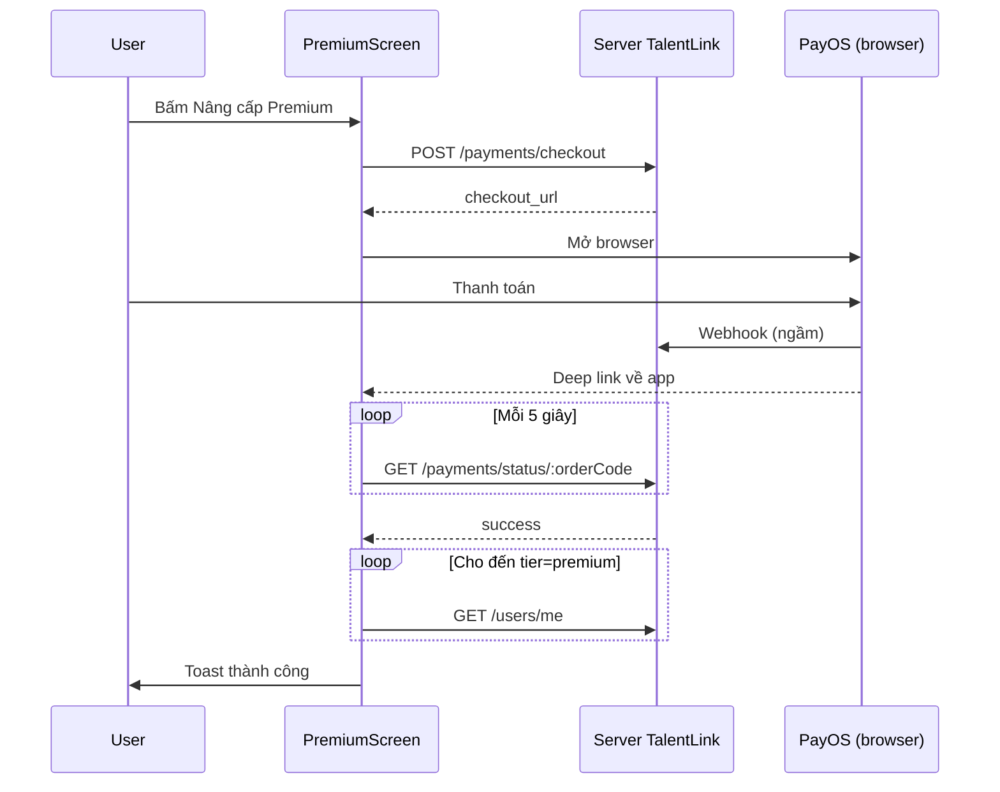

# Feature: Payments (Thanh toán Premium)

**Route:** `app/(payments)/premium`  
**Module:** `features/payments/`  
**Cổng thanh toán:** PayOS (Việt Nam)

---

## Payments là gì? (đọc phần này trước)

Feature này lo việc user **trả tiền để nâng cấp Premium** trên TalentLink.

| Gói hiện tại      | Giá       | Thời hạn |
| ----------------- | --------- | -------- |
| Soundspal Premium | 2.000 VND | 30 ngày  |

**Premium được quảng bá gồm:**

- Ứng tuyển job không giới hạn
- Bộ lọc tìm kiếm nâng cao
- Ưu tiên hiển thị hồ sơ

**Lưu ý:** App hiện chủ yếu **hiển thị** badge Premium; chưa chặn cứng tính năng free ở màn jobs/explore (backend mới là nơi quyết định quyền thật).

---

## Concept: Thanh toán trên app mobile hoạt động thế nào?

### Vì sao không nhập thẻ trong app?

App **không** tự làm form nhập số thẻ — vì:

- Xử lý thẻ cần chuẩn bảo mật cao (PCI).
- PayOS đã có trang thanh toán an toàn sẵn.

**Cách làm của TalentLink:**

```
App tạo "phiên thanh toán" → mở trình duyệt PayOS → user trả tiền ở đó
→ PayOS báo server TalentLink → app hỏi server "xong chưa?" → bật Premium
```

### Ba bên tham gia

| Bên                     | Vai trò                                                |
| ----------------------- | ------------------------------------------------------ |
| **App (PremiumScreen)** | Tạo phiên, mở PayOS, hiện trạng thái, poll kết quả     |
| **Server TalentLink**   | Tạo link PayOS, nhận webhook từ PayOS, đổi `tier` user |
| **PayOS**               | Trang web user chọn ví/Momo/ngân hàng và xác nhận      |

App **không** giữ tiền, **không** biết mật khẩu ngân hàng user.

### Các khái niệm cần biết

| Thuật ngữ        | Giải thích đơn giản                                            |
| ---------------- | -------------------------------------------------------------- |
| **Checkout**     | Tạo một lần thanh toán — server trả về `checkout_url`          |
| **checkout_url** | Link mở PayOS trong browser                                    |
| **orderCode**    | Mã đơn PayOS (chỉ số, vd `123456789`) — dùng để hỏi trạng thái |
| **Deep link**    | Link dạng `soundspal://...` — PayOS xong thì mở lại app        |
| **Poll**         | App hỏi server **mỗi 5 giây**: "Đơn này paid chưa?"            |
| **tier**         | `free` hoặc `premium` — field trên user sau khi trả tiền       |
| **Webhook**      | PayOS gọi server backend (app không thấy trực tiếp)            |

### Ví dụ đời thường

1. Bạn vào quầy vé (**app**) — "Tôi muốn mua vé VIP".
2. Nhân viên in phiếu có mã QR (**checkout_url** + **orderCode**).
3. Bạn sang máy PayOS (**browser**) quét và trả tiền.
4. Bạn quay lại quầy (**deep link** về app).
5. Nhân viên hỏi hệ thống 5 giây/lần (**poll**) đến khi thấy "đã thanh toán".
6. Cổng mở cho bạn vào khu VIP (**tier = premium**).

---

## Luồng user từng bước

### Bước 1 — Vào màn Premium

```
Tab Cá nhân (PersonalScreen) → bấm "Premium"
  → /(payments)/premium → PremiumScreen
```

### Bước 2 — Bấm "Nâng cấp Premium"

```
1. Kiểm tra đã login (cần user.id)
2. buildPremiumUpgradeCheckoutRequest() — gói thông tin gửi server
3. POST /payments/checkout
4. Server trả checkout_url
5. Linking.openURL(checkout_url) — mở Safari/Chrome PayOS
```

**Payload gửi server** (`domain/constants/payment.ts`):

```typescript
{
  purpose: 'ACCOUNT_UPGRADE',      // Loại: nâng cấp tài khoản
  reference_id: userId,            // User nào trả tiền
  amount: 2000,                    // VND
  description: 'Soundspal Premium 30 days',
  redirect_url: 'soundspal://...', // PayOS xong → mở lại app (thành công)
  cancel_url: 'soundspal://...',   // User hủy → cũng về app
}
```

`redirect_url` / `cancel_url` tạo bằng `ExpoLinking.createURL('/(payments)/premium')`.

### Bước 3 — User thanh toán trên PayOS

App **chờ** — user ở browser, app có thể vào background.

### Bước 4 — Quay lại app (deep link)

PayOS redirect về URL kiểu:

```
soundspal:///(payments)/premium?orderCode=123456789&status=PAID
```

App bắt link bằng:

- `Linking.getInitialURL()` — mở app từ link
- `Linking.addEventListener('url', ...)` — app đang chạy nhận link

`parsePayOSReturnUrl()` đọc `orderCode` và `status` từ URL.

### Bước 5 — Poll trạng thái (hỏi server liên tục)

Vì webhook PayOS → backend có thể **chậm vài giây**, app không tin URL một lần — **poll**:

```
GET /payments/status/:orderCode   — mỗi 5 giây
```

Trạng thái chuẩn hóa (`normalizePaymentStatus`):

| Status      | Ý nghĩa    | App làm gì                 |
| ----------- | ---------- | -------------------------- |
| `pending`   | Chưa xong  | Tiếp tục poll              |
| `success`   | Thành công | Toast + refresh user       |
| `failed`    | Thất bại   | Báo lỗi, cho tạo phiên mới |
| `cancelled` | User hủy   | Báo đã hủy                 |

Khi `success` / `failed` / `cancelled` → **dừng poll** (terminal status).

### Bước 6 — Kích hoạt Premium trên tài khoản

Thanh toán success **chưa chắc** `tier` đổi ngay — backend xử lý async.

App thêm vòng poll user:

```
GET /users/me (useGetCurrentUser) — mỗi 5 giây
  → đợi đến khi tier === 'premium'
```

Đồng thời `queryClient.invalidateQueries(userKeys.current())` để cache profile mới.

### Gia hạn

User đã Premium → nút đổi thành **"Gia hạn Premium"** — **cùng flow**, chỉ khác chữ trên UI.

---

## Sơ đồ tổng thể



---

## Cấu trúc code

```
features/payments/
├── domain/
│   ├── constants/payment.ts       # Giá 2000, poll 5s
│   ├── entities/payment.type.ts   # CheckoutRequest, status...
│   ├── repositories/IPaymentRepository.ts
│   └── utils/payment.ts           # Parse URL, format VND, label tiếng Việt
├── data/
│   ├── datasources/paymentsRemoteDataSource.ts
│   └── repositories/PaymentRepositoryImpl.ts
└── presentation/
    ├── hooks/usePaymentApi.ts
    └── screens/PremiumScreen.tsx   # Toàn bộ UX thanh toán
```

**Route mỏng:** `app/(payments)/premium.tsx` → re-export `PremiumScreen`.

---

## API

| Method | Path                          | Khi nào gọi                                  |
| ------ | ----------------------------- | -------------------------------------------- |
| POST   | `/payments/checkout`          | User bấm nâng cấp — lấy `checkout_url`       |
| GET    | `/payments/status/:orderCode` | Poll sau khi có mã đơn                       |
| GET    | `/payments/history`           | Fallback tìm `orderCode` nếu deep link thiếu |

---

## Hooks chính (`usePaymentApi.ts`)

| Hook                                 | Loại     | Việc                            |
| ------------------------------------ | -------- | ------------------------------- |
| `useCreatePaymentCheckout`           | mutation | Tạo phiên → mở PayOS            |
| `useGetPaymentStatus`                | query    | Poll status theo orderCode      |
| `useGetPaymentHistory`               | query    | Lịch sử (ít dùng trên UI chính) |
| `buildPremiumUpgradeCheckoutRequest` | helper   | Ghép userId + deep link URLs    |

**404 khi poll status:** Order chưa sync kịp — retry tối đa **8 lần** (trong hook).

---

## Logic đặc biệt trong PremiumScreen

| Tình huống                      | Xử lý                                                   |
| ------------------------------- | ------------------------------------------------------- |
| Đã có checkout chưa xong        | Nút "Tiếp tục thanh toán" — mở lại URL cũ               |
| App từ background về foreground | Tự refetch status nếu chưa terminal                     |
| Deep link thiếu orderCode       | `resolvePaymentOrderCodeFromHistory` — lấy đơn mới nhất |
| orderCode không phải số         | Lỗi — PayOS chỉ dùng mã numeric                         |
| Chưa login                      | Không cho checkout                                      |
| Terminal success                | Toast + invalidate user cache                           |

---

## Webhook là gì? — Vì sao app phải poll 5 giây?

Phần này giải thích câu hỏi hay gặp nhất khi đọc code payment.

### Ba kênh thông tin sau khi user trả tiền PayOS

Khi bạn trả xong trên PayOS, **có 3 luồng** chạy **không cùng lúc**:

```
1. PayOS → mở lại APP (deep link)     "User đã quay về app rồi"
2. PayOS → gọi SERVER (webhook)       "Tiền đã vào, đơn #123 paid"
3. APP → hỏi SERVER (poll)            "Đơn #123 paid chưa?"
```

### Webhook là gì? (ví dụ đời thường)

**Webhook** = bên kia **chủ động gọi điện cho bạn** khi có việc xong, thay vì bạn gọi hỏi suốt.

| Cách                    | Ai chủ động?                            | Ví dụ                                           |
| ----------------------- | --------------------------------------- | ----------------------------------------------- |
| **Poll** (app đang làm) | App hỏi server: "Xong chưa? Xong chưa?" | Cứ 5 giây gọi `GET /payments/status/...`        |
| **Webhook**             | PayOS gọi server: "Đơn này đã trả tiền" | `POST` tới URL backend (app **không** tham gia) |

Tưởng tượng bạn đặt đồ ăn:

- **Deep link** = shipper gõ cửa nhà bạn ("Tôi tới rồi").
- **Webhook** = shipper gọi **quầy nhà hàng** báo "Khách đã nhận, chốt đơn".
- **Poll** = bạn mở app đặt món, **5 giây refresh** xem trạng thái "đang giao" → "đã giao".

**App mobile không nhận webhook từ PayOS** — chỉ **server TalentLink** nhận (URL backend, bí mật, PayOS cấu hình sẵn). App không thể nghe trực tiếp.

### Vì sao deep link chưa đủ?

User quay app qua link `?orderCode=123&status=PAID` — nhưng:

1. Link đôi khi **thiếu** status hoặc orderCode.
2. Backend có thể **chưa kịp** cập nhật DB khi user vừa quay (webhook đến trễ 1–3 giây).
3. App cần **một nguồn tin cậy** = hỏi server: `GET /payments/status/123`.

→ **Poll** = app tự hỏi server định kỳ cho đến khi có kết quả chắc chắn.

### Timeline thực tế (giây)

```
0s   User bấm "Thanh toán" trên PayOS
2s   PayOS báo thành công
2s   Deep link mở app          ← app biết user quay lại
2s   App bắt đầu poll...
3s   PayOS webhook tới server   ← server mới ghi "paid" vào DB
5s   App poll lần 1 → có thể vẫn "pending"
10s  App poll lần 2 → "success" ← UI hiện thành công
12s  Server đổi tier user → premium
15s  App poll /users/me → thấy tier=premium
```

Nếu **không poll**, app chỉ dựa deep link một lần → dễ kẹt màn "đang chờ" hoặc hiện Free dù đã trả tiền.

### Sao đúng 5 giây?

Constant `PAYMENT_STATUS_POLL_INTERVAL_MS = 5000` trong `payment.ts`:

| Nhanh hơn (1s)                                        | Chậm hơn (30s)          |
| ----------------------------------------------------- | ----------------------- |
| Nhiều request, tốn pin/mạng                           | User chờ lâu, tưởng lỗi |
| **5s** = cân bằng: đủ nhanh cho UX, không spam server |

Không phải số magic bắt buộc — có thể đổi trong constant.

### Hai lớp poll trong PremiumScreen

| Poll  | API                               | Mục đích                                                   |
| ----- | --------------------------------- | ---------------------------------------------------------- |
| **1** | `GET /payments/status/:orderCode` | Đơn PayOS đã paid chưa?                                    |
| **2** | `GET /users/me`                   | Tài khoản đã lên `premium` chưa? (sau khi payment success) |

Lớp 2 vì: thanh toán success ≠ tier đổi **ngay** — backend còn bước kích hoạt Premium sau webhook.

---

| Nơi                                 | Field                              |
| ----------------------------------- | ---------------------------------- |
| `authStore.user.tier`               | Sau login — cơ bản                 |
| `useGetCurrentUser()` → `/users/me` | Đầy đủ + `subscription_expires_at` |

Màn Premium đọc cả hai; ưu tiên `currentUser` từ API.

---

## Tại sao làm vậy? (không dùng cách khác?)

| Quyết định                       | Lý do đơn giản                                     |
| -------------------------------- | -------------------------------------------------- |
| PayOS thay vì nhập thẻ trong app | An toàn, đúng luật thanh toán VN                   |
| Mở browser thay WebView          | PayOS + ngân hàng tin browser hơn WebView nhúng    |
| Deep link quay app               | User không phải tự mở lại app                      |
| Poll status                      | App không nhận webhook trực tiếp — phải hỏi server |
| Poll `/users/me` sau success     | Backend đổi tier sau webhook — có độ trễ           |
| Không Apple/Google IAP           | Backend đã PayOS; IAP cần setup riêng từng store   |

---

## Phụ thuộc feature khác

| Feature          | Dùng để                                           |
| ---------------- | ------------------------------------------------- |
| **auth**         | `user.id` khi checkout, `tier` trong store        |
| **profiles**     | `useGetCurrentUser` — biết Premium đã active chưa |
| **expo-linking** | Tạo URL + lắng nghe quay lại app                  |

---

## Câu hỏi thường gặp

**H: App có trừ tiền trực tiếp không?**  
Không. App chỉ mở PayOS. Tiền đi qua PayOS → ngân hàng/ví.

**H: `orderCode` là gì?**  
Mã đơn do PayOS/backend cấp (dãy số). Dùng để hỏi `GET /payments/status/:orderCode`.

**H: Sao phải poll 5 giây một lần? Webhook là gì?**

**Webhook:** PayOS **gọi server** TalentLink báo "đơn đã trả tiền" — app **không** nghe được, chỉ server nhận.

**Poll:** App **hỏi server** mỗi 5 giây: "Đơn #123 paid chưa?" vì user quay app **trước khi** server chắc chắn đã xử lý xong webhook.

Không poll → UI dễ kẹt "đang chờ" dù PayOS đã thu tiền. Chi tiết + timeline: mục [Webhook là gì?](#webhook-là-gì--vì-sao-app-phải-poll-5-giây).

**H: Trả tiền xong mà vẫn hiện Free?**  
Đợi vài giây — app đang poll `/users/me` (lớp 2). Server cần thời gian sau webhook mới đổi `tier`. Nếu quá lâu: lỗi phía server xử lý PayOS.

**H: Khác In-App Purchase (Apple/Google) thế nào?**  
IAP: trả qua App Store/Play, Apple/Google giữ % commission. PayOS: phù hợp VN, backend đã tích hợp, mở browser.

**H: Premium có chặn apply job trên app không?**  
Hiện **chưa** chặn ở code client jobs/explore — chủ yếu hiển thị + backend quyền.

---

## Gặp lỗi — mở file nào?

| Triệu chứng          | File                                                       |
| -------------------- | ---------------------------------------------------------- |
| Không mở được PayOS  | `PremiumScreen.tsx` → `openCheckoutUrl`                    |
| Không nhận deep link | `PremiumScreen` — `Linking.addEventListener`               |
| Poll mãi pending     | `useGetPaymentStatus` — server chưa nhận/cập nhật từ PayOS |
| Tier không đổi       | `useGetCurrentUser`, backend `/users/me`                   |
| Sai mã đơn           | `payment.ts` utils → `normalizePayOSOrderCode`             |
