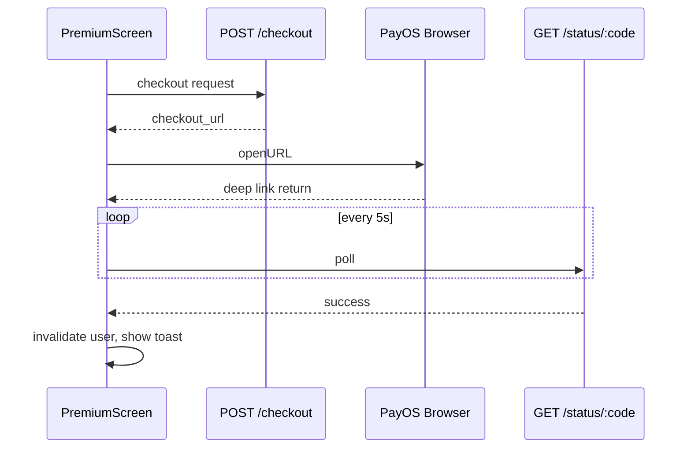

# Feature: Payments (Thanh toán Premium)

**Route:** `app/(payments)/premium`  
**Module:** `features/payments/`  
**Gateway:** PayOS — checkout URL mở browser, deep link quay lại app.

---

## 1. Mục đích nghiệp vụ

Nâng cấp tài khoản **Premium**:

| Benefit (UI copy)       | Mô tả marketing          |
| ----------------------- | ------------------------ |
| Unlimited applications  | Apply job không giới hạn |
| Advanced search filters | Filter nâng cao explore  |
| Profile priority        | Ưu tiên hiển thị         |

**Gói hiện tại:** 2.000 VND / 30 ngày (`PREMIUM_UPGRADE_PAYMENT` constant).

**Lưu ý:** Client **chưa enforce** premium gates trong jobs/explore — tier chủ yếu display + backend.

---

## 2. Luồng nghiệp vụ

### 2.1 Mua Premium

```
PersonalScreen → "Premium" → PremiumScreen
  → buildPremiumUpgradeCheckoutRequest(userId, redirectUrl, cancelUrl)
  → useCreatePaymentCheckout()
  → POST /payments/checkout
  → Response: checkout_url
  → Linking.openURL(checkout_url) — mở PayOS browser
```

### 2.2 Quay lại app (deep link)

```
PayOS redirect → soundspal:///(payments)/premium?orderCode=&status=
  → parsePayOSReturnUrl()
  → useGetPaymentStatus(orderCode) — poll mỗi 5s
  → Terminal: success | failed | cancelled → stop poll
  → Success: toast + invalidate userKeys.current()
  → Poll /users/me until tier === 'premium'
```

### 2.3 Gia hạn

User đã premium → CTA đổi thành **"Gia hạn Premium"** — cùng checkout flow.

### 2.4 Lịch sử thanh toán

```
useGetPaymentHistory()
  → GET /payments/history?limit&offset
  → Hiển thị list + resolve orderCode nếu URL thiếu
```

---

## 3. Cấu trúc code

```
features/payments/
├── domain/
│   ├── constants/payment.ts       # PREMIUM_UPGRADE_PAYMENT
│   ├── entities/payment.type.ts
│   ├── repositories/IPaymentRepository.ts
│   └── utils/payment.ts           # Parse URL, format VND, errors
├── data/
│   ├── datasources/paymentsRemoteDataSource.ts
│   └── repositories/PaymentRepositoryImpl.ts
└── presentation/
    ├── hooks/usePaymentApi.ts
    └── screens/PremiumScreen.tsx
```

---

## 4. API endpoints

| Method | Path                          | Mục đích          |
| ------ | ----------------------------- | ----------------- |
| POST   | `/payments/checkout`          | Tạo PayOS session |
| GET    | `/payments/history`           | Lịch sử           |
| GET    | `/payments/status/:orderCode` | Poll trạng thái   |

---

## 5. Checkout payload

**File:** `domain/constants/payment.ts`

```typescript
{
  purpose: 'ACCOUNT_UPGRADE',
  reference_id: userId,        // string user id
  amount: 2000,                  // VND
  description: 'Soundspal Premium 30 days',
  redirect_url: '...',           // deep link success
  cancel_url: '...'              // deep link cancel
}
```

`buildPremiumUpgradeCheckoutRequest()` trong `usePaymentApi.ts` assemble payload + URLs.

---

## 6. Payment utils

**File:** `domain/utils/payment.ts`

| Hàm                                  | Mục đích                               |
| ------------------------------------ | -------------------------------------- |
| `parsePayOSReturnUrl(url)`           | Extract orderCode, status từ deep link |
| `normalizePaymentStatus(raw)`        | Map backend status → UI enum           |
| `formatVnd(amount)`                  | Hiển thị tiền                          |
| `resolvePaymentOrderCodeFromHistory` | Fallback khi URL thiếu code            |
| `getPaymentErrorMessage`             | User-friendly errors                   |

**Order code rule:** Phải numeric `/^\d+$/` — PayOS order code format.

---

## 7. Polling logic (PremiumScreen)

| Config          | Giá trị                                             |
| --------------- | --------------------------------------------------- |
| Poll interval   | 5 giây                                              |
| 404 retry       | Tối đa 8 lần (order chưa sync)                      |
| Terminal status | `success`, `failed`, `cancelled`                    |
| App foreground  | Refetch status khi app active lại                   |
| Premium sync    | Poll `useGetCurrentUser` until `tier === 'premium'` |

---

## 8. Business rules

| Rule                 | Chi tiết                                    |
| -------------------- | ------------------------------------------- |
| Auth required        | Checkout cần `user.id`                      |
| Tier detection       | `authStore.user.tier` hoặc `/users/me`      |
| Expiry display       | `subscription_expires_at` hoặc `expires_at` |
| Renew vs upgrade     | Same flow — UI text khác                    |
| Benefits enforcement | **Chưa** client-side trong jobs/explore     |

---

## 9. Phụ thuộc

| Hướng               | Chi tiết                                  |
| ------------------- | ----------------------------------------- |
| payments → auth     | `user.id`, `tier`                         |
| payments → profiles | `useGetCurrentUser`, entry PersonalScreen |
| expo-linking        | Open PayOS + listen deep link return      |

---

## 10. Tại sao triển khai như vậy?

| Quyết định               | Lý do                                                         |
| ------------------------ | ------------------------------------------------------------- |
| PayOS browser checkout   | PCI compliance — không nhập thẻ trong WebView app             |
| Deep link return         | Expo standard — `Linking.addEventListener`                    |
| Poll status              | Webhook không reliable trên mobile — client poll đến terminal |
| Poll user tier           | Backend upgrade async sau payment success                     |
| Constant amount 2000 VND | Dev/test pricing — production config qua backend sau          |

---

## 11. Sơ đồ thanh toán



---

## 12. Câu hỏi thường gặp

**H: Tại sao không dùng In-App Purchase Apple/Google?**  
T: PayOS phù hợp thị trường VN + backend đã tích hợp; IAP cần setup riêng từng store.

**H: Premium có được enforce không?**  
T: Hiện chủ yếu backend + UI badge. Client gates (limit apply, lock filter) cần implement thêm.

**H: orderCode từ đâu nếu deep link thiếu?**  
T: `resolvePaymentOrderCodeFromHistory` — lấy entry mới nhất trong payment history.

---

## 13. Debug

| Triệu chứng        | File                                      |
| ------------------ | ----------------------------------------- |
| Checkout không mở  | `PremiumScreen` Linking.openURL           |
| Stuck polling      | `parsePayOSReturnUrl`, status endpoint    |
| Tier không update  | Poll `useGetCurrentUser`, backend webhook |
| Invalid order code | Regex numeric check trong utils           |
