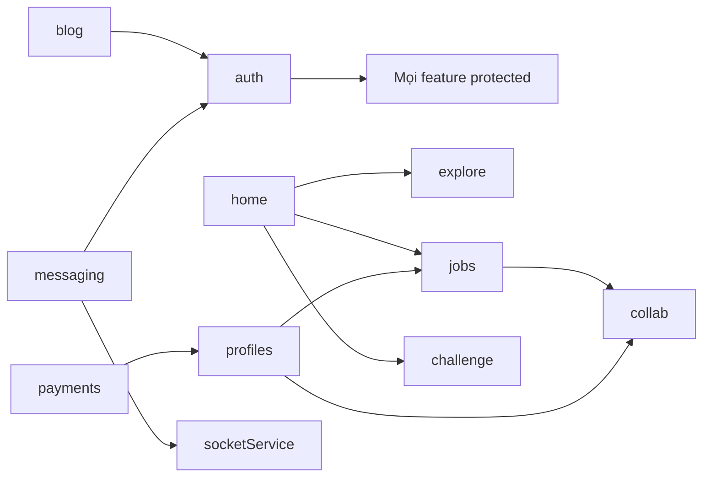

# TalentLink Mobile — Hướng dẫn onboarding

> Tài liệu tổng quan cho dev mới vào dự án.  
> Đọc kèm [architecture.md](./architecture.md) để xem sơ đồ tổng thể.

**Tài liệu chi tiết từng feature:** [features/README.md](./features/README.md)

---

## Mục lục

1. [App là gì? Đối tượng người dùng](#1-app-là-gì-đối-tượng-người-dùng)
2. [Nắm source trong 15 phút](#2-nắm-source-trong-15-phút)
3. [Stack công nghệ & lý do chọn](#3-stack-công-nghệ--lý-do-chọn)
4. [Kiến trúc Clean Architecture](#4-kiến-trúc-clean-architecture)
5. [Từng chức năng chi tiết](#5-từng-chức-năng-chi-tiết)
6. [Luồng xuyên suốt (end-to-end)](#6-luồng-xuyên-suốt-end-to-end)
7. [Câu hỏi thường gặp](#7-câu-hỏi-thường-gặp)
8. [Tóm tắt nhanh](#8-tóm-tắt-nhanh)

---

## 1. App là gì? Đối tượng người dùng

**TalentLink** là nền tảng kết nối tài năng âm nhạc với cơ hội việc làm và cộng đồng sáng tạo.

| Vai trò              | Làm gì trên app                                            |
| -------------------- | ---------------------------------------------------------- |
| **Ca sĩ / Producer** | Tạo profile, apply job, tham gia beat challenge, đăng blog |
| **Venue (địa điểm)** | Đăng tuyển, quản lý profile venue                          |
| **Người dùng chung** | Khám phá talent, nhắn tin, bookmark blog, nâng cấp Premium |

Backend: `https://talentlink.io.vn/api/v1`  
Realtime: Socket.IO tại `https://talentlink.io.vn`

---

## 2. Nắm source trong 15 phút

### Thứ tự đọc (quan trọng nhất trước)

```
1. app/_layout.tsx              → Root: QueryClient, auth guard, theme
2. shared/infrastructure/api/   → apiClient + refresh token
3. features/auth/               → Login, JWT, MMKV persist
4. features/jobs/               → Feature mẫu đủ 3 layer
5. app/(tabs)/_layout.tsx       → 5 tab chính
6. docs/architecture.md         → Sơ đồ tổng
```

### Quy tắc tìm code

| Muốn sửa gì            | Vào đâu                                                                |
| ---------------------- | ---------------------------------------------------------------------- |
| Màn hình / route       | `app/(nhóm)/tên.tsx` → re-export từ `features/*/presentation/screens/` |
| UI component           | `features/{tên}/presentation/components/`                              |
| Gọi API                | `features/{tên}/data/datasources/`                                     |
| React Query hook       | `features/{tên}/presentation/hooks/`                                   |
| Type dữ liệu           | `features/{tên}/domain/entities/`                                      |
| Nút dùng chung, header | `shared/presentation/ui/`                                              |

### 5 tab chính (`app/(tabs)/`)

| Tab           | Screen                | Feature                        |
| ------------- | --------------------- | ------------------------------ |
| Home          | `HomeScreen`          | `home` + data từ `explore`     |
| Explore       | `ExploreScreen`       | `explore` — tìm user theo role |
| Jobs          | `JobsTabScreen`       | `jobs`                         |
| Notifications | `NotificationsScreen` | `messaging`                    |
| Personal      | `PersonalScreen`      | `profiles`                     |

---

## 3. Stack công nghệ & lý do chọn

### Tổng quan

| Layer        | Công nghệ                  | Vai trò                                |
| ------------ | -------------------------- | -------------------------------------- |
| Framework    | **React Native + Expo 54** | Cross-platform iOS/Android             |
| Routing      | **Expo Router**            | File-based routing, deep link          |
| UI           | **NativeWind (Tailwind)**  | Style nhanh, đồng bộ design            |
| Server state | **TanStack React Query**   | Cache API, refetch, mutation           |
| Client state | **Zustand**                | Auth, theme, audio player              |
| HTTP         | **Axios**                  | Interceptor refresh token              |
| Storage      | **MMKV**                   | Lưu token nhanh, sync                  |
| Realtime     | **Socket.IO**              | Chat, typing indicator                 |
| Form         | **React Hook Form + Zod**  | Validate form auth/profile             |
| Build        | **EAS**                    | Build cloud, không cần Mac cho Android |

---

### Tại sao React Native + Expo?

**Câu hỏi sếp/hội đồng:** _"Sao không làm Flutter hay native thuần?"_

**Trả lời mẫu:**

> Team chọn **Expo + React Native** vì:
>
> 1. **Một codebase** cho iOS và Android — phù hợp MVP với team nhỏ.
> 2. **Expo** giảm chi phí setup native (không cần Xcode/Android Studio ngay từ đầu), có EAS Build để CI/CD.
> 3. Backend và team đã quen **TypeScript** — stack thống nhất với web.
> 4. Expo Router cho **deep linking** sẵn (blog detail, job detail qua URL).
>
> **Trade-off:** Performance native thuần tốt hơn ở animation nặng; app TalentLink chủ yếu list/form/media — RN đủ dùng.

**Không chọn Flutter vì:** team skill TS/React; ecosystem npm lớn; chia sẻ logic với web sau này dễ hơn.

**Không chọn Ionic/Capacitor vì:** UX mobile native (gesture, keyboard) kém hơn RN cho app social/media.

---

### Kịch bản: Tại sao TanStack React Query thay vì Redux Toolkit Query / chỉ useEffect?

**Trả lời mẫu:**

> Hầu hết state trong app là **server state** (danh sách job, blog, profile) — không phải global UI state.
>
> React Query cung cấp:
>
> - **Cache tự động** — quay lại màn Jobs không gọi API lại ngay
> - **staleTime / gcTime** — kiểm soát freshness
> - **invalidateQueries** sau mutation — apply job xong tự refresh list
> - **loading / error** chuẩn, ít boilerplate hơn Redux
>
> **Zustand** chỉ giữ state **client-only**: token, theme, audio đang phát — tách bạch với server state.

---

### Kịch bản: Tại sao Zustand thay vì Redux / Context?

**Trả lời mẫu:**

> Auth store cần **persist MMKV** + đọc ngoài React (axios interceptor). Zustand:
>
> - API đơn giản, ít code
> - Middleware `persist` tích hợp MMKV
> - `useAuthStore.getState()` gọi được trong `apiClient` interceptor
>
> Redux hợp app lớn nhiều slice phức tạp; app này ~7 store nhỏ — Zustand đủ và dễ maintain.

---

### Kịch bản: Tại sao MMKV thay vì AsyncStorage?

**Trả lời mẫu:**

> Token auth cần đọc **đồng bộ** khi app khởi động (rehydrate trước khi render). MMKV:
>
> - Nhanh hơn AsyncStorage (mmap)
> - Hỗ trợ sync read — tránh flash màn login khi user đã đăng nhập
>
> `useAuthHydration` đợi MMKV rehydrate xong mới chạy `useProtectedRoute` — tránh redirect sai.

---

### Kịch bản: Tại sao Clean Architecture / feature-based?

**Trả lời mẫu:**

> Ban đầu code theo layer (`components/`, `hooks/`, `types/` chung). Khi thêm feature (challenge, blog) code **scatter**, khó onboard dev mới.
>
> Refactor sang **feature modules** (`features/jobs/`, `features/blog/`):
>
> - Mỗi feature có `domain / data / presentation` — sửa Jobs không đụng Blog
> - Dễ test domain (use case) tách khỏi UI
> - Chuẩn bị port logic sang **KMP SDK** sau (domain layer dùng chung)
>
> **Không dùng full Clean Arch mọi API** — chỉ thêm UseCase khi có business rule (vd: `LoginUseCase`, `SubmitJobApplicationUseCase`).

---

## 4. Kiến trúc Clean Architecture

### Một request đi qua đâu? (ví dụ: lấy danh sách job)

```
Screen (JobsTabScreen)
  → useGetJobs()                    [presentation/hooks]
  → GetJobsUseCase.execute()        [domain/usecases]  ← optional
  → jobRepository.getJobs()         [data/repository]
  → jobRemoteDataSource.getJobs()   [data/datasource]
  → apiClient GET /posts            [shared/infrastructure]
```

### Ba layer — nhớ 1 câu

| Layer            | Câu hỏi trả lời            | Không được import                        |
| ---------------- | -------------------------- | ---------------------------------------- |
| **domain**       | "Quy tắc nghiệp vụ là gì?" | React, Axios, Expo                       |
| **data**         | "Lấy/lưu data từ đâu?"     | React components                         |
| **presentation** | "User thấy gì?"            | Gọi axios trực tiếp (nên qua repository) |

### `app/` chỉ là routing

```tsx
// app/(jobs)/detail.tsx — 1 dòng
export { default } from '@/features/jobs/presentation/screens/JobDetailScreen';
```

**Lý do:** Tách routing khỏi UI để đổi navigator (Expo Router → khác) mà không đụng business logic.

---

## 5. Từng chức năng chi tiết

---

### 5.1 Auth — Đăng nhập, đăng ký, OAuth

**Mục đích:** Xác thực user, quản lý JWT access/refresh token, bảo vệ route.

**File quan trọng:**

| File                                                     | Vai trò                                        |
| -------------------------------------------------------- | ---------------------------------------------- |
| `features/auth/presentation/screens/LoginScreen.tsx`     | UI đăng nhập                                   |
| `features/auth/presentation/hooks/useAuthApi.ts`         | `useLogin`, `useSignup`, OAuth hooks           |
| `features/auth/domain/usecases/LoginUseCase.ts`          | Validate identifier/password trước khi gọi API |
| `features/auth/data/datasources/authRemoteDataSource.ts` | POST `/auth/login`, `/auth/signup`...          |
| `features/auth/presentation/store/authStore.ts`          | Lưu token + user, persist MMKV                 |
| `shared/infrastructure/api/apiClient.ts`                 | Gắn Bearer token, auto refresh 401             |
| `shared/presentation/hooks/useProtectedRoute.ts`         | Redirect login / verify email                  |
| `shared/utils/jwt.ts`                                    | Decode JWT lấy user info                       |

**Luồng đăng nhập:**

```
User nhập email/password
  → useLogin().mutate()
  → LoginUseCase.execute()
  → authRepository.login()
  → API trả access_token + refresh_token
  → getUserFromToken(access_token)
  → authStore.setCredentials()
  → queryClient.clear() (xóa cache user cũ)
  → useProtectedRoute redirect → /(tabs)
```

**Luồng refresh token (quan trọng — hay bị hỏi):**

```
API trả 401
  → apiClient interceptor bắt
  → isRefreshing? → xếp hàng request (failedQueue)
  → POST /auth/refresh với refresh_token
  → Cập nhật authStore
  → Retry request gốc
  → FormData upload: KHÔNG retry (body đã consume) → báo lỗi rõ ràng
```

**Giải thích:**

| Câu hỏi                              | Trả lời                                                                                              |
| ------------------------------------ | ---------------------------------------------------------------------------------------------------- |
| Sao dùng JWT thay vì session cookie? | Mobile app không quản lý cookie như browser; JWT trong header `Authorization` chuẩn cho REST mobile. |
| Refresh token lưu đâu?               | MMKV qua Zustand persist — encrypted storage có thể thêm sau (Keychain/Keystore).                    |
| OAuth Google?                        | `useGoogleSignIn` → `mobileOAuth` API → nếu chưa đăng ký → `CompleteOAuthProfileScreen`.             |
| Email chưa verify?                   | `useProtectedRoute` chặn vào app, redirect `email-verification-required`.                            |

---

### 5.2 Home — Trang chủ

**Mục đích:** Hub giới thiệu — featured artists + featured jobs, shortcut sang Explore/Challenge/Blog.

**File quan trọng:**

| File                                                  | Vai trò                               |
| ----------------------------------------------------- | ------------------------------------- |
| `features/home/presentation/screens/HomeScreen.tsx`   | UI chính                              |
| `features/home/presentation/components/`              | `ArtistCard`, `JobCard`               |
| `features/explore/presentation/hooks/useSearchApi.ts` | `useFeaturedUsers`, `useFeaturedJobs` |

**Luồng:**

```
HomeScreen mount
  → useFeaturedUsers(10) + useFeaturedJobs(10)
  → GET /landing/featured-users, /landing/featured-jobs
  → Transform API shape → ArtistItem / JobItem cho card
```

**Giải thích:**

| Câu hỏi                      | Trả lời                                                                                  |
| ---------------------------- | ---------------------------------------------------------------------------------------- |
| Home không có `data/` layer? | Home chỉ aggregate data từ Explore API — không có API riêng; tránh duplicate repository. |
| Skeleton loading?            | `ArtistCardSkeleton`, `JobCardSkeleton` khi `isLoading` — UX tốt hơn spinner trống.      |

---

### 5.3 Explore — Tìm kiếm talent

**Mục đích:** Tìm ca sĩ, producer, venue theo filter; entry point sang Blog.

**File quan trọng:**

| File                                                          | Vai trò                              |
| ------------------------------------------------------------- | ------------------------------------ |
| `features/explore/presentation/screens/ExploreScreen.tsx`     | UI + filter chips                    |
| `features/explore/presentation/hooks/useSearchApi.ts`         | `useSearchUsers`, `useGetGenres`     |
| `features/explore/presentation/store/searchStore.ts`          | Filter state (role, genre, location) |
| `features/explore/data/datasources/searchRemoteDataSource.ts` | POST `/search/users`                 |

**Giải thích:**

| Câu hỏi                            | Trả lời                                                                            |
| ---------------------------------- | ---------------------------------------------------------------------------------- |
| Filter lưu Zustand hay URL params? | `searchStore` (client state) — user đổi tab không mất filter; có thể sync URL sau. |
| POST thay vì GET cho search?       | Backend thiết kế body phức tạp (nhiều filter); mobile follow API backend.          |

---

### 5.4 Jobs — Tuyển dụng / Ứng tuyển

**Mục đích:** Đăng tin tuyển, xem chi tiết, apply, quản lý bài đăng của mình.

**File quan trọng (feature mẫu Clean Architecture):**

| File                                                           | Vai trò                 |
| -------------------------------------------------------------- | ----------------------- |
| `features/jobs/presentation/screens/JobsTabScreen.tsx`         | Danh sách job           |
| `features/jobs/presentation/screens/JobDetailScreen.tsx`       | Chi tiết + apply        |
| `features/jobs/presentation/screens/RecruitmentFormScreen.tsx` | Tạo job mới             |
| `features/jobs/presentation/hooks/useJobApi.ts`                | React Query hooks       |
| `features/jobs/domain/usecases/GetJobsUseCase.ts`              | Use case list           |
| `features/jobs/domain/usecases/SubmitJobApplicationUseCase.ts` | Validate trước apply    |
| `features/jobs/data/datasources/jobRemoteDataSource.ts`        | CRUD `/posts`           |
| `features/jobs/domain/utils/jobFormatters.ts`                  | Format salary, deadline |

**Luồng apply job:**

```
JobDetailScreen → JobApplyModal
  → useSubmitJobApplication().mutate({ jobId, body })
  → SubmitJobApplicationUseCase (check jobId không rỗng)
  → POST /posts/{id}/submit
  → invalidateQueries job detail + mySubmissions
```

**Giải thích:**

| Câu hỏi                                               | Trả lời                                                                                    |
| ----------------------------------------------------- | ------------------------------------------------------------------------------------------ |
| Tại sao có UseCase cho Apply mà không có cho GetList? | Apply có **business rule** (validate input); GetList chỉ proxy API — không cần class thừa. |
| API gọi `/posts` không phải `/jobs`?                  | Backend naming legacy — mobile map domain `Job` trong entity, endpoint giữ nguyên.         |

---

### 5.5 Profiles — Hồ sơ cá nhân

**Mục đích:** Xem/sửa profile artist/venue, gallery media/video, edit profile form.

**File quan trọng:**

| File                                                             | Vai trò                    |
| ---------------------------------------------------------------- | -------------------------- |
| `features/profiles/presentation/screens/PersonalScreen.tsx`      | Tab "Cá nhân"              |
| `features/profiles/presentation/screens/ArtistProfileScreen.tsx` | Profile công khai          |
| `features/profiles/presentation/screens/EditProfileScreen.tsx`   | Sửa thông tin              |
| `features/profiles/presentation/hooks/useUserApi.ts`             | User CRUD hooks            |
| `features/profiles/data/datasources/userRemoteDataSource.ts`     | `/users/me`, upload avatar |
| `features/profiles/presentation/components/editprofile/`         | Form từng section          |

**Sub-flows:**

- **Media gallery:** `MediaGalleryScreen` + `useMediaApi`
- **Upload file:** `useStorageApi` → POST `/storage/upload`
- **Venue:** `VenueEditProfileScreen` — API riêng `updateVenueBasic/Contact/Additional`

**Giải thích:**

| Câu hỏi                  | Trả lời                                                                     |
| ------------------------ | --------------------------------------------------------------------------- |
| Upload ảnh qua FormData? | Chuẩn multipart mobile; axios set boundary tự động.                         |
| Profile tách khỏi Auth?  | Auth = session/token; Profile = business data user — tách feature dễ scale. |

---

### 5.6 Messaging — Chat & thông báo

**Mục đích:** Danh sách hội thoại, chat realtime, màn Notifications.

**File quan trọng:**

| File                                                               | Vai trò                    |
| ------------------------------------------------------------------ | -------------------------- |
| `features/messaging/presentation/screens/DetailMessageScreen.tsx`  | Chat UI                    |
| `features/messaging/presentation/screens/ContactMessageScreen.tsx` | Danh sách contact          |
| `features/messaging/presentation/screens/NotificationsScreen.tsx`  | Tab thông báo              |
| `features/messaging/presentation/hooks/useMessagingApi.ts`         | REST: gửi/sửa/xóa tin      |
| `features/messaging/presentation/store/messagingStore.ts`          | Typing, optimistic UI      |
| `shared/infrastructure/socket/socketService.ts`                    | Socket.IO connect, events  |
| `shared/presentation/providers/SocketProvider.tsx`                 | Wrap app, connect khi auth |

**Luồng realtime:**

```
User login → SocketProvider connect
  → io('talentlink.io.vn', { auth: { token } })
  → on('new_message') → cập nhật store + invalidate React Query
  → TypingIndicator qua event typing
```

**Giải thích:**

| Câu hỏi                    | Trả lời                                                                                          |
| -------------------------- | ------------------------------------------------------------------------------------------------ |
| REST + WebSocket cùng lúc? | REST đảm bảo message persist; Socket cho **realtime push** — pattern phổ biến (WhatsApp, Slack). |
| Sao không chỉ dùng Socket? | Mất tin khi offline; REST load history khi mở conversation.                                      |
| Socket reconnect?          | `maxReconnectAttempts = 5`, refresh token 1 lần nếu auth fail.                                   |

---

### 5.7 Challenge — Beat challenge & Leaderboard

**Mục đích:** Producer đăng beat, ca sĩ record entry, bình chọn, xem leaderboard.

**File quan trọng:**

| File                                                                 | Vai trò             |
| -------------------------------------------------------------------- | ------------------- |
| `features/challenge/presentation/screens/ChallengeExploreScreen.tsx` | Duyệt beats         |
| `features/challenge/presentation/screens/RecordScreen.tsx`           | Thu âm entry        |
| `features/challenge/presentation/screens/LeaderboardScreen.tsx`      | Bảng xếp hạng       |
| `features/challenge/presentation/screens/MyContentScreen.tsx`        | Beat/entry của tôi  |
| `features/challenge/presentation/components/recordStudio/`           | Waveform, studio UI |
| `features/challenge/presentation/store/audioStore.ts`                | Mini player state   |
| `features/challenge/data/datasources/challengeRemoteDataSource.ts`   | `/beats/*` API      |

**Luồng submit entry:**

```
RecordScreen → thu âm → FormData (audio file)
  → challengeRepository.submitEntry(beatId, formData)
  → POST /beats/{id}/entries (multipart)
```

**Giải thích:**

| Câu hỏi                   | Trả lời                                                                                    |
| ------------------------- | ------------------------------------------------------------------------------------------ |
| Audio state dùng Zustand? | Player chạy cross-screen (mini player) — cần global client state, không phải server cache. |
| expo-av cho record?       | Expo module ổn định, không cần link native module thủ công.                                |
| Vote up/down?             | API `voteEntry` / `removeVote` — gọi trực tiếp từ `RankList`, `Podium` components.         |

---

### 5.8 Blog — Bài viết & cộng đồng

**Mục đích:** Đọc/viết blog, comment, bookmark, upload ảnh bài viết.

**File quan trọng:**

| File                                                        | Vai trò                           |
| ----------------------------------------------------------- | --------------------------------- |
| `features/blog/presentation/screens/BlogIndexScreen.tsx`    | Feed + tab + search               |
| `features/blog/presentation/screens/BlogDetailScreen.tsx`   | Chi tiết + comments               |
| `features/blog/presentation/components/CreateBlogModal.tsx` | Tạo bài (draft → publish → media) |
| `features/blog/data/datasources/blogRemoteDataSource.ts`    | Toàn bộ blog API                  |
| `features/blog/data/mappers/blogPostMapper.ts`              | API shape → `BlogPost` UI         |
| `features/blog/domain/usecases/AddBlogPostMediaUseCase.ts`  | Validate upload                   |
| `features/blog/data/utils/blogMediaUtils.ts`                | Upload qua `fetch` (Android fix)  |

**Luồng tạo blog:**

```
CreateBlogModal
  1. createBlogPost()        → POST /blogs (draft)
  2. addBlogPostMedia()      → fetch POST /storage/upload → POST /blogs/{id}/media
  3. publishBlogPost()       → PATCH /blogs/{id}/publish
```

**Giải thích kỹ thuật:**

| Câu hỏi                            | Trả lời                                                                                                                                         |
| ---------------------------------- | ----------------------------------------------------------------------------------------------------------------------------------------------- |
| Upload dùng `fetch` thay vì axios? | **React Native Android:** axios multipart sau 401 refresh dễ `ERR_NETWORK` vì FormData consume một lần. `fetch` ổn định hơn cho storage upload. |
| Mapper tách riêng?                 | API trả `BlogItem`, UI cần `BlogPost` (thumbnail, publishedAt label) — mapper tách khỏi hook, dễ test.                                          |
| Không có GET /blogs/:id?           | `useBlogArticle` lấy từ cache feed rồi `find` by id — giảm API call; trade-off: bài không trong feed cần fetch riêng sau.                       |

---

### 5.9 Collab — Hợp tác / Submission

**Mục đích:** Quản lý đơn ứng tuyển job (submission), venue review accept/reject.

**File quan trọng:**

| File                                                              | Vai trò                                       |
| ----------------------------------------------------------------- | --------------------------------------------- |
| `features/collab/presentation/components/`                        | `CollabTabs`, `OpportunitySubmissionCard`     |
| `features/profiles/presentation/screens/JobSubmissionsScreen.tsx` | Submission của tôi                            |
| `features/profiles/presentation/screens/CollaborationScreen.tsx`  | Hub collab                                    |
| `features/collab/presentation/hooks/useCollabApi.ts`              | Submissions API                               |
| `features/collab/data/datasources/collabRemoteDataSource.ts`      | `/my-submissions`, `/submissions/{id}/review` |

**Giải thích:**

| Câu hỏi                           | Trả lời                                                                                       |
| --------------------------------- | --------------------------------------------------------------------------------------------- |
| Collab tách feature hay gộp Jobs? | Submission có lifecycle riêng (withdraw, review) — tách module; UI có thể nằm trong Profiles. |

---

### 5.10 Payments — Premium / PayOS

**Mục đích:** Nâng cấp tài khoản Premium qua cổng PayOS.

**File quan trọng:**

| File                                                       | Vai trò                     |
| ---------------------------------------------------------- | --------------------------- |
| `features/payments/presentation/screens/PremiumScreen.tsx` | UI thanh toán               |
| `features/payments/presentation/hooks/usePaymentApi.ts`    | Checkout + poll status      |
| `features/payments/domain/constants/payment.ts`            | Gói premium, interval poll  |
| `features/payments/domain/utils/payment.ts`                | Map status PayOS → UI label |

**Luồng thanh toán:**

```
PremiumScreen
  → useCreatePaymentCheckout() → POST /payments/checkout → checkout_url
  → Mở browser PayOS (Linking.openURL)
  → User quay lại app (deep link / AppState)
  → useGetPaymentStatus() poll đến khi PAID / CANCELLED
  → invalidate user profile (tier premium)
```

**Giải thích:**

| Câu hỏi                             | Trả lời                                                                                     |
| ----------------------------------- | ------------------------------------------------------------------------------------------- |
| Sao mở browser ngoài?               | PayOS yêu cầu web checkout — chuẩn mobile payment VN (MoMo, VNPay tương tự).                |
| Poll status thay vì webhook client? | Mobile không nhận webhook server-side; poll + AppState listener là pattern thực tế cho MVP. |

---

### 5.11 Shared — Hạ tầng dùng chung

| Module     | File                                             | Vai trò                    |
| ---------- | ------------------------------------------------ | -------------------------- |
| API        | `shared/infrastructure/api/apiClient.ts`         | Axios + refresh            |
| Cache      | `shared/infrastructure/api/queryClient.ts`       | React Query config         |
| Storage    | `shared/infrastructure/storage/mmkvStorage.ts`   | MMKV adapter               |
| Socket     | `shared/infrastructure/socket/socketService.ts`  | WebSocket                  |
| UI         | `shared/presentation/ui/`                        | Header, Modal, Chat bubble |
| Navigation | `shared/presentation/navigation/`                | Tab bar, wrapper           |
| Theme      | `shared/presentation/store/themeStore.ts`        | Dark/light                 |
| Auth guard | `shared/presentation/hooks/useProtectedRoute.ts` | Route protection           |

---

## 6. Luồng xuyên suốt (end-to-end)

### Kịch bản demo cho hội đồng (5 phút)

```
1. Mở app → Home (featured artists/jobs)     [home + explore]
2. Explore → tìm ca sĩ → xem profile           [explore + profiles]
3. Jobs → xem tin → Apply                      [jobs + collab]
4. Challenge → nghe beat → xem leaderboard      [challenge]
5. Blog → đọc bài → comment                     [blog]
6. Messages → chat                              [messaging + socket]
7. Personal → Premium upgrade                   [payments]
```

### Sơ đồ phụ thuộc feature



---

## 7. Câu hỏi thường gặp

### Kiến trúc & thiết kế

**H: Em tách domain/data/presentation có phải over-engineering không?**  
T: Không — với ~250 file và 10 feature, cấu trúc cũ đã khó maintain. Chỉ thêm UseCase khi có rule nghiệp vụ; CRUD đơn giản dùng repository trực tiếp.

**H: Sao không dùng micro-frontend / monorepo?**  
T: Một app mobile một team — feature folder đủ; monorepo cần khi có thêm web app + SDK riêng package.

**H: Bảo mật token thế nào?**  
T: MMKV persist; HTTPS only; refresh token rotation; logout clear cache; có thể nâng cấp Keychain/Keystore.

### Kỹ thuật

**H: Xử lý offline?**  
T: React Query cache giữ data đã load; chưa có full offline-first (SQLite sync) — hướng phát triển.

**H: Test coverage?**  
T: 224 unit tests (components, hooks, utils); integration test gọi API thật (cần network).

**H: CI/CD?**  
T: Husky pre-commit (lint-staged), pre-push (eslint); EAS Build workflow trong `.github/workflows/`.

### Nghiệp vụ

**H: Phân biệt Job vs Collab vs Challenge?**  
T: **Job** = tuyển dụng dài hạn; **Collab** = quản lý đơn ứng tuyển; **Challenge** = cuộc thi beat ngắn hạn, vote & leaderboard.

**H: Premium cho quyền gì?**  
T: Theo `PREMIUM_UPGRADE_PAYMENT` constant — tier user trong JWT/profile; backend quyết định feature gate.

---

## 8. Tóm tắt nhanh

### Nhớ 10 đường dẫn

```
app/_layout.tsx                          → Root providers
shared/infrastructure/api/apiClient.ts     → HTTP + refresh token
features/auth/presentation/store/        → Token MMKV
shared/presentation/hooks/useProtectedRoute.ts → Auth guard
features/jobs/                           → Mẫu Clean Arch đủ 3 layer
features/blog/data/datasources/          → API phức tạp nhất
shared/infrastructure/socket/            → Realtime chat
features/challenge/presentation/store/audioStore.ts → Audio player
features/payments/presentation/screens/PremiumScreen.tsx → PayOS
docs/architecture.md                     → Sơ đồ tổng
```

### Công thức đánh giá lựa chọn kỹ thuật

```
1. Nêu yêu cầu (cross-platform / realtime / cache / team skill)
2. Nêu lựa chọn và lợi ích cụ thể trong project
3. Thừa nhận trade-off ngắn gọn
4. Nêu hướng nâng cấp nếu scale (optional)
```

---

## Phụ lục: Map route → screen

| Route                       | Screen file                                      |
| --------------------------- | ------------------------------------------------ |
| `/(tabs)/`                  | `features/home/.../HomeScreen.tsx`               |
| `/(tabs)/explore`           | `features/explore/.../ExploreScreen.tsx`         |
| `/(tabs)/jobs`              | `features/jobs/.../JobsTabScreen.tsx`            |
| `/(tabs)/personal`          | `features/profiles/.../PersonalScreen.tsx`       |
| `/(tabs)/notifications`     | `features/messaging/.../NotificationsScreen.tsx` |
| `/(auth)/login`             | `features/auth/.../LoginScreen.tsx`              |
| `/(jobs)/detail`            | `features/jobs/.../JobDetailScreen.tsx`          |
| `/(blog)/[id]`              | `features/blog/.../BlogDetailScreen.tsx`         |
| `/(challenge)/leaderboard`  | `features/challenge/.../LeaderboardScreen.tsx`   |
| `/(payments)/premium`       | `features/payments/.../PremiumScreen.tsx`        |
| `/(messages)/detailMessage` | `features/messaging/.../DetailMessageScreen.tsx` |

---

_Tài liệu cập nhật sau refactor Clean Architecture. Liên hệ team lead khi thêm feature mới — copy cấu trúc từ `features/jobs/`._
